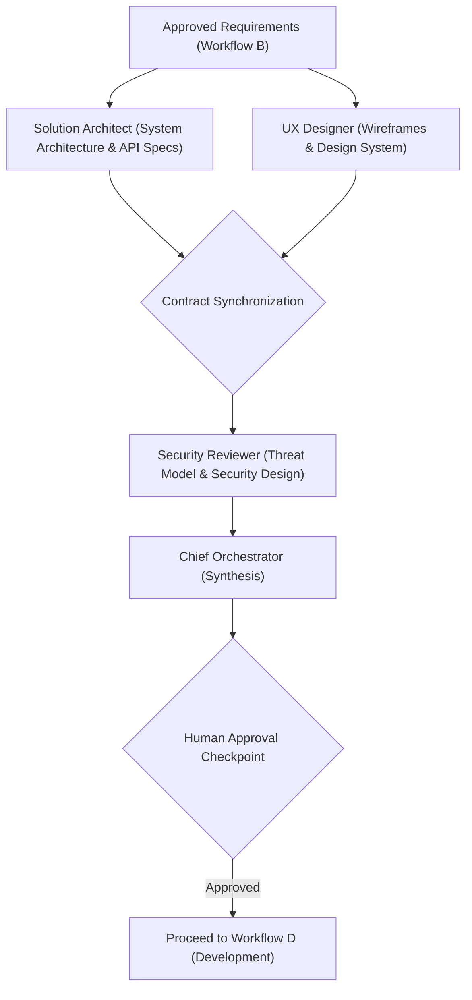

# Workflow C: Architecture and Design Runbook

## Overview
Workflow C establishes the technical and visual foundations in parallel, producing contract-first specifications, relational database schemas, wireframes, and design system tokens.

## Execution Sequence

## Participating Agents
- **Parallel Leads**: `solution-architect` & `ux-designer`
- **Security Auditor**: `security-reviewer`
- **Reviewer**: `chief-orchestrator`
- **Approver**: Human User (Level 3 Governance)

## Step-by-Step Procedure
1. **Initiation**: Upon Workflow B approval, Chief Orchestrator triggers Solution Architect and UX Designer in parallel.
2. **Architecture Stream (Solution Architect)**:
   - System architecture (Modular Monolith, C4 diagrams) in `docs/architecture/system-architecture.md`.
   - Initial ADRs in `docs/architecture/adr/`.
   - Relational database schema in `docs/architecture/database-schema.md`.
   - OpenAPI 3.1 contract in `docs/architecture/api-spec.yaml`.
3. **UX Stream (UX Designer)**:
   - Design system tokens in `docs/ux/design-system.md`.
   - Mobile-first responsive wireframes and specs in `docs/ux/wireframes-and-specs.md`.
   - User journeys across all 4 modalities in `docs/ux/user-journeys.md`.
4. **Contract Synchronization**: Architect and UX Designer align API payload schemas with wireframe UI data requirements.
5. **Security Threat Modeling**: Security Reviewer performs STRIDE threat modeling on the proposed architecture in `docs/architecture/threat-model.md`.
6. **Human Approval Gate**: Chief Orchestrator compiles the design package and requests human sign-off on system architecture and provisional technology choices before code generation begins.

## Required Deliverables
- [ ] System Architecture Specification (`docs/architecture/system-architecture.md`)
- [ ] Initial ADRs (`docs/architecture/adr/ADR-001-modular-monolith.md`, `ADR-002-provisional-tech-stack.md`)
- [ ] Relational Schema Spec (`docs/architecture/database-schema.md`)
- [ ] OpenAPI 3.1 Spec (`docs/architecture/api-spec.yaml`)
- [ ] Design System Spec (`docs/ux/design-system.md`)
- [ ] Responsive Wireframes (`docs/ux/wireframes-and-specs.md`)
- [ ] Threat Model (`docs/architecture/threat-model.md`)
- [ ] Formal Human Sign-off recorded in `docs/DECISION_LOG.md`

