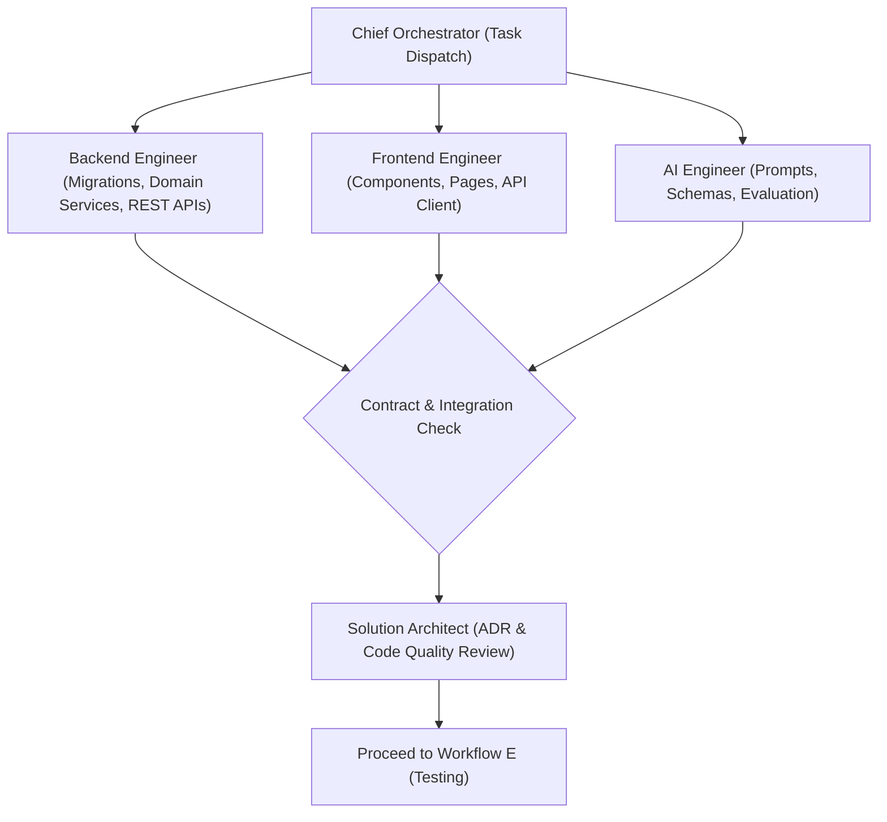

# Workflow D: Development Runbook

## Overview
Workflow D coordinates the synchronized implementation of frontend, backend, and AI capabilities, strictly bounded by the approved OpenAPI contracts, design system tokens, and database schemas.

## Execution Sequence

## Participating Agents
- **Coordinator**: `chief-orchestrator`
- **Execution Team**: `frontend-engineer`, `backend-engineer`, `ai-engineer`
- **Reviewer**: `solution-architect`

## Step-by-Step Procedure
1. **Task Delegation**: Chief Orchestrator decomposes backlog stories into sprint tasks and dispatches to Frontend, Backend, and AI Engineers with explicit input links to `api-spec.yaml` and `design-system.md`.
2. **Backend Stream**:
   - Backend Engineer generates reversible database migrations.
   - Implements modular domain services and deterministic scoring algorithms.
   - Exposes REST endpoints matching `docs/architecture/api-spec.yaml`.
   - Authors unit and repository integration tests with >80% coverage.
3. **Frontend Stream**:
   - Frontend Engineer implements Next.js App Router routes and reusable UI components.
   - Implements mobile-first layouts (360px - 1440px) using design tokens.
   - Binds type-safe API client generated from the OpenAPI spec.
   - Authors component tests with Vitest / React Testing Library.
4. **AI Stream**:
   - AI Engineer develops prompt templates and few-shot examples for compatibility explanations.
   - Implements strict JSON response schema validation.
   - Masks all PII prior to model invocation.
5. **Architectural Review**: Solution Architect audits implementation against ADRs, verifying modular boundaries and absence of premature complexity.
6. **Handoff to QA**: Once code passes local linting, type-checks, and unit tests, Chief Orchestrator hands off to Workflow E.

## Required Deliverables
- [ ] Working application features and route handlers.
- [ ] Versioned database migration scripts.
- [ ] Generated type-safe API client bindings.
- [ ] Passing automated unit and integration tests with verified logs.
- [ ] Technical documentation in `docs/development/`.
