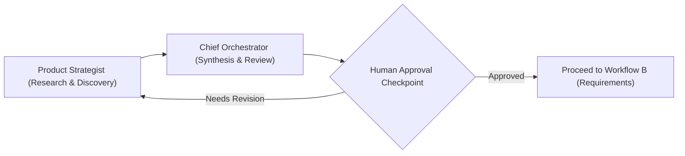

# Workflow A: Ideation Runbook

## Overview
Workflow A establishes the strategic and problem-validation foundation of Project Flatmate.

## Execution Sequence

## Participating Agents
- **Initiator**: `product-strategist`
- **Reviewer**: `chief-orchestrator`
- **Approver**: Human User (Level 3 Governance)

## Step-by-Step Procedure
1. **Initiation**: Chief Orchestrator assigns discovery tasks to Product Strategist using the `product-discovery` and `market-research` skills.
2. **Research & Synthesis**: Product Strategist executes market analysis for Thiruvananthapuram, Kerala, interviews personas (students & IT professionals), benchmarks competitors, and formulates the value proposition.
3. **Artifact Generation**: Product Strategist drafts:
   - `docs/product/problem-statement.md`
   - `docs/product/market-research.md`
   - `docs/product/user-personas.md`
   - `docs/product/value-proposition.md`
   - `docs/product/mvp-scope.md`
4. **Handoff to Orchestrator**: Product Strategist submits the Standard Agent Handoff Report to Chief Orchestrator.
5. **Orchestrator Validation**: Chief Orchestrator verifies that all 4 user modalities are addressed and no technical implementation has commenced.
6. **Human Approval Gate**: Chief Orchestrator presents the ideation package to the Human User for explicit sign-off before requirements engineering begins.

## Required Deliverables
- [ ] Problem Statement (`docs/product/problem-statement.md`)
- [ ] Market Research (`docs/product/market-research.md`)
- [ ] User Personas (`docs/product/user-personas.md`)
- [ ] Value Proposition Canvas (`docs/product/value-proposition.md`)
- [ ] MVP Hypotheses (`docs/product/mvp-scope.md`)
- [ ] Formal Human Sign-off in `docs/DECISION_LOG.md`

