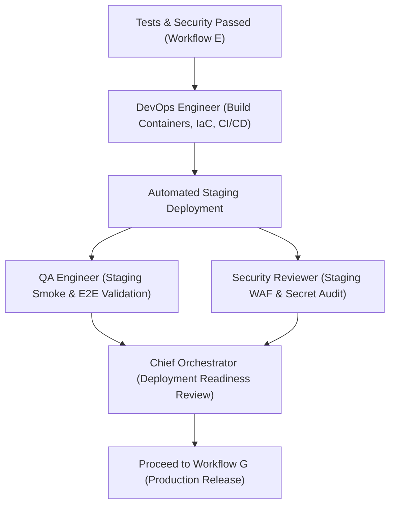

# Workflow F: Infrastructure and Deployment Runbook

## Overview
Workflow F orchestrates container building, CI/CD pipeline automation, environment staging, automated database migrations, and deployment health verification.

## Execution Sequence

## Participating Agents
- **Lead**: `devops-engineer`
- **Verifiers**: `qa-engineer` & `security-reviewer`
- **Coordinator**: `chief-orchestrator`

## Step-by-Step Procedure
1. **Initiation**: Following Workflow E Go recommendation, Chief Orchestrator triggers DevOps Engineer.
2. **Containerization & IaC (DevOps Engineer)**:
   - Hardens multi-stage Dockerfiles and executes build checks.
   - Updates Infrastructure as Code and staging configuration templates.
   - Configures GitHub Actions CI/CD workflows (`.github/workflows/ci.yml`).
3. **Staging Deployment**:
   - Executes automated database migrations on staging environment with pre-flight check.
   - Deploys container workloads to staging environment.
   - Verifies health probes (`/healthz`, `/readyz`).
4. **Staging Smoke Validation**:
   - QA Engineer runs automated smoke tests and critical E2E flows against live staging URL.
   - Security Reviewer audits SSL/TLS certificates, CSP headers, and secrets injection.
5. **Rollback Verification**:
   - DevOps Engineer validates rollback procedures (`docs/deployment/rollback-runbook.md`) in staging to guarantee zero-downtime recovery.
6. **Handoff to Release**: Chief Orchestrator compiles staging verification evidence for Workflow G.

## Required Deliverables
- [ ] Hardened Dockerfiles and `docker-compose.yml`
- [ ] Verified CI/CD workflows (`.github/workflows/ci.yml`)
- [ ] Staging Deployment Verification Report in `docs/deployment/staging-report.md`
- [ ] Verified Rollback Runbook (`docs/deployment/rollback-runbook.md`)

