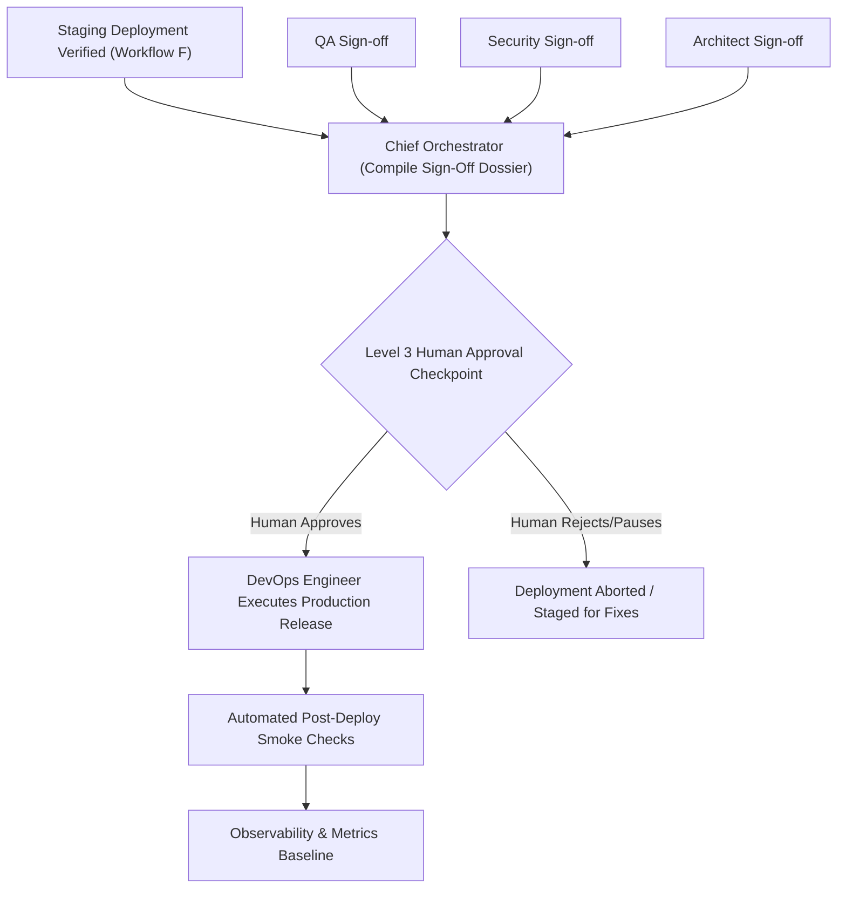

# Workflow G: Release Runbook

## Overview
Workflow G is the final release governance checkpoint. It gathers all prerequisite test, security, architectural, and operational sign-offs, and enforces the non-negotiable **Level 3 Human Approval** requirement before any production deployment is executed.

## Execution Sequence

## Participating Agents
- **Coordinator**: `chief-orchestrator`
- **Sign-off Stakeholders**: `solution-architect`, `qa-engineer`, `security-reviewer`, `devops-engineer`
- **Approver**: Human User (Level 3 Governance - Strict Requirement)

## Step-by-Step Procedure
1. **Compilation of Release Dossier**: Chief Orchestrator audits and bundles all prerequisite artifacts:
   - QA Go Recommendation & Defect Zero Log (`docs/testing/release-test-report.md`).
   - Security Sign-off with 0 High/Critical CVEs (`docs/testing/security-signoff.md`).
   - Architecture Conformance Approval (`docs/architecture/adr/`).
   - Staging Verification & Rollback Verification (`docs/deployment/staging-report.md`).
2. **Pre-Release Checklist**: Chief Orchestrator verifies that:
   - All migrations are backward-compatible.
   - Production secrets are configured securely and not exposed in git.
   - Rollback runbook is active.
3. **Mandatory Level 3 Human Approval Gate**:
   - Chief Orchestrator pauses autonomous operations and submits the formal Release Request to the Human User.
   - Production deployment CANNOT proceed without explicit, affirmative human consent.
4. **Production Execution (DevOps Engineer)**:
   - Upon receiving human approval, DevOps Engineer executes production deployment pipeline.
   - Runs pre-deploy database migration hook.
   - Updates production container traffic.
5. **Post-Deployment Verification**:
   - QA Engineer runs automated production smoke tests on public endpoints.
   - DevOps Engineer monitors error rates and latency in Prometheus/logs.
6. **Release Logging**: Chief Orchestrator records release timestamp, commit hash, and sign-offs in `docs/PROJECT_STATUS.md` and `docs/DECISION_LOG.md`.

## Required Deliverables
- [ ] Complete Release Sign-off Dossier
- [ ] Explicit Human Approval recorded in `docs/DECISION_LOG.md`
- [ ] Production Deployment Execution Logs
- [ ] Post-Deployment Verification Report
