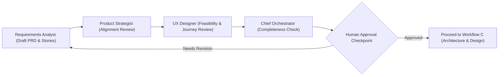

# Workflow B: Requirements Runbook

## Overview
Workflow B translates the approved product vision into a formal, testable Product Requirements Document (PRD), detailed functional and non-functional specifications, and an actionable backlog.

## Execution Sequence

## Participating Agents
- **Lead**: `requirements-analyst`
- **Reviewers**: `product-strategist`, `ux-designer`, `chief-orchestrator`
- **Approver**: Human User (Level 3 Governance)

## Step-by-Step Procedure
1. **Initiation**: After Workflow A approval, Chief Orchestrator triggers Requirements Analyst using `requirements-engineering` and `user-story-writing` skills.
2. **Drafting PRD & Specs**: Requirements Analyst writes:
   - `docs/requirements/PRD.md`
   - `docs/requirements/functional-requirements.md`
   - `docs/requirements/non-functional-requirements.md`
   - `docs/requirements/backlog.md` (epics, user stories with Given-When-Then acceptance criteria)
   - `docs/requirements/traceability-matrix.md`
3. **Peer Reviews**:
   - Product Strategist verifies strategic alignment and MVP scope boundaries.
   - UX Designer verifies user journey continuity and interaction feasibility.
4. **Orchestrator Validation**: Chief Orchestrator checks that every user story has testable acceptance criteria and no unresolved ambiguities remain.
5. **Human Approval Gate**: Chief Orchestrator presents the PRD and backlog to the Human User for formal Level 3 approval.

## Required Deliverables
- [ ] Approved PRD (`docs/requirements/PRD.md`)
- [ ] Functional Requirements (`docs/requirements/functional-requirements.md`)
- [ ] Non-Functional Targets (`docs/requirements/non-functional-requirements.md`)
- [ ] User Stories with Gherkin Acceptance Criteria (`docs/requirements/backlog.md`)
- [ ] Requirements Traceability Matrix (`docs/requirements/traceability-matrix.md`)
- [ ] Formal Human Sign-off recorded in `docs/DECISION_LOG.md`

