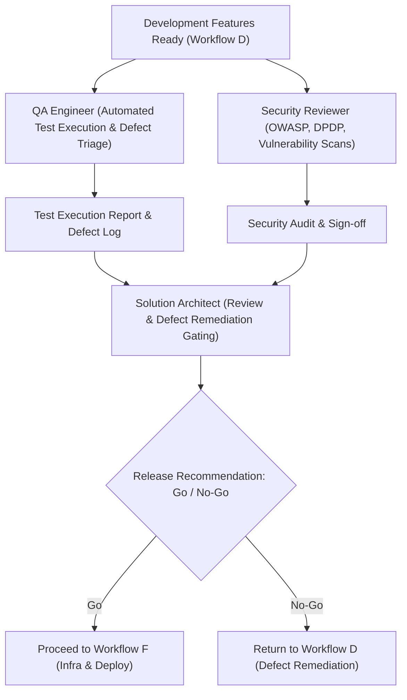

# Workflow E: Testing Runbook

## Overview
Workflow E validates implementation completeness, acceptance criteria conformance, API contract adherence, mobile responsive integrity, and security resilience across all application layers.

## Execution Sequence

## Participating Agents
- **Testing Leads**: `qa-engineer` & `security-reviewer`
- **Architectural Gatekeeper**: `solution-architect`
- **Coordinator**: `chief-orchestrator`

## Step-by-Step Procedure
1. **Initiation**: Upon completion of Workflow D, Chief Orchestrator triggers QA Engineer and Security Reviewer.
2. **QA Execution Stream (QA Engineer)**:
   - Runs automated API contract tests against OpenAPI spec.
   - Executes unit, integration, and Playwright E2E suites.
   - Executes cross-browser and mobile responsive regression tests (Chromium, Firefox, WebKit at 360px, 390px, 768px, 1280px).
   - Verifies each story's Gherkin acceptance criteria from `docs/requirements/backlog.md`.
   - Logs any defects in `docs/testing/defect-log.md`.
3. **Security Review Stream (Security Reviewer)**:
   - Runs dependency vulnerability scanner (`npm audit`, Trivy).
   - Audits authentication, session management, and RBAC guards.
   - Validates DPDP Act compliance (PII masking, location coarsening).
   - Tests abuse prevention and rate-limiting controls.
4. **Defect Triage & Resolution**:
   - Any Blocker or Critical defects immediately route back to Workflow D for developer remediation.
5. **Quality & Security Recommendation**:
   - QA Engineer produces `docs/testing/release-test-report.md`.
   - Security Reviewer produces `docs/testing/security-signoff.md`.
   - Solution Architect approves release readiness.

## Required Deliverables
- [ ] Test Execution Report with coverage metrics (`docs/testing/release-test-report.md`)
- [ ] Defect Log (`docs/testing/defect-log.md`) with 0 open Critical/Blocker bugs
- [ ] Security Sign-off Document (`docs/testing/security-signoff.md`)
- [ ] Formal Go / No-Go Recommendation from Solution Architect
