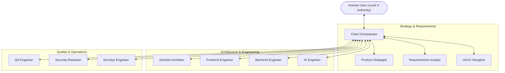

# Project Buddy – Multi-Agent Software Engineering System

**Buddy** is a person-first flatmate discovery and compatibility platform designed to help people find compatible flatmates based on lifestyle, daily routines, social habits, cleanliness, financial alignment, food preferences, and accommodation arrangements.

Initial Launch Target: **Thiruvananthapuram (Trivandrum), Kerala, India** (College students and Technopark/Infopark IT professionals).

This repository contains the complete, production-grade **Multi-Agent Software Engineering System** engineered to build, test, and release Buddy following rigorous software engineering standards.

---

## 1. Multi-Agent Ecosystem

The system features **11 specialized agents**, each with dedicated responsibilities, authority levels, tool grants, and assigned skills.



### Agent Roster & Skill Assignments

| # | Agent Name | Role | Primary Responsibility | Assigned Skills |
| :--- | :--- | :--- | :--- | :--- |
| 1 | `chief-orchestrator` | Systems & Lifecycle Coordinator | Decomposes objectives, coordinates workflows, manages dependencies, validates deliverables, enforces rules, escalates Level 3 decisions. | `system-architecture`, `test-automation`, `cicd-deployment`, all 7 workflows |
| 2 | `product-strategist` | Product Strategy & Market Research Lead | Problem discovery, market dynamics in Trivandrum, competitor benchmarking, personas, value proposition, MVP scoping. | `product-discovery`, `market-research`, `workflow-ideation` |
| 3 | `requirements-analyst` | Requirements Engineering Lead | PRD authoring, functional & non-functional requirements, epics, user stories with Gherkin acceptance criteria, backlog management. | `requirements-engineering`, `user-story-writing`, `workflow-requirements` |
| 4 | `ux-designer` | Principal Experience & Interface Designer | User journeys across 4 modalities, information architecture, mobile-first responsive wireframes, design system tokens, accessibility (WCAG 2.1 AA). | `ux-research`, `responsive-design`, `design-systems`, `workflow-architecture-and-design` |
| 5 | `solution-architect` | Principal Software & Systems Architect | Modular monolith architecture, ADR authoring, Domain-Driven Design, PostgreSQL schema, OpenAPI 3.1 contracts, simplicity advocate. | `system-architecture`, `database-design`, `api-design`, `security-engineering`, `workflow-architecture-and-design` |
| 6 | `frontend-engineer` | Senior Frontend Engineer | Next.js App Router, React, TypeScript, responsive mobile-first execution, design system implementation, type-safe API client integration. | `frontend-engineering`, `responsive-design`, `design-systems`, `workflow-development` |
| 7 | `backend-engineer` | Senior Backend Engineer | Node.js, TypeScript, PostgreSQL, REST APIs, database migrations, deterministic compatibility scoring engine, real-time messaging. | `backend-engineering`, `database-design`, `api-design`, `workflow-development` |
| 8 | `ai-engineer` | Senior Applied AI / LLM Engineer | Assistive Gemini API integration, structured outputs with schema validation, prompt engineering, "Why You Click" explanations, guardrails. | `ai-engineering`, `security-engineering`, `workflow-development` |
| 9 | `devops-engineer` | Senior DevOps & Platform Engineer | Multi-stage Dockerfiles, Docker Compose, CI/CD pipelines in GitHub Actions, environment configuration, secrets hygiene, rollback runbooks. | `cloud-infrastructure`, `cicd-deployment`, `security-engineering`, `workflow-infrastructure-and-deployment` |
| 10 | `qa-engineer` | Quality Assurance & Test Lead | Test strategy, test pyramid, automated unit/integration/E2E test suites, API contract testing, responsive UI regression, defect triage. | `test-automation`, `api-design`, `workflow-testing` |
| 11 | `security-reviewer` | Principal Security & Privacy Architect | STRIDE threat modeling, OWASP Top 10 audits, authentication/authorization checks, DPDP Act privacy compliance, vulnerability scans, release sign-off. | `security-engineering`, `system-architecture`, `workflow-testing`, `workflow-infrastructure-and-deployment` |

---

## 2. Reusable Skills Architecture

The system provides **17 reusable specialized skills** stored under `.agents/skills/<name>/SKILL.md`:

1. [`product-discovery`](file:///home/akhil/Vibe%20Coding/Flatmate/.agents/skills/product-discovery/SKILL.md): Customer problem discovery, hypothesis validation, value proposition design.
2. [`market-research`](file:///home/akhil/Vibe%20Coding/Flatmate/.agents/skills/market-research/SKILL.md): Regional market analysis (Trivandrum students and Technopark IT professionals).
3. [`requirements-engineering`](file:///home/akhil/Vibe%20Coding/Flatmate/.agents/skills/requirements-engineering/SKILL.md): PRD drafting, functional and non-functional requirements.
4. [`user-story-writing`](file:///home/akhil/Vibe%20Coding/Flatmate/.agents/skills/user-story-writing/SKILL.md): INVEST criteria, Given-When-Then Gherkin acceptance criteria.
5. [`ux-research`](file:///home/akhil/Vibe%20Coding/Flatmate/.agents/skills/ux-research/SKILL.md): Journey mapping across 4 modalities, psychological safety design.
6. [`responsive-design`](file:///home/akhil/Vibe%20Coding/Flatmate/.agents/skills/responsive-design/SKILL.md): Mobile-first layouts (360px-1440px), touch ergonomics, PWA readiness.
7. [`design-systems`](file:///home/akhil/Vibe%20Coding/Flatmate/.agents/skills/design-systems/SKILL.md): Design tokens, accessible color palettes (WCAG 2.1 AA), Tailwind configs.
8. [`system-architecture`](file:///home/akhil/Vibe%20Coding/Flatmate/.agents/skills/system-architecture/SKILL.md): Modular Monolith, Domain-Driven Design, C4 diagrams, ADR authoring.
9. [`database-design`](file:///home/akhil/Vibe%20Coding/Flatmate/.agents/skills/database-design/SKILL.md): PostgreSQL relational modeling, indexing strategy, versioned migrations.
10. [`api-design`](file:///home/akhil/Vibe%20Coding/Flatmate/.agents/skills/api-design/SKILL.md): RESTful API contracts, OpenAPI 3.1 specification, RFC 7807 error formats.
11. [`frontend-engineering`](file:///home/akhil/Vibe%20Coding/Flatmate/.agents/skills/frontend-engineering/SKILL.md): Next.js App Router, React Server Components, TypeScript strict mode.
12. [`backend-engineering`](file:///home/akhil/Vibe%20Coding/Flatmate/.agents/skills/backend-engineering/SKILL.md): Node.js modular clean architecture, deterministic matching algorithms.
13. [`ai-engineering`](file:///home/akhil/Vibe%20Coding/Flatmate/.agents/skills/ai-engineering/SKILL.md): Gemini API structured outputs, prompt caching, PII masking, safety guardrails.
14. [`test-automation`](file:///home/akhil/Vibe%20Coding/Flatmate/.agents/skills/test-automation/SKILL.md): Automated unit, integration, API contract, and Playwright E2E testing.
15. [`security-engineering`](file:///home/akhil/Vibe%20Coding/Flatmate/.agents/skills/security-engineering/SKILL.md): STRIDE threat modeling, OWASP Top 10, DPDP Act compliance.
16. [`cloud-infrastructure`](file:///home/akhil/Vibe%20Coding/Flatmate/.agents/skills/cloud-infrastructure/SKILL.md): Multi-stage Dockerfiles, Docker Compose, IaC, observability.
17. [`cicd-deployment`](file:///home/akhil/Vibe%20Coding/Flatmate/.agents/skills/cicd-deployment/SKILL.md): GitHub Actions CI/CD pipelines, migration hooks, zero-downtime rollbacks.

---

## 3. Workflow Architecture (Workflows A through G)

Seven standardized workflows govern the software lifecycle:

- **Workflow A: Ideation** (`Product Strategist` → `Chief Orchestrator` → `Human Approval`)
  - Runbook: [workflow-a-ideation.md](file:///home/akhil/Vibe%20Coding/Flatmate/docs/workflows/workflow-a-ideation.md) / Skill: `workflow-ideation`
- **Workflow B: Requirements** (`Requirements Analyst` → `Product Strategist` → `UX Designer` → `Human Approval`)
  - Runbook: [workflow-b-requirements.md](file:///home/akhil/Vibe%20Coding/Flatmate/docs/workflows/workflow-b-requirements.md) / Skill: `workflow-requirements`
- **Workflow C: Architecture & Design** (`Solution Architect` + `UX Designer` in parallel → `Security Reviewer` → `Human Approval`)
  - Runbook: [workflow-c-architecture-and-design.md](file:///home/akhil/Vibe%20Coding/Flatmate/docs/workflows/workflow-c-architecture-and-design.md) / Skill: `workflow-architecture-and-design`
- **Workflow D: Development** (`Chief Orchestrator` → `Frontend Engineer` + `Backend Engineer` + `AI Engineer` → `Solution Architect` review)
  - Runbook: [workflow-d-development.md](file:///home/akhil/Vibe%20Coding/Flatmate/docs/workflows/workflow-d-development.md) / Skill: `workflow-development`
- **Workflow E: Testing** (`QA Engineer` + `Security Reviewer` + `Solution Architect` → Go/No-Go Recommendation)
  - Runbook: [workflow-e-testing.md](file:///home/akhil/Vibe%20Coding/Flatmate/docs/workflows/workflow-e-testing.md) / Skill: `workflow-testing`
- **Workflow F: Infrastructure & Deployment** (`DevOps Engineer` + `QA Engineer` + `Security Reviewer` → Staging Verification)
  - Runbook: [workflow-f-infrastructure-and-deployment.md](file:///home/akhil/Vibe%20Coding/Flatmate/docs/workflows/workflow-f-infrastructure-and-deployment.md) / Skill: `workflow-infrastructure-and-deployment`
- **Workflow G: Release** (`Chief Orchestrator` coordinates sign-offs → **Mandatory Level 3 Human Approval** → Production Release)
  - Runbook: [workflow-g-release.md](file:///home/akhil/Vibe%20Coding/Flatmate/docs/workflows/workflow-g-release.md) / Skill: `workflow-release`

---

## 4. Governance, Authority Levels, and Handoffs

### The 15 Non-Negotiable Engineering Rules
Defined in full in [AGENTS.md](file:///home/akhil/Vibe%20Coding/Flatmate/AGENTS.md) and `.agents/rules/`:
1. Approved documentation is the sole source of truth.
2. No autonomous requirement alterations.
3. Architecture changes require an Architecture Decision Record (ADR).
4. Contract-first development adhering to OpenAPI specifications.
5. Strict coding standards (strict TypeScript, modular architecture).
6. Versioned, reversible database migrations.
7. Acceptance criteria mandatory for every feature.
8. Automated test coverage mandatory (>80% on core domain logic).
9. Security Reviewer sign-off required for security-sensitive modifications.
10. Explicit human approval mandatory for production deployments.
11. Proactive communication of dependencies and blockers.
12. Explicit recording of assumptions and open questions.
13. Evidence-based completion (no claims without verified test/build logs).
14. Inspect existing files before modifying them.
15. Context and token economy.

### Authority Levels
- **Level 1 (Independent)**: Research, requirements drafting, wireframing, testing, and implementation within approved scope.
- **Level 2 (Review Required)**: Database migrations, API contract changes, architecture modifications, auth changes, CI/CD updates.
- **Level 3 (Human Approval Required)**: Production deployments, destructive DB operations, production secrets, external spending, unmasked PII handling.

### Standard Agent Handoff Report
All agent handoffs must conform to the standard template in `docs/templates/handoff-report-template.md`.

---

## 5. How to Invoke Agents and Workflows

### In Antigravity Chat
- **Invoke a Subagent**:
  The system automatically delegates to subagents or you can prompt:
  `"Use subagent 'product-strategist' to analyze the flatmate market in Technopark Trivandrum."`
- **Execute a Workflow**:
  Workflows are accessible as skills or slash commands:
  `"Run workflow-ideation to begin project discovery."` or type `/workflow-ideation`.

### In Antigravity Multi-Agent Swarm
To run parallel agents on a shared message board:
```
swarm(action="add", name="solution-architect", brief="Design the OpenAPI 3.1 specification for discovery feeds.")
swarm(action="add", name="ux-designer", brief="Specify the wireframes and design system tokens for the discovery cards.")
```

---

## 6. Buddy v1.1.0 Enhancements

The platform has been enhanced with six major architectural and experience upgrades:

1. **Application Branding**: Complete rebrand to **Buddy** across UI, metadata, client API, and error handling.
2. **Authentication & Access Control**: Portal access gated behind authentication with dedicated Login Gateway and automatic redirects for unauthenticated users.
3. **Conversational Registration Experience**: Bumble-style 12-step progressive onboarding with distraction-free layouts, 1–2 related questions per screen, mandatory mobile OTP, optional verification badges, and visual subsection progress ticks (`✔`).
4. **Discovery & Matching Logic**: Modality treated as user availability status rather than a disqualifying dealbreaker, with added location (suburb centroid) and budget affinity scoring.
5. **Profile & Compatibility Expansion**: Roommate compatibility expanded with household vibe and hosting preferences (`QUIET_SANCTUARY`, `SOCIALLY_ACTIVE`, `BALANCED_CASUAL`) with an optional hard dealbreaker.
6. **Responsive Match Listing**: Modern responsive desktop tile/card grid with candidate metadata and harmony chips, coupled with an ergonomic mobile view featuring an active avatar tray and chat drawer.

---

## 7. Current Project Status & Release Tracking
- **Environment Status**: Fully configured, validated, and initialized.
- **Test Suite Status**: 105 automated unit, integration, scoring, and security tests passing with 0 failures across 30 suites.
- **Specification**: See [docs-buddy-enhancement-spec.md](file:///home/akhil/.gemini/antigravity/brain/0b4659dd-acfa-4a3c-aaa1-ea2f4fab0713/docs-buddy-enhancement-spec.md).
- **Project Tracking**: See [PROJECT_STATUS.md](file:///home/akhil/Vibe%20Coding/Flatmate/docs/PROJECT_STATUS.md).
- **Decision Log**: See [DECISION_LOG.md](file:///home/akhil/Vibe%20Coding/Flatmate/docs/DECISION_LOG.md).

