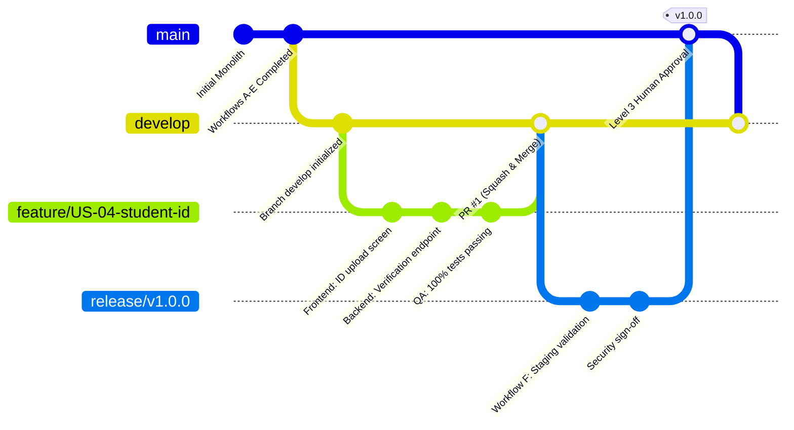
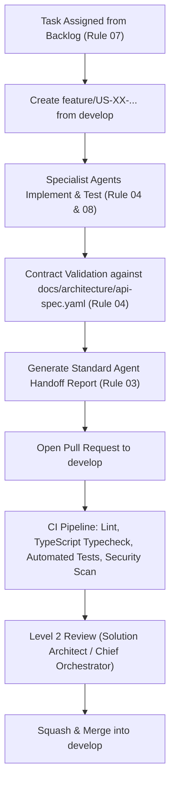

# Flatmate Git Branching & Collaboration Strategy

## 1. Overview & Objectives

This document establishes the official Git branching strategy for **Flatmate**. It is tailored specifically for our **multi-agent software engineering system**, balancing autonomous specialist agent execution with strict human oversight (Level 3 governance), continuous contract compliance, and rapid iterative delivery.

---

## 2. Branch Hierarchy & Topology



---

## 3. Core Branches

### 3.1 `main` (Production Branch)
- **Purpose**: Represents stable, production-ready releases.
- **Protection Rules**:
  - Direct commits and force pushes are strictly prohibited.
  - Merges into `main` require **Level 3 Human Approval** (Workflow G: Release).
  - All CI automated tests, contract checks, and security scans must be 100% passing.
  - Every merge to `main` is tagged with a semantic version (e.g. `v1.0.0`, `v1.1.0`).

### 3.2 `develop` (Integration Branch)
- **Purpose**: The primary daily integration branch where completed features, fixes, and documentation merge.
- **Protection Rules**:
  - Direct commits are restricted; all changes arrive via Pull Requests (PRs).
  - Requires **Level 2 Review** (Chief Orchestrator, Solution Architect, or QA Engineer sign-off).
  - Triggers automated CI builds, unit/integration test suites, and preview server updates.

---

## 4. Supporting Branches & Naming Conventions

All supporting branches branch off `develop` and merge back into `develop` (except hotfixes).

| Branch Type | Source Branch | Target Branch | Naming Convention | Example |
| :--- | :--- | :--- | :--- | :--- |
| **Feature** | `develop` | `develop` | `feature/<story-id>-<short-description>` | `feature/US-04-student-id-upload` |
| **Workflow** | `develop` | `develop` | `workflow/<phase>-<milestone>` | `workflow/d-modality-filters` |
| **Bug Fix** | `develop` | `develop` | `fix/<defect-id>-<description>` | `fix/DEF-006-otp-rate-limit` |
| **Hotfix** | `main` | `main` & `develop` | `hotfix/<issue>-<description>` | `hotfix/SEC-001-session-revocation` |
| **Release** | `develop` | `main` & `develop` | `release/v<semver>` | `release/v1.0.0` |
| **Docs/Architecture** | `develop` | `develop` | `docs/<adr-id-or-topic>` | `docs/ADR-007-branching-strategy` |

---

## 5. Multi-Agent Development Lifecycle & PR Protocol

When specialized agents collaborate on a feature, the following lifecycle applies:



### Pull Request Requirements
Every PR submitted by an agent must include:
1. **Story / Task Reference**: Explicit reference to a user story in `docs/requirements/backlog.md`.
2. **Standard Agent Handoff Report**: Formatted per Rule 03 (Task, Agent, Status, Inputs, Deliverables, Decisions, Dependencies, Open Questions).
3. **Automated Test Evidence**: Log output confirming tests ran and passed (Rule 13).
4. **Zero Contract Violations**: Verified conformance with `docs/architecture/api-spec.yaml`.

---

## 6. Commit Message Standards

Flatmate strictly enforces the **Conventional Commits** standard:

```text
<type>(<scope>): <short description in imperative mood>

[optional body with rationale and decisions]

[optional footer: Task-ID, Closes #issue, Co-authored-by]
```

### Allowed Types
- `feat`: A new user-facing feature or API capability.
- `fix`: A bug fix or defect remediation.
- `docs`: Documentation updates, PRD revisions, or ADRs.
- `test`: Adding or refactoring automated tests.
- `refactor`: Code change that neither fixes a bug nor adds a feature.
- `perf`: Performance or query optimization.
- `chore`: Tooling, configuration, or dependency updates.

### Examples
- `feat(auth): add college ID card image upload for CET students`
- `fix(matching): clamp dealbreaker distance calculation to prevent NaN`
- `docs(adr): add ADR-007 defining Git branching strategy`

---

## 7. Release & Deployment Pipeline (Workflows F & G)

1. **Release Cut**: When a milestone in `develop` is ready, cut `release/vX.Y.Z`.
2. **Pre-Release Verification (Workflow F)**:
   - DevOps Engineer spins up staging container.
   - QA Engineer executes full Playwright E2E and regression suites.
   - Security Reviewer conducts STRIDE audit and DPDP Act verification.
3. **Human Approval (Level 3 Gate - Workflow G)**:
   - Chief Orchestrator presents synthesized Release Recommendation.
   - Human User provides explicit approval.
4. **Merge & Tag**:
   - Merge `release/vX.Y.Z` into `main` and tag `vX.Y.Z`.
   - Back-merge `release/vX.Y.Z` into `develop` (if hotfixes or release adjustments were applied).
