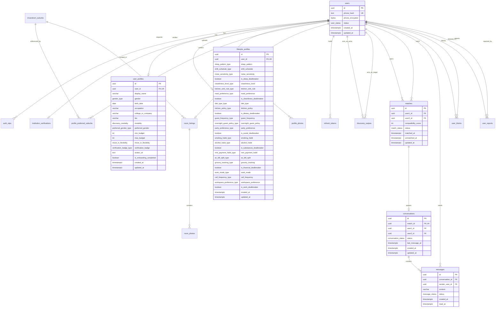

# Flatmate – PostgreSQL Database Schema Specification

**Document Version**: 1.0.0  
**Phase**: Workflow C (Architecture & Design)  
**Author**: Solution Architect  
**Reviewers**: Chief Orchestrator, Backend Engineer, Security Reviewer  
**Status**: Ready for Level 2 Review  
**Date**: 2026-11-14  
**Database Engine**: PostgreSQL 16  
**Normal Form**: Third Normal Form (3NF)

---

## 1. Schema Design Principles & Conventions

1. **Primary Keys**: All primary keys are 128-bit Universally Unique Identifiers (UUIDv4) generated via `gen_random_uuid()` to prevent enumeration attacks and support distributed/sharded environments.
2. **Referential Integrity**: Foreign keys strictly declare `ON DELETE CASCADE` (for child entities like messages, photos, preferences) or `ON DELETE RESTRICT` (for referenced geographic entities). Unindexed foreign keys are strictly prohibited.
3. **Data Protection & DPDP Compliance**:
   - Phone numbers are stored encrypted with AES-256-GCM (`phone_encrypted`) alongside a deterministic SHA-256 HMAC hash (`phone_hash`) for indexed unique lookups.
   - Institutional emails are masked in storage (`email_masked`) and indexed by cryptographic hash (`email_hash`).
   - Location coordinates are never bound directly to user profiles; users select standardized micro-market suburban codes (`suburb_code`).
4. **Symmetrical Deduplication**: Symmetrical pairs (matches) are strictly ordered using `CHECK (user1_id < user2_id)` to prevent duplicate mirrored records.
5. **Auditing & Timestamps**: Every table contains `created_at TIMESTAMPTZ NOT NULL DEFAULT NOW()`, and mutating entities include an `updated_at` column triggered via a database function.

---

## 2. Entity-Relationship (ER) Diagram



---

## 3. Trivandrum Suburbs Geospatial Centroids

To satisfy privacy requirements and simplify proximity filtering without exposing exact resident GPS points, the platform seeds 8 standardized suburban zones across Thiruvananthapuram:

| Suburb Code (`code`) | Display Name (`name`) | Latitude | Longitude | Primary Ecosystem & Anchor Points |
| :--- | :--- | :--- | :--- | :--- |
| `KAZHAKKOOTTAM` | Kazhakkoottam | 8.568600 | 76.873100 | Technopark Phase I & III, Infosys, UST Campus, Greenfield Stadium |
| `KARIAVATTOM` | Kariavattom | 8.561500 | 76.884500 | University of Kerala Kariavattom Campus, LNCPE Sports College |
| `SREEKARYAM` | Sreekaryam | 8.547800 | 76.916300 | College of Engineering Trivandrum (CET), ICAR-CTCRI |
| `ULLOOR` | Ulloor | 8.528400 | 76.927200 | Kesavadasapuram junction, Medical College hospital campus |
| `PATTOM` | Pattom | 8.520800 | 76.940500 | Kendriya Vidyalaya, St. Mary's, Administrative & Coaching hub |
| `KOWDIAR` | Kowdiar | 8.524100 | 76.960200 | Kowdiar Palace, Golf Club, Premium residential apartment corridor |
| `MANACAUD` | Manacaud | 8.473500 | 76.953500 | South Trivandrum, Attukal Temple, Chalai heritage trade zone |
| `VELLAYAMBALAM` | Vellayambalam | 8.513700 | 76.956700 | Central transit junction connecting Kowdiar, Museum, and Vazhuthacaud |

---

## 4. Complete DDL Schema & Reversible Migrations

### 4.1 Migration UP: `001_initial_schema.up.sql`

```sql
-- Migration UP: 001_initial_schema.up.sql
-- Description: Complete 3NF relational schema for Project Flatmate (Trivandrum MVP)

BEGIN;

-- Enable UUID extension
CREATE EXTENSION IF NOT EXISTS "pgcrypto";

-- Custom Domain Enumerations
CREATE TYPE user_status AS ENUM (
    'ACTIVE',
    'QUARANTINED',
    'BANNED',
    'SUSPENDED'
);

CREATE TYPE gender_type AS ENUM (
    'MALE',
    'FEMALE',
    'NON_BINARY'
);

CREATE TYPE preferred_gender_type AS ENUM (
    'MALE',
    'FEMALE',
    'ANY'
);

CREATE TYPE discovery_modality AS ENUM (
    'MODALITY_1', -- Has room available, seeking flatmate
    'MODALITY_2', -- Seeking accommodation and flatmate
    'MODALITY_3', -- Has flat, wants to relocate with new flatmate
    'MODALITY_4'  -- Seeking compatible person first to search together
);

CREATE TYPE move_in_flexibility AS ENUM (
    'WITHIN_15_DAYS',
    'ONE_MONTH',
    'TWO_MONTHS',
    'FLEXIBLE'
);

CREATE TYPE verification_badge_type AS ENUM (
    'UNVERIFIED',
    'VERIFIED_STUDENT',
    'VERIFIED_PROFESSIONAL'
);

CREATE TYPE institution_type_enum AS ENUM (
    'CORPORATE',
    'ACADEMIC'
);

CREATE TYPE verification_status_enum AS ENUM (
    'PENDING',
    'VERIFIED',
    'REJECTED'
);

-- 7 Lifestyle Vector Enumerations
CREATE TYPE sleep_pattern_type AS ENUM ('EARLY_BIRD', 'NIGHT_OWL', 'FLEXIBLE');
CREATE TYPE shift_schedule_type AS ENUM ('NORMAL_DAY', 'US_SHIFT', 'UK_SHIFT', 'ROTATIONAL_NIGHT');
CREATE TYPE noise_sensitivity_type AS ENUM ('LIGHT_SLEEPER', 'HEAVY_SLEEPER');

CREATE TYPE cleanliness_level_type AS ENUM ('RELAXED', 'MODERATE', 'METICULOUS');
CREATE TYPE kitchen_sink_rule_type AS ENUM ('IMMEDIATE_WASH', 'SAME_DAY', 'NEXT_DAY');
CREATE TYPE maid_preference_type AS ENUM ('MUST_HAVE_MAID', 'OPEN_TO_MAID', 'DIY_ONLY');

CREATE TYPE diet_type_type AS ENUM ('STRICT_VEGETARIAN', 'EGGETARIAN', 'NON_VEGETARIAN', 'HALAL_ONLY');
CREATE TYPE kitchen_policy_type AS ENUM ('VEG_ONLY_KITCHEN', 'SEPARATE_UTENSILS_OK', 'NO_RESTRICTIONS');

CREATE TYPE guest_frequency_type AS ENUM ('NO_GUESTS', 'OCCASIONAL_FRIENDS', 'FREQUENT_GUESTS');
CREATE TYPE overnight_guest_policy_type AS ENUM ('NO_OVERNIGHT', 'SAME_GENDER_ONLY', 'PARTNERS_ALLOWED', 'FLEXIBLE_WITH_NOTICE');
CREATE TYPE party_preference_type AS ENUM ('NEVER_AT_HOME', 'OCCASIONAL_WEEKENDS', 'FREQUENT');

CREATE TYPE smoking_habit_type AS ENUM ('NON_SMOKER_STRICT', 'BALCONY_ONLY', 'SMOKER');
CREATE TYPE alcohol_habit_type AS ENUM ('TEETOTALER', 'SOCIAL_DRINKER', 'REGULAR');

CREATE TYPE rent_payment_habit_type AS ENUM ('STRICT_1ST_OF_MONTH', 'BEFORE_5TH', 'FLEXIBLE');
CREATE TYPE ac_bill_split_type AS ENUM ('EQUAL_SPLIT', 'PROPORTIONAL_TO_USAGE');
CREATE TYPE grocery_tracking_type AS ENUM ('SPLITWISE_APP', 'INDIVIDUAL_PROVISIONS', 'ROTATIONAL_PAYMENT');

CREATE TYPE work_mode_type AS ENUM ('OFFICE_DAILY', 'HYBRID', '100_PERCENT_REMOTE');
CREATE TYPE call_frequency_type AS ENUM ('LOW', 'HIGH');
CREATE TYPE workspace_preference_type AS ENUM ('PRIVATE_ROOM_DESK', 'LIVING_ROOM_DESK_OK');

CREATE TYPE swipe_action_type AS ENUM ('LIKE', 'PASS', 'SUPERLIKE');
CREATE TYPE match_status AS ENUM ('ACTIVE', 'UNMATCHED');
CREATE TYPE conversation_status AS ENUM ('ACTIVE', 'ARCHIVED', 'TERMINATED');
CREATE TYPE message_status AS ENUM ('SENT', 'DELIVERED', 'READ');

CREATE TYPE room_type_enum AS ENUM ('PRIVATE_ROOM', 'SHARED_ROOM');
CREATE TYPE bathroom_type_enum AS ENUM ('ATTACHED_PRIVATE', 'SHARED');

CREATE TYPE report_category_enum AS ENUM (
    'HARASSMENT_OR_ABUSE',
    'SPAM_OR_COMMERCIAL_BROKER',
    'FAKE_PROFILE_IMPERSONATION',
    'MORAL_POLICING_OR_DISCRIMINATION'
);

CREATE TYPE report_status_enum AS ENUM (
    'PENDING_REVIEW',
    'ACTIONED_QUARANTINE',
    'DISMISSED'
);

-- Trigger function for auto-updating updated_at
CREATE OR REPLACE FUNCTION update_updated_at_column()
RETURNS TRIGGER AS $$
BEGIN
    NEW.updated_at = NOW();
    RETURN NEW;
END;
$$ LANGUAGE plpgsql;

-- 1. Trivandrum Micro-market Suburbs (Master Lookup)
CREATE TABLE trivandrum_suburbs (
    code VARCHAR(50) PRIMARY KEY,
    name VARCHAR(100) NOT NULL,
    latitude DECIMAL(9, 6) NOT NULL,
    longitude DECIMAL(9, 6) NOT NULL,
    description TEXT,
    is_active BOOLEAN NOT NULL DEFAULT TRUE,
    created_at TIMESTAMPTZ NOT NULL DEFAULT NOW()
);

-- 2. Users (Authentication & Identity Root)
CREATE TABLE users (
    id UUID PRIMARY KEY DEFAULT gen_random_uuid(),
    phone_hash TEXT NOT NULL UNIQUE,
    phone_encrypted BYTEA NOT NULL,
    status user_status NOT NULL DEFAULT 'ACTIVE',
    created_at TIMESTAMPTZ NOT NULL DEFAULT NOW(),
    updated_at TIMESTAMPTZ NOT NULL DEFAULT NOW()
);

CREATE TRIGGER update_users_updated_at
    BEFORE UPDATE ON users
    FOR EACH ROW EXECUTE FUNCTION update_updated_at_column();

-- 3. Auth OTPs (Ephemeral verification store)
CREATE TABLE auth_otps (
    id UUID PRIMARY KEY DEFAULT gen_random_uuid(),
    phone_hash TEXT NOT NULL,
    otp_hash TEXT NOT NULL,
    attempts_count INT NOT NULL DEFAULT 0,
    expires_at TIMESTAMPTZ NOT NULL,
    verified_at TIMESTAMPTZ,
    created_at TIMESTAMPTZ NOT NULL DEFAULT NOW()
);

CREATE INDEX idx_auth_otps_lookup ON auth_otps (phone_hash, expires_at);

-- 4. Institution Verifications
CREATE TABLE institution_verifications (
    id UUID PRIMARY KEY DEFAULT gen_random_uuid(),
    user_id UUID NOT NULL REFERENCES users(id) ON DELETE CASCADE,
    email_hash TEXT NOT NULL UNIQUE,
    email_masked TEXT NOT NULL,
    institution_type institution_type_enum NOT NULL,
    institution_name VARCHAR(150) NOT NULL,
    domain VARCHAR(100) NOT NULL,
    status verification_status_enum NOT NULL DEFAULT 'PENDING',
    token_hash TEXT NOT NULL,
    expires_at TIMESTAMPTZ NOT NULL,
    verified_at TIMESTAMPTZ,
    created_at TIMESTAMPTZ NOT NULL DEFAULT NOW()
);

CREATE INDEX idx_institution_verif_user ON institution_verifications (user_id);
CREATE INDEX idx_institution_verif_domain ON institution_verifications (domain);

-- 5. User Profiles
CREATE TABLE user_profiles (
    id UUID PRIMARY KEY DEFAULT gen_random_uuid(),
    user_id UUID NOT NULL UNIQUE REFERENCES users(id) ON DELETE CASCADE,
    display_name VARCHAR(50) NOT NULL,
    gender gender_type NOT NULL,
    birth_date DATE NOT NULL,
    occupation VARCHAR(100) NOT NULL,
    college_or_company VARCHAR(150),
    bio VARCHAR(300),
    modality discovery_modality NOT NULL,
    preferred_gender preferred_gender_type NOT NULL DEFAULT 'ANY',
    min_budget INT NOT NULL CHECK (min_budget >= 1000),
    max_budget INT NOT NULL CHECK (max_budget >= min_budget),
    move_in_flexibility move_in_flexibility NOT NULL DEFAULT 'FLEXIBLE',
    verification_badge verification_badge_type NOT NULL DEFAULT 'UNVERIFIED',
    avatar_url TEXT,
    is_onboarding_completed BOOLEAN NOT NULL DEFAULT FALSE,
    created_at TIMESTAMPTZ NOT NULL DEFAULT NOW(),
    updated_at TIMESTAMPTZ NOT NULL DEFAULT NOW()
);

CREATE TRIGGER update_user_profiles_updated_at
    BEFORE UPDATE ON user_profiles
    FOR EACH ROW EXECUTE FUNCTION update_updated_at_column();

CREATE INDEX idx_user_profiles_feed_filter ON user_profiles (gender, preferred_gender, modality, min_budget, max_budget);
CREATE INDEX idx_user_profiles_badge ON user_profiles (verification_badge);

-- 6. Profile Preferred Suburbs (Many-to-Many join)
CREATE TABLE profile_preferred_suburbs (
    id UUID PRIMARY KEY DEFAULT gen_random_uuid(),
    user_id UUID NOT NULL REFERENCES users(id) ON DELETE CASCADE,
    suburb_code VARCHAR(50) NOT NULL REFERENCES trivandrum_suburbs(code) ON DELETE RESTRICT,
    created_at TIMESTAMPTZ NOT NULL DEFAULT NOW(),
    CONSTRAINT uq_user_suburb UNIQUE (user_id, suburb_code)
);

CREATE INDEX idx_profile_suburbs_suburb ON profile_preferred_suburbs (suburb_code);

-- 7. Profile Photos
CREATE TABLE profile_photos (
    id UUID PRIMARY KEY DEFAULT gen_random_uuid(),
    user_id UUID NOT NULL REFERENCES users(id) ON DELETE CASCADE,
    photo_url TEXT NOT NULL,
    order_index INT NOT NULL CHECK (order_index BETWEEN 0 AND 3),
    is_primary BOOLEAN NOT NULL DEFAULT FALSE,
    created_at TIMESTAMPTZ NOT NULL DEFAULT NOW(),
    CONSTRAINT uq_user_photo_order UNIQUE (user_id, order_index)
);

CREATE INDEX idx_profile_photos_user ON profile_photos (user_id);

-- 8. Lifestyle Profiles (7 Vectors + Dealbreaker Flags)
CREATE TABLE lifestyle_profiles (
    id UUID PRIMARY KEY DEFAULT gen_random_uuid(),
    user_id UUID NOT NULL UNIQUE REFERENCES users(id) ON DELETE CASCADE,
    
    -- Vector 1: Sleep
    sleep_pattern sleep_pattern_type NOT NULL,
    shift_schedule shift_schedule_type NOT NULL,
    noise_sensitivity noise_sensitivity_type NOT NULL,
    is_sleep_dealbreaker BOOLEAN NOT NULL DEFAULT FALSE,

    -- Vector 2: Cleanliness
    cleanliness_level cleanliness_level_type NOT NULL,
    kitchen_sink_rule kitchen_sink_rule_type NOT NULL,
    maid_preference maid_preference_type NOT NULL,
    is_cleanliness_dealbreaker BOOLEAN NOT NULL DEFAULT FALSE,

    -- Vector 3: Dietary
    diet_type diet_type_type NOT NULL,
    kitchen_policy kitchen_policy_type NOT NULL,
    is_dietary_dealbreaker BOOLEAN NOT NULL DEFAULT FALSE,

    -- Vector 4: Social
    guest_frequency guest_frequency_type NOT NULL,
    overnight_guest_policy overnight_guest_policy_type NOT NULL,
    party_preference party_preference_type NOT NULL,
    is_social_dealbreaker BOOLEAN NOT NULL DEFAULT FALSE,

    -- Vector 5: Substances
    smoking_habit smoking_habit_type NOT NULL,
    alcohol_habit alcohol_habit_type NOT NULL,
    is_substances_dealbreaker BOOLEAN NOT NULL DEFAULT FALSE,

    -- Vector 6: Financial
    rent_payment_habit rent_payment_habit_type NOT NULL,
    ac_bill_split ac_bill_split_type NOT NULL,
    grocery_tracking grocery_tracking_type NOT NULL,
    is_financial_dealbreaker BOOLEAN NOT NULL DEFAULT FALSE,

    -- Vector 7: Work
    work_mode work_mode_type NOT NULL,
    call_frequency call_frequency_type NOT NULL,
    workspace_preference workspace_preference_type NOT NULL,
    is_work_dealbreaker BOOLEAN NOT NULL DEFAULT FALSE,

    created_at TIMESTAMPTZ NOT NULL DEFAULT NOW(),
    updated_at TIMESTAMPTZ NOT NULL DEFAULT NOW()
);

CREATE TRIGGER update_lifestyle_profiles_updated_at
    BEFORE UPDATE ON lifestyle_profiles
    FOR EACH ROW EXECUTE FUNCTION update_updated_at_column();

CREATE INDEX idx_lifestyle_dealbreakers ON lifestyle_profiles (
    is_sleep_dealbreaker,
    is_cleanliness_dealbreaker,
    is_dietary_dealbreaker,
    is_social_dealbreaker,
    is_substances_dealbreaker,
    is_financial_dealbreaker,
    is_work_dealbreaker
);

-- 9. Discovery Swipes (Deck decisions)
CREATE TABLE discovery_swipes (
    id UUID PRIMARY KEY DEFAULT gen_random_uuid(),
    actor_user_id UUID NOT NULL REFERENCES users(id) ON DELETE CASCADE,
    target_user_id UUID NOT NULL REFERENCES users(id) ON DELETE CASCADE,
    action swipe_action_type NOT NULL,
    created_at TIMESTAMPTZ NOT NULL DEFAULT NOW(),
    CONSTRAINT uq_swipe_pair UNIQUE (actor_user_id, target_user_id),
    CONSTRAINT chk_swipe_self CHECK (actor_user_id <> target_user_id)
);

CREATE INDEX idx_swipes_target_actor ON discovery_swipes (target_user_id, actor_user_id, action);

-- 10. Matches (Mutual opt-in pairs)
CREATE TABLE matches (
    id UUID PRIMARY KEY DEFAULT gen_random_uuid(),
    user1_id UUID NOT NULL REFERENCES users(id) ON DELETE CASCADE,
    user2_id UUID NOT NULL REFERENCES users(id) ON DELETE CASCADE,
    compatibility_score INT NOT NULL CHECK (compatibility_score BETWEEN 0 AND 100),
    status match_status NOT NULL DEFAULT 'ACTIVE',
    matched_at TIMESTAMPTZ NOT NULL DEFAULT NOW(),
    unmatched_at TIMESTAMPTZ,
    updated_at TIMESTAMPTZ NOT NULL DEFAULT NOW(),
    CONSTRAINT chk_canonical_user_order CHECK (user1_id < user2_id),
    CONSTRAINT uq_matched_pair UNIQUE (user1_id, user2_id)
);

CREATE TRIGGER update_matches_updated_at
    BEFORE UPDATE ON matches
    FOR EACH ROW EXECUTE FUNCTION update_updated_at_column();

CREATE INDEX idx_matches_user1 ON matches (user1_id, status);
CREATE INDEX idx_matches_user2 ON matches (user2_id, status);

-- 11. Conversations (Active 1-on-1 Chat Rooms)
CREATE TABLE conversations (
    id UUID PRIMARY KEY DEFAULT gen_random_uuid(),
    match_id UUID NOT NULL UNIQUE REFERENCES matches(id) ON DELETE CASCADE,
    user1_id UUID NOT NULL REFERENCES users(id) ON DELETE CASCADE,
    user2_id UUID NOT NULL REFERENCES users(id) ON DELETE CASCADE,
    status conversation_status NOT NULL DEFAULT 'ACTIVE',
    last_message_at TIMESTAMPTZ NOT NULL DEFAULT NOW(),
    created_at TIMESTAMPTZ NOT NULL DEFAULT NOW(),
    updated_at TIMESTAMPTZ NOT NULL DEFAULT NOW()
);

CREATE TRIGGER update_conversations_updated_at
    BEFORE UPDATE ON conversations
    FOR EACH ROW EXECUTE FUNCTION update_updated_at_column();

CREATE INDEX idx_conversations_user1 ON conversations (user1_id, status, last_message_at DESC);
CREATE INDEX idx_conversations_user2 ON conversations (user2_id, status, last_message_at DESC);

-- 12. Messages (In-App Chat Stream)
CREATE TABLE messages (
    id UUID PRIMARY KEY DEFAULT gen_random_uuid(),
    conversation_id UUID NOT NULL REFERENCES conversations(id) ON DELETE CASCADE,
    sender_user_id UUID NOT NULL REFERENCES users(id) ON DELETE CASCADE,
    content VARCHAR(2000) NOT NULL,
    status message_status NOT NULL DEFAULT 'SENT',
    created_at TIMESTAMPTZ NOT NULL DEFAULT NOW(),
    read_at TIMESTAMPTZ
);

CREATE INDEX idx_messages_conversation_chronological ON messages (conversation_id, created_at DESC);

-- 13. Room Listings (Optional for Host Modalities 1 & 3)
CREATE TABLE room_listings (
    id UUID PRIMARY KEY DEFAULT gen_random_uuid(),
    user_id UUID NOT NULL UNIQUE REFERENCES users(id) ON DELETE CASCADE,
    room_type room_type_enum NOT NULL,
    sharing_count INT CHECK (sharing_count IS NULL OR sharing_count > 1),
    bathroom_type bathroom_type_enum NOT NULL,
    monthly_rent INT NOT NULL CHECK (monthly_rent > 0),
    security_deposit INT NOT NULL CHECK (security_deposit >= 0),
    available_from DATE NOT NULL,
    location_suburb VARCHAR(50) NOT NULL REFERENCES trivandrum_suburbs(code) ON DELETE RESTRICT,
    amenities TEXT[] NOT NULL DEFAULT '{}',
    created_at TIMESTAMPTZ NOT NULL DEFAULT NOW(),
    updated_at TIMESTAMPTZ NOT NULL DEFAULT NOW()
);

CREATE TRIGGER update_room_listings_updated_at
    BEFORE UPDATE ON room_listings
    FOR EACH ROW EXECUTE FUNCTION update_updated_at_column();

CREATE INDEX idx_room_listings_suburb_rent ON room_listings (location_suburb, monthly_rent);

-- 14. Room Photos
CREATE TABLE room_photos (
    id UUID PRIMARY KEY DEFAULT gen_random_uuid(),
    room_listing_id UUID NOT NULL REFERENCES room_listings(id) ON DELETE CASCADE,
    photo_url TEXT NOT NULL,
    order_index INT NOT NULL CHECK (order_index BETWEEN 0 AND 3),
    created_at TIMESTAMPTZ NOT NULL DEFAULT NOW(),
    CONSTRAINT uq_room_photo_order UNIQUE (room_listing_id, order_index)
);

CREATE INDEX idx_room_photos_listing ON room_photos (room_listing_id);

-- 15. User Blocks (Immediate bidirectional feed exclusion)
CREATE TABLE user_blocks (
    id UUID PRIMARY KEY DEFAULT gen_random_uuid(),
    blocker_user_id UUID NOT NULL REFERENCES users(id) ON DELETE CASCADE,
    blocked_user_id UUID NOT NULL REFERENCES users(id) ON DELETE CASCADE,
    reason TEXT,
    created_at TIMESTAMPTZ NOT NULL DEFAULT NOW(),
    CONSTRAINT uq_user_block UNIQUE (blocker_user_id, blocked_user_id),
    CONSTRAINT chk_block_self CHECK (blocker_user_id <> blocked_user_id)
);

CREATE INDEX idx_user_blocks_blocker ON user_blocks (blocker_user_id);
CREATE INDEX idx_user_blocks_blocked ON user_blocks (blocked_user_id);

-- 16. User Reports (Trust & Safety incidents)
CREATE TABLE user_reports (
    id UUID PRIMARY KEY DEFAULT gen_random_uuid(),
    reporter_user_id UUID NOT NULL REFERENCES users(id) ON DELETE CASCADE,
    reported_user_id UUID NOT NULL REFERENCES users(id) ON DELETE CASCADE,
    category report_category_enum NOT NULL,
    details TEXT NOT NULL,
    status report_status_enum NOT NULL DEFAULT 'PENDING_REVIEW',
    created_at TIMESTAMPTZ NOT NULL DEFAULT NOW(),
    actioned_at TIMESTAMPTZ,
    CONSTRAINT chk_report_self CHECK (reporter_user_id <> reported_user_id)
);

CREATE INDEX idx_user_reports_reported ON user_reports (reported_user_id, status);

-- 17. Refresh Tokens (Session rotation & reuse detection)
CREATE TABLE refresh_tokens (
    id UUID PRIMARY KEY DEFAULT gen_random_uuid(),
    user_id UUID NOT NULL REFERENCES users(id) ON DELETE CASCADE,
    token_hash TEXT NOT NULL UNIQUE,
    family_id UUID NOT NULL,
    is_revoked BOOLEAN NOT NULL DEFAULT FALSE,
    expires_at TIMESTAMPTZ NOT NULL,
    created_at TIMESTAMPTZ NOT NULL DEFAULT NOW()
);

CREATE INDEX idx_refresh_tokens_family ON refresh_tokens (user_id, family_id, is_revoked);

-- Seed Trivandrum Micro-Markets
INSERT INTO trivandrum_suburbs (code, name, latitude, longitude, description) VALUES
('KAZHAKKOOTTAM', 'Kazhakkoottam', 8.568600, 76.873100, 'Technopark Phase I & III, Infosys, UST Campus, Greenfield Stadium'),
('KARIAVATTOM', 'Kariavattom', 8.561500, 76.884500, 'University of Kerala Kariavattom Campus, LNCPE Sports College'),
('SREEKARYAM', 'Sreekaryam', 8.547800, 76.916300, 'College of Engineering Trivandrum (CET), ICAR-CTCRI'),
('ULLOOR', 'Ulloor', 8.528400, 76.927200, 'Kesavadasapuram junction, Medical College hospital campus'),
('PATTOM', 'Pattom', 8.520800, 76.940500, 'Kendriya Vidyalaya, St. Marys, Administrative & Coaching hub'),
('KOWDIAR', 'Kowdiar', 8.524100, 76.960200, 'Kowdiar Palace, Golf Club, Premium residential apartment corridor'),
('MANACAUD', 'Manacaud', 8.473500, 76.953500, 'South Trivandrum, Attukal Temple, Chalai heritage trade zone'),
('VELLAYAMBALAM', 'Vellayambalam', 8.513700, 76.956700, 'Central transit junction connecting Kowdiar, Museum, and Vazhuthacaud');

COMMIT;
```

---

### 4.2 Migration DOWN: `001_initial_schema.down.sql`

```sql
-- Migration DOWN: 001_initial_schema.down.sql
-- Description: Completely and cleanly roll back initial Flatmate schema

BEGIN;

DROP TABLE IF EXISTS refresh_tokens CASCADE;
DROP TABLE IF EXISTS user_reports CASCADE;
DROP TABLE IF EXISTS user_blocks CASCADE;
DROP TABLE IF EXISTS room_photos CASCADE;
DROP TABLE IF EXISTS room_listings CASCADE;
DROP TABLE IF EXISTS messages CASCADE;
DROP TABLE IF EXISTS conversations CASCADE;
DROP TABLE IF EXISTS matches CASCADE;
DROP TABLE IF EXISTS discovery_swipes CASCADE;
DROP TABLE IF EXISTS lifestyle_profiles CASCADE;
DROP TABLE IF EXISTS profile_photos CASCADE;
DROP TABLE IF EXISTS profile_preferred_suburbs CASCADE;
DROP TABLE IF EXISTS user_profiles CASCADE;
DROP TABLE IF EXISTS institution_verifications CASCADE;
DROP TABLE IF EXISTS auth_otps CASCADE;
DROP TABLE IF EXISTS users CASCADE;
DROP TABLE IF EXISTS trivandrum_suburbs CASCADE;

DROP FUNCTION IF EXISTS update_updated_at_column CASCADE;

DROP TYPE IF EXISTS report_status_enum CASCADE;
DROP TYPE IF EXISTS report_category_enum CASCADE;
DROP TYPE IF EXISTS bathroom_type_enum CASCADE;
DROP TYPE IF EXISTS room_type_enum CASCADE;
DROP TYPE IF EXISTS message_status CASCADE;
DROP TYPE IF EXISTS conversation_status CASCADE;
DROP TYPE IF EXISTS match_status CASCADE;
DROP TYPE IF EXISTS swipe_action_type CASCADE;

DROP TYPE IF EXISTS workspace_preference_type CASCADE;
DROP TYPE IF EXISTS call_frequency_type CASCADE;
DROP TYPE IF EXISTS work_mode_type CASCADE;
DROP TYPE IF EXISTS grocery_tracking_type CASCADE;
DROP TYPE IF EXISTS ac_bill_split_type CASCADE;
DROP TYPE IF EXISTS rent_payment_habit_type CASCADE;
DROP TYPE IF EXISTS alcohol_habit_type CASCADE;
DROP TYPE IF EXISTS smoking_habit_type CASCADE;
DROP TYPE IF EXISTS party_preference_type CASCADE;
DROP TYPE IF EXISTS overnight_guest_policy_type CASCADE;
DROP TYPE IF EXISTS guest_frequency_type CASCADE;
DROP TYPE IF EXISTS kitchen_policy_type CASCADE;
DROP TYPE IF EXISTS diet_type_type CASCADE;
DROP TYPE IF EXISTS maid_preference_type CASCADE;
DROP TYPE IF EXISTS kitchen_sink_rule_type CASCADE;
DROP TYPE IF EXISTS cleanliness_level_type CASCADE;
DROP TYPE IF EXISTS noise_sensitivity_type CASCADE;
DROP TYPE IF EXISTS shift_schedule_type CASCADE;
DROP TYPE IF EXISTS sleep_pattern_type CASCADE;

DROP TYPE IF EXISTS verification_status_enum CASCADE;
DROP TYPE IF EXISTS institution_type_enum CASCADE;
DROP TYPE IF EXISTS verification_badge_type CASCADE;
DROP TYPE IF EXISTS move_in_flexibility CASCADE;
DROP TYPE IF EXISTS discovery_modality CASCADE;
DROP TYPE IF EXISTS preferred_gender_type CASCADE;
DROP TYPE IF EXISTS gender_type CASCADE;
DROP TYPE IF EXISTS user_status CASCADE;

COMMIT;
```
