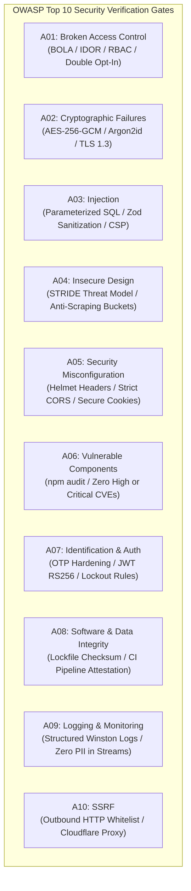
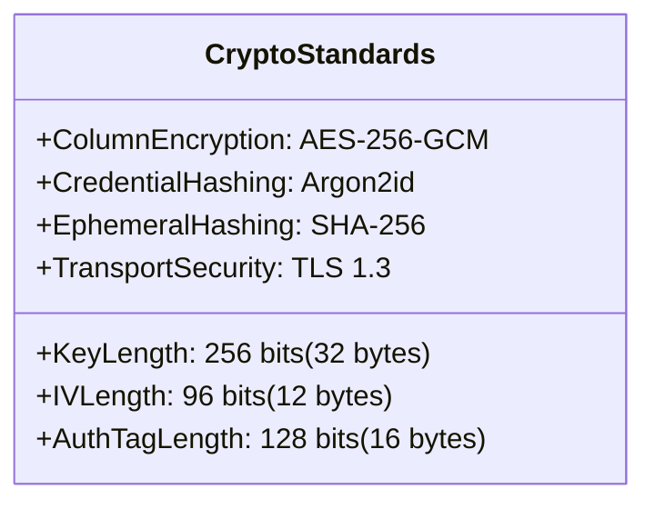
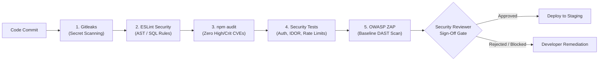

# Flatmate Core Platform – Pre-Implementation Security Audit Checklist

**Document Title**: Comprehensive Pre-Implementation Security Audit Checklist & Hardening Standards  
**Document Version**: 1.0.0  
**Phase**: Workflow C (Architecture and Design)  
**Author**: Security Reviewer  
**Reviewers**: Solution Architect, Backend Engineer, DevOps Engineer, QA Engineer, Chief Orchestrator  
**Status**: Ready for Human Sign-off (Level 2 Complete -> Level 3 human gate)  
**Date**: 2026-11-14  
**Target Scope**: MVP v1.0 (Development & Deployment Verification)

---

## 1. Purpose & Scope

This document establishes the mandatory security controls, architectural checklists, cryptographic standards, HTTP hardening guidelines, and CI/CD security gate criteria that must be satisfied during **Workflow D (Development)**, **Workflow E (Testing)**, and **Workflow F (Infrastructure & Deployment)** before production sign-off.

Adherence to this checklist is enforceable under **Rule 09 (Mandatory Security Review)** and **Rule 05 (Security, Trust, and Data Protection)** of `AGENTS.md`.

---

## 2. OWASP Top 10 (2021/2024) Verification Checklist

Every item in this checklist must be verified in code review and validated through automated testing before release candidate promotion.



### 2.1 Detailed Audit Items

| Category | Control ID | Audit Requirement | Verification Standard / Tool | Gate Threshold | Mandatory Status |
| :--- | :--- | :--- | :--- | :--- | :--- |
| **A01: Broken Access Control** | `CHK-AC-01` | **Server-Derived Identity**: Client-supplied user IDs (`req.body.userId`) must NEVER be trusted for authorization. Identity must be extracted strictly from verified session tokens. | ESLint AST inspection & code review. | Zero instances of client-supplied user ID assignment. | **Blocking (P0)** |
| | `CHK-AC-02` | **BOLA / IDOR Guarding**: Endpoints modifying or viewing specific resources (`/listings/:id`, `/chat/:conversationId`) must verify user ownership or active participation. | Automated Playwright / Vitest IDOR test suite. | HTTP 403/404 returned when User A accesses User B's resource. | **Blocking (P0)** |
| | `CHK-AC-03` | **Double Opt-In Enforcement**: Chat creation must reject requests between users who do not have a confirmed mutual match in the database. | Integration test attempting direct chat initiation without match. | HTTP 403 Forbidden on unmatched chat attempt. | **Blocking (P0)** |
| | `CHK-AC-04` | **Modality Route Guards**: Users can only access listing creation and management if their active modality is `MODALITY_1` or `MODALITY_3`. | Unit test verifying modality guard middleware. | HTTP 400 Bad Request if modality mismatched. | **Blocking (P0)** |
| **A02: Cryptographic Failures** | `CHK-CR-01` | **Column-Level PII Encryption**: User phone numbers, academic verification records, and personal documents must be encrypted at rest using AES-256-GCM. | Database raw query test asserting encrypted ciphertext in PII columns. | Zero plain-text E.164 phone numbers in DB tables. | **Blocking (P0)** |
| | `CHK-CR-02` | **Password & Credential Hashing**: Any persistent secrets or administrative credentials must be hashed using Argon2id. | Code review of hashing utility module. | Argon2id configured with $m=65536, t=3, p=4$. | **Blocking (P0)** |
| | `CHK-CR-03` | **In-Transit Encryption**: All HTTP and WebSocket traffic must enforce TLS 1.3 (minimum TLS 1.2). | SSL Labs / testssl.sh automated scan. | SSL Labs Grade A+ with HSTS enabled. | **Blocking (P0)** |
| | `CHK-CR-04` | **Secret Management**: No secrets, API keys, or private certificates stored in repository source code or Docker images. | Automated `gitleaks` scan on all git commits. | Zero committed secrets in repository history. | **Blocking (P0)** |
| **A03: Injection** | `CHK-IN-01` | **SQL Parameterization**: 100% of database queries must use parameterized placeholders via ORM or typed query builder (Kysely / Prisma / pg). Raw string concatenation is strictly prohibited. | ESLint rule `no-sql-raw-template` & manual review. | Zero raw SQL string interpolations. | **Blocking (P0)** |
| | `CHK-IN-02` | **Input Schema Validation**: All incoming HTTP request payloads and query parameters must be validated using strict Zod schemas with unknown key stripping. | Express/Next.js middleware audit. | 100% of POST/PUT/PATCH routes guarded with Zod validator. | **Blocking (P0)** |
| | `CHK-IN-03` | **XSS Defense & Sanitization**: User-generated content (bios, chat messages) must be sanitized with `DOMPurify` before DOM rendering; React auto-escaping verified. | Playwright XSS injection test payload `<script>alert(1)</script>`. | Script tags neutralized; zero script execution. | **Blocking (P0)** |
| **A04: Insecure Design** | `CHK-ID-01` | **Threat Model Verification**: All high and critical threats documented in `threat-model.md` must have verified mitigation code in place. | Security Reviewer manual sign-off. | 100% of STRIDE threats addressed. | **Blocking (P0)** |
| | `CHK-ID-02` | **Anti-Scraping Rate Limits**: Redis token-bucket rate limits applied to swipe actions (60/min), feed fetches (30/min), and OTP attempts (3/15m). | k6 load test simulating rate limit thresholds. | HTTP 429 Too Many Requests triggered. | **Blocking (P0)** |
| **A05: Security Misconfiguration** | `CHK-CF-01` | **Helmet HTTP Headers**: Enforce HSTS, CSP, X-Frame-Options, X-Content-Type-Options, Referrer-Policy, and Permissions-Policy. | Automated curl header inspection test. | All required headers present with exact values. | **Blocking (P0)** |
| | `CHK-CF-02` | **CORS Configuration**: Restrict allowed origins strictly to production domain whitelist. Disallow wildcard `*` with credentials. | CORS test suite with spoofed `Origin: evil.com`. | Disallowed origins receive no `Access-Control-Allow-Origin`. | **Blocking (P0)** |
| | `CHK-CF-03` | **Secure Cookie Flags**: Session cookies must have `HttpOnly`, `Secure`, `SameSite=Strict`, and `Path` scoped. | Automated client cookie inspection test. | All session cookies verified with correct flags. | **Blocking (P0)** |
| | `CHK-CF-04` | **Banner & Stack Trace Suppression**: `X-Powered-By` header disabled; error stack traces suppressed in production environments. | HTTP request sending malformed payload. | Returns RFC 7807 problem details with zero stack trace. | **Blocking (P0)** |
| **A06: Vulnerable Components** | `CHK-VC-01` | **Dependency Vulnerability Scanning**: Production dependencies must have zero High or Critical vulnerabilities. | Automated `npm audit --audit-level=high` & Snyk in CI. | Build fails on any High or Critical unmitigated CVE. | **Blocking (P0)** |
| | `CHK-VC-02` | **Lockfile Integrity**: Lockfile (`package-lock.json`) strictly enforced using `npm ci`. | CI build workflow configuration. | `npm ci` enforced in all container and CI builds. | **Blocking (P0)** |
| **A07: Auth Failures** | `CHK-AU-01` | **Cryptographic OTP Generation**: OTP generation must use `crypto.randomInt(100000, 999999)` instead of insecure pseudo-random generators (`Math.random()`). | Code audit of `OTPService`. | `crypto.randomInt` used exclusively. | **Blocking (P0)** |
| | `CHK-AU-02` | **Brute-Force Account Lockout**: Account locked for 30 minutes after 5 consecutive failed OTP entries. | Automated test submitting 5 invalid OTPs. | Account locked; 6th attempt rejected with HTTP 423. | **Blocking (P0)** |
| | `CHK-AU-03` | **JWT Algorithm Whitelisting**: JWT verification must explicitly specify allowed algorithms (`algorithms: ['HS256']` or `['RS256']`), rejecting `none`. | JWT unit test with forged `alg: none`. | Verification fails with 401 Unauthorized. | **Blocking (P0)** |
| | `CHK-AU-04` | **Refresh Token Rotation**: Refresh token reuse detection invalidates all existing sessions in the token family. | Integration test presenting an already-used refresh token. | All tokens in family revoked; user forced to re-login. | **Blocking (P0)** |
| **A08: Software Integrity** | `CHK-SI-01` | **CI Pipeline Protections**: Pipeline runs only on signed commits; branch protection rules prevent direct push to `main`. | GitHub / GitLab branch protection verification. | Branch protection active on `main` branch. | **High (P1)** |
| **A09: Logging & Monitoring** | `CHK-LG-01` | **Zero PII in Application Logs**: Phone numbers, tokens, OTP codes, passwords, and full names must be sanitized/redacted from log streams. | Automated regex log scanner running over test execution logs. | Zero matches for E.164 phone numbers or OTP codes. | **Blocking (P0)** |
| | `CHK-LG-02` | **Security Event Auditing**: Log all security events (login failures, lockout triggers, DPDP consent modifications, account deletions, report triggers). | Winston structured logger inspection. | Structured JSON logs with timestamp, event_type, and user_id_hash. | **High (P1)** |
| **A10: SSRF** | `CHK-SS-01` | **Outbound Request Sanitization**: External HTTP requests (Gemini API, SMS Gateway, webhooks) must be restricted to hardcoded, validated endpoint URLs. | Egress network proxy & firewall rules. | Outbound calls to private IP ranges (`10.0.0.0/8`, `127.0.0.1`, `169.254.169.254`) blocked. | **Blocking (P0)** |

---

## 3. Database Query Parameterization & Data Access Standards

### 3.1 Strict Parameterization Rules
1. **Mandatory Parameterized Placeholders**: All relational queries executed against PostgreSQL must utilize numbered parameter placeholders (`$1, $2, ...`):
   ```typescript
   // COMPLIANT: Fully parameterized query
   const result = await db.query(
     `SELECT id, name, modality, micro_market, compatibility_vector
      FROM user_profiles
      WHERE modality = $1 AND micro_market = $2 AND is_active = true`,
     [modality, microMarket]
   );
   ```
2. **Prohibited Patterns**:
   ```typescript
   // NON-COMPLIANT: High-risk SQL injection vulnerability!
   const result = await db.query(
     `SELECT * FROM user_profiles WHERE modality = '${modality}'` // BLOCKED
   );
   ```
3. **Dynamic Filter Construction**: When building dynamic queries for discovery filters (budget range, dietary preferences), developers must use a query builder with parameterized bindings or an array accumulator pattern:
   ```typescript
   const conditions: string[] = ['is_active = true', 'is_banned = false'];
   const values: unknown[] = [];

   if (filters.modality) {
     values.push(filters.modality);
     conditions.push(`modality = $${values.length}`);
   }
   if (filters.microMarket) {
     values.push(filters.microMarket);
     conditions.push(`micro_market = $${values.length}`);
   }
   const query = `SELECT * FROM user_profiles WHERE ${conditions.join(' AND ')}`;
   ```

---

## 4. Cryptographic Standards Specification



### 4.1 Column-Level PII Encryption (AES-256-GCM)
All columns holding Indian mobile numbers (`phone_number`), corporate/academic verification emails (`verification_email`), and government documents must be encrypted prior to database insertion.

- **Algorithm**: `AES-256-GCM` (Galois/Counter Mode provides authenticated encryption with confidentiality and integrity).
- **Key Length**: 256 bits (32 bytes), stored securely in environment secret `PII_ENCRYPTION_KEY` (never committed to repository).
- **Initialization Vector (IV)**: Cryptographically secure pseudo-random 96-bit (12-byte) IV generated per encryption event (`crypto.randomBytes(12)`). IV must NEVER be reused with the same key.
- **Authentication Tag**: 128-bit (16-byte) authentication tag generated by GCM mode. Tampering with ciphertext triggers decryption failure.
- **Serialization Format**: Stored as a concatenated string or JSON in the database column:
  `iv:ciphertext:auth_tag` (all base64-encoded).

#### Reference Implementation Contract:
```typescript
import crypto from 'node:crypto';

const ALGORITHM = 'aes-256-gcm';
const IV_LENGTH = 12; // 96 bits recommended for GCM
const KEY = Buffer.from(process.env.PII_ENCRYPTION_KEY!, 'hex'); // 32-byte key

export function encryptPII(plainText: string): string {
  const iv = crypto.randomBytes(IV_LENGTH);
  const cipher = crypto.createCipheriv(ALGORITHM, KEY, iv);
  let encrypted = cipher.update(plainText, 'utf8', 'base64');
  encrypted += cipher.final('base64');
  const tag = cipher.getAuthTag();

  return `${iv.toString('base64')}:${encrypted}:${tag.toString('base64')}`;
}

export function decryptPII(cipherString: string): string {
  const [ivB64, encrypted, tagB64] = cipherString.split(':');
  if (!ivB64 || !encrypted || !tagB64) {
    throw new Error('Malformed ciphertext string');
  }

  const iv = Buffer.from(ivB64, 'base64');
  const tag = Buffer.from(tagB64, 'base64');
  const decipher = crypto.createDecipheriv(ALGORITHM, KEY, iv);
  decipher.setAuthTag(tag);

  let decrypted = decipher.update(encrypted, 'base64', 'utf8');
  decrypted += decipher.final('utf8');
  return decrypted;
}
```

### 4.2 Credential & Secret Hashing (Argon2id)
Where persistent passwords, staff credentials, or long-lived authentication secrets are hashed, **Argon2id** (winner of the Password Hashing Competition) must be utilized:
- **Type**: `Argon2id` (hybrid offering defense against side-channel and GPU cracking attacks).
- **Memory Cost ($m$)**: $65,536\text{ KiB}$ ($64\text{ MB}$).
- **Time Cost ($t$)**: $3$ iterations.
- **Parallelism ($p$)**: $4$ threads.
- **Salt**: 16 bytes cryptographically secure random (`crypto.randomBytes(16)`).

### 4.3 Ephemeral Token Hashing (SHA-256 with Server-Side Salt)
For short-lived tokens such as phone OTP verification codes and refresh token database lookups:
- Algorithm: `HMAC-SHA-256` or `SHA-256(token + process.env.OTP_SALT)`.
- TTL: 300 seconds for OTP codes; 14 days for Refresh Tokens.

---

## 5. HTTP Headers, Edge Hardening & Secure Cookies

### 5.1 Helmet Security Headers Configuration
The application gateway and Express/Next.js middleware must configure Helmet headers as follows:

```typescript
import helmet from 'helmet';

export const securityHeadersMiddleware = helmet({
  // HTTP Strict Transport Security
  hsts: {
    maxAge: 31536000, // 1 year in seconds
    includeSubDomains: true,
    preload: true,
  },
  // Content Security Policy
  contentSecurityPolicy: {
    directives: {
      defaultSrc: ["'self'"],
      scriptSrc: ["'self'", "'wasm-unsafe-eval'"],
      styleSrc: ["'self'", "'unsafe-inline'"], // Tailwind CSS classes
      imgSrc: ["'self'", "data:", "blob:", "https://*.flatmate.in", "https://*.cloudflare.com", "https://*.amazonaws.com"],
      connectSrc: ["'self'", "wss://*.flatmate.in", "https://generativelanguage.googleapis.com"],
      fontSrc: ["'self'"],
      objectSrc: ["'none'"],
      mediaSrc: ["'self'"],
      frameSrc: ["'none'"],
      baseUri: ["'self'"],
      formAction: ["'self'"],
      upgradeInsecureRequests: [],
    },
  },
  // Anti-Clickjacking
  frameguard: {
    action: 'deny',
  },
  // MIME type sniffing prevention
  noSniff: true,
  // Cross-Site Scripting filter
  xssFilter: true,
  // Referrer Policy
  referrerPolicy: {
    policy: 'strict-origin-when-cross-origin',
  },
  // Cross-Origin Resource Policy
  crossOriginResourcePolicy: { policy: 'same-site' },
  // DNS Prefetch Control
  dnsPrefetchControl: { allow: false },
});
```

### 5.2 Strict Cross-Origin Resource Sharing (CORS) Policy
Wildcard origins (`*`) combined with credentials (`credentials: true`) represent a severe vulnerability and are **strictly forbidden**.

```typescript
import cors from 'cors';

const allowedOrigins = [
  'https://flatmate.in',
  'https://app.flatmate.in',
  ...(process.env.NODE_ENV !== 'production'
    ? ['http://localhost:3000', 'http://127.0.0.1:3000']
    : []),
];

export const corsMiddleware = cors({
  origin: (origin, callback) => {
    // Allow requests with no origin (e.g. mobile apps, curl) only if non-browser
    if (!origin || allowedOrigins.includes(origin)) {
      callback(null, true);
    } else {
      callback(new Error('Blocked by CORS policy'));
    }
  },
  credentials: true, // Allow cookies
  methods: ['GET', 'POST', 'PUT', 'PATCH', 'DELETE', 'OPTIONS'],
  allowedHeaders: [
    'Content-Type',
    'Authorization',
    'X-Requested-With',
    'Accept',
    'Cache-Control',
  ],
  maxAge: 86400, // 24-hour pre-flight cache
});
```

### 5.3 Secure Cookie Specification Matrix

| Cookie Name | Purpose | Max Age | HttpOnly | Secure | SameSite | Path Scope | Prefix |
| :--- | :--- | :--- | :--- | :--- | :--- | :--- | :--- |
| `__Host-access-token` | Short-lived session JWT | 15 minutes (900s) | `true` | `true` | `Strict` | `/` | `__Host-` |
| `__Host-refresh-token` | Session renewal token | 14 days (1209600s) | `true` | `true` | `Strict` | `/api/v1/auth` | `__Host-` |
| `__Host-csrf-token` | Double-submit Anti-CSRF token | Session | `false` (readable by JS) | `true` | `Strict` | `/` | `__Host-` |

> [!IMPORTANT]
> The `__Host-` prefix enforces that the cookie must be sent over HTTPS, originated from the exact host (no subdomains), and have path set to `/`. This protects against subdomain cookie injection attacks.

---

## 6. DPDP Statutory & Privacy Safeguards Audit Checklist

| Compliance ID | Requirement | Verification Step | Failure Condition |
| :--- | :--- | :--- | :--- |
| **DPDP-01** | Explicit Granular Consent | Verify that signup flow captures explicit user check for: (1) Terms & Discovery, (2) Optional room listing display. Consent record saved with timestamp and policy version. | Missing consent row in `consent_records` upon account creation. |
| **DPDP-02** | Geolocation Coarsening | Verify that client map views render micro-market centroids ($\pm 2.0\text{ km}$ radius fuzzing) and that raw lat/long coordinates are never requested via browser Geolocation API. | Precision GPS coordinates ($>4$ decimal places) found in network payloads. |
| **DPDP-03** | Right to Erasure Execution | Verify that calling POST `/api/v1/account/delete` prompts for OTP confirmation, sets `DELETION_PENDING`, and triggers hard-purge within 72 hours. | User data still queryable in `users` table after 72 hours. |
| **DPDP-04** | AI Payload Data Minimization | Verify that prompt payloads to Google Gemini API contain only structured lifestyle vector enums (`SLEEP_SCHEDULE`, `CLEANLINESS`, `DIETARY_HABIT`). | Any user name, phone number, bio, or contact string transmitted in Gemini SDK call. |
| **DPDP-05** | Grievance Redressal SLA | Verify that user-submitted safety reports and privacy grievances populate `grievance_tickets` table with automated 48-hour SLA deadline alert. | Ticket created without assigned SLA expiration or notification trigger. |

---

## 7. CI/CD Automated Security Gates & Pipeline Criteria

To ensure continuous security compliance, the CI/CD pipeline (`workflow-f-infrastructure-and-deployment.md`) must execute the following automated security checks on every pull request:



### 7.1 Pipeline Pass / Fail Criteria

1. **Gitleaks Scan**:
   - Tool: `gitleaks detect --source=. --verbose`
   - Gate: **Zero findings**. Pipeline fails immediately if any pattern matching API keys, tokens, or private keys is found.
2. **Static Analysis & Security Linting (SAST)**:
   - Tool: ESLint with `eslint-plugin-security` and custom AST checks.
   - Gate: Zero security-related linter warnings or errors.
3. **Software Composition Analysis (SCA)**:
   - Tool: `npm audit --audit-level=high`
   - Gate: **Zero High or Critical vulnerabilities**. Medium vulnerabilities must have documented exceptions with target patch dates.
4. **Automated Security Integration Tests**:
   - Tool: Vitest running test suite under `tests/security/` (`idor.test.ts`, `rate-limit.test.ts`, `otp-brute-force.test.ts`, `pii-masking.test.ts`).
   - Gate: **100% test pass rate**.
5. **OWASP ZAP Dynamic Scan (DAST)**:
   - Tool: OWASP ZAP Baseline Scan in staging environment.
   - Gate: **Zero High or Medium risk alerts**.

---

## 8. Pre-Implementation Audit Sign-Off

This audit checklist must be executed and formally signed off by the **Security Reviewer** prior to releasing code to production.

- **Checklist Version**: 1.0.0
- **Governing Architecture Spec**: `docs/architecture/threat-model.md`
- **Sign-off Authority**: Level 2 Internal Approval / Level 3 Human Production Authorization Gate
