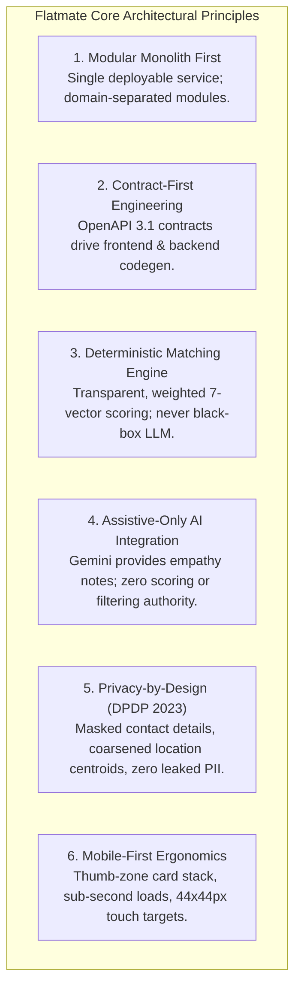
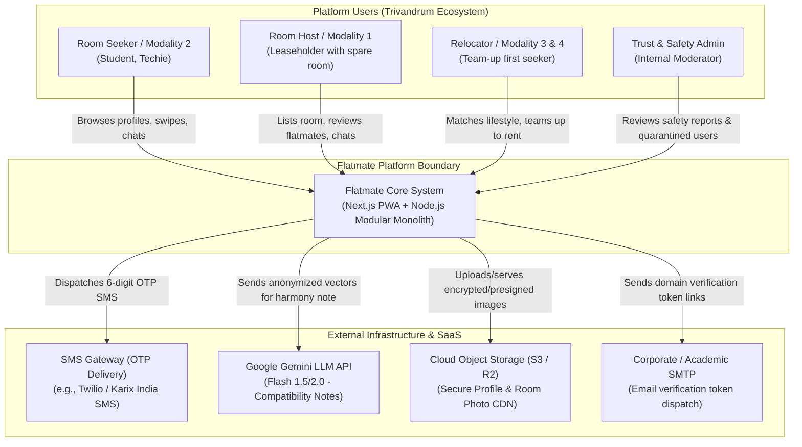
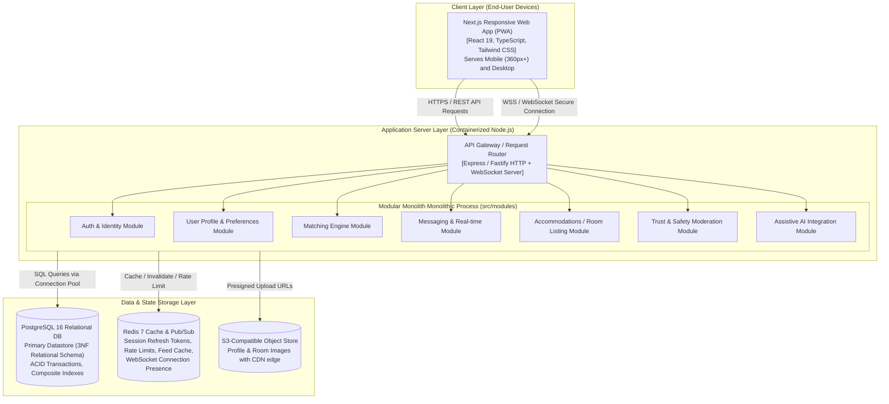
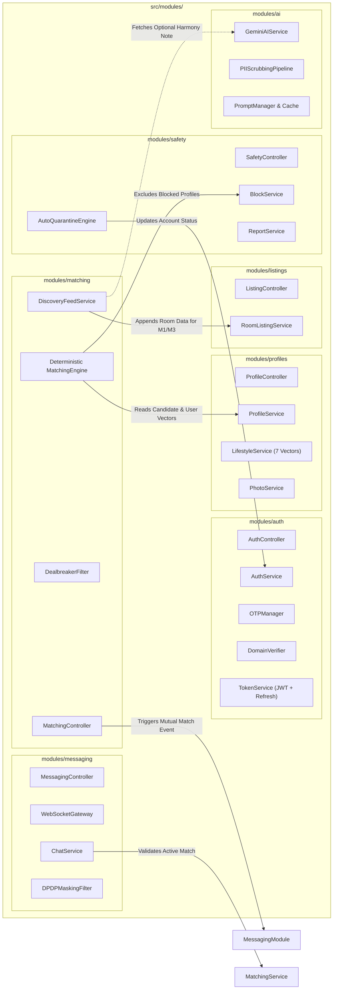
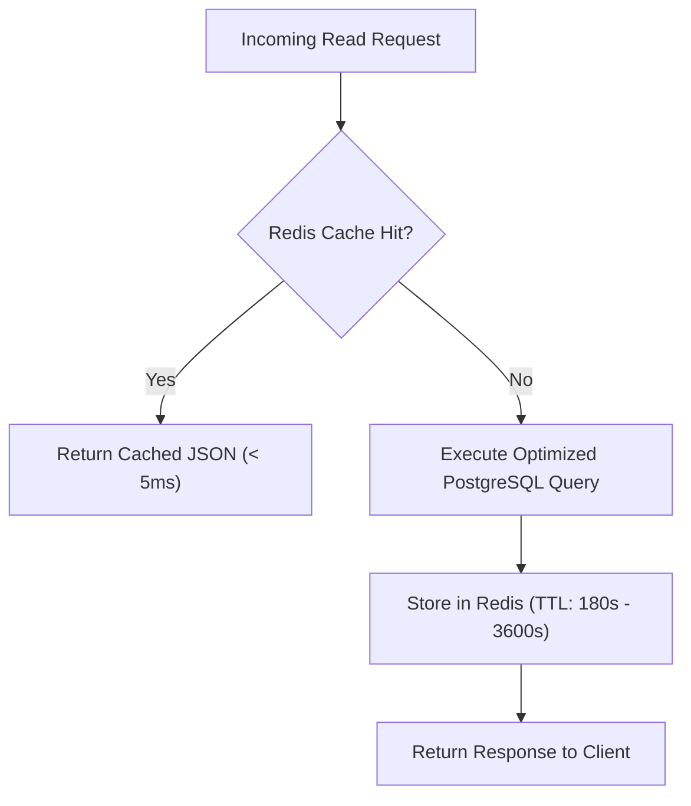
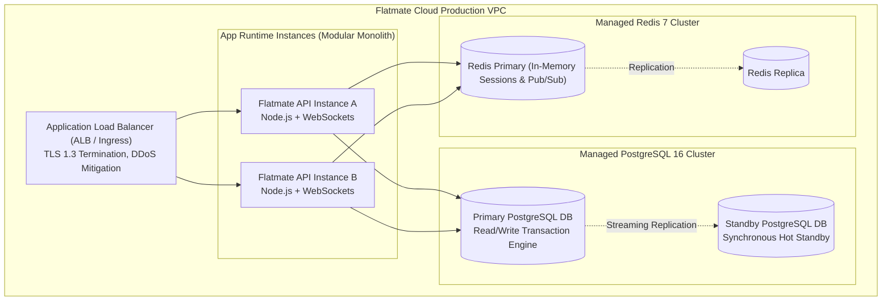

# Flatmate – System Architecture Specification

**Document Version**: 1.0.0  
**Phase**: Workflow C (Architecture & Design)  
**Author**: Solution Architect  
**Reviewers**: Chief Orchestrator, Security Reviewer, Backend Engineer, Frontend Engineer  
**Status**: Ready for Level 2 Review  
**Date**: 2026-11-14  
**Target Release**: MVP v1.0 (Thiruvananthapuram, Kerala, India)

---

## 1. Architectural Strategy & Design Principles

Flatmate is architected as a **Modular Monolith** designed for high developer velocity, end-to-end type safety, strict domain boundary encapsulation, and zero premature distributed system overhead.

### 1.1 Core Architectural Principles

1. **Modular Monolith First**: The system avoids premature microservices, event streaming fabrics (Kafka/RabbitMQ), and multi-repository sprawl. All domain contexts live in a unified codebase with clean in-process interfaces, allowing atomic transactions and zero network serialization penalties.
2. **Contract-First Engineering**: The OpenAPI 3.1 specification (`docs/architecture/api-spec.yaml`) is the single canonical source of truth for all API contracts.
3. **Deterministic Business Logic**: All compatibility scoring (0%–100%) and dealbreaker filtering are executed through transparent, verifiable mathematical algorithms. LLMs are prohibited from computing scores or filtering users.
4. **Assistive-Only AI**: The Gemini API is strictly limited to generating contextual "Why You Click" harmony notes and icebreaker prompts, operating through anonymized vector payloads and strict JSON output validation.
5. **Privacy-by-Design & India DPDP Act Compliance**: No raw phone numbers, exact geolocation coordinates, or institutional email addresses are exposed across client payloads.
6. **Mobile-First Responsiveness & PWA Ergonomics**: Core flows are designed for single-hand mobile operation (360px–428px widths) with progressive web app (PWA) offline shell caching.

---

## 2. C4 Architecture Models

### 2.1 C4 Level 1: System Context Diagram

The System Context diagram details how Flatmate interacts with users in Trivandrum and external partner infrastructure.

---

### 2.2 C4 Level 2: Container Diagram

The Container diagram illustrates the deployable technical runtime units forming the Flatmate platform.

---

### 2.3 C4 Level 3: Component Diagram (Modular Monolith Structure)

The internal software components are isolated into distinct domain modules under `src/modules/`, interacting exclusively through strongly typed contracts and domain event dispatches.

---

## 3. Domain-Driven Design (DDD) Bounded Contexts

The domain model is partitioned into six explicit Bounded Contexts, each with strict domain entities, value objects, domain events, and explicit contracts.

### 3.1 Context Boundaries & Responsibilities

| Bounded Context | Core Entities & Aggregates | Ubiquitous Language | Inbound Interfaces | Outbound Dependencies |
| :--- | :--- | :--- | :--- | :--- |
| **1. Auth & Identity** | `User`, `AuthOTP`, `InstitutionVerification`, `RefreshToken` | Phone Auth, OTP, Access Token, Token Rotation, Corporate Whitelist, Academic Domain. | REST: `/api/v1/auth/*` | SMS Gateway, SMTP Mailer |
| **2. User Profile & Preferences** | `UserProfile`, `LifestyleProfile` (7 Vectors), `ProfilePhoto`, `MicroMarket` | Chronotype, Cleanliness Vector, Dealbreaker, Modality (1..4), Trivandrum Micro-market. | REST: `/api/v1/profiles/*`, `/api/v1/lifestyle/*` | Object Storage CDN |
| **3. MatchingEngine** | `DiscoveryFeed`, `SwipeDecision`, `Match`, `CompatibilityMatrix` | 7-Vector Score, Vector Affinity, Hard Dealbreaker, Double Opt-in, Mutual Match, Rewind. | REST: `/api/v1/discovery/*`, `/api/v1/matches/*` | Profiles Context, Safety Context |
| **4. Messaging & Real-Time** | `Conversation`, `ChatMessage`, `WebSocketConnection` | Double Opt-in Room, Masked Chat, Read Receipt, PII Filter, Unmatch Termination. | REST: `/api/v1/conversations/*`, WSS: `/ws/v1` | Matching Context |
| **5. Accommodations & Listings** | `RoomListing`, `RoomPhoto`, `AmenitySpecification` | Spare Room, Move-in Date, Security Deposit, AC Sub-metering, Attached Bath. | REST: `/api/v1/rooms/*` | Profiles Context, Object Storage |
| **6. Trust & Safety** | `UserBlock`, `UserReport`, `QuarantineTrigger`, `AuditLog` | Harassment Category, Auto-Quarantine, Commercial Broker Ban, Moral Policing Shield. | REST: `/api/v1/safety/*` | Auth Context, Matching Context |

### 3.2 Inter-Module Communication Invariants

1. **In-Process Interface Calls**: Domain modules invoke each other via strongly typed TypeScript services (e.g., `MatchingEngine` calls `IProfileQueryService.getLifestyleVectors(userIds)`).
2. **Zero Cross-Context SQL Joins**: Code in `modules/matching` must NEVER execute raw SQL joins across tables owned exclusively by `modules/messaging` or `modules/safety`. Each module owns its database entities.
3. **Decoupled Domain Events**: Critical state transitions publish in-process domain events via Node.js typed event emitter:
   - `UserMatchedEvent`: Emitted by `MatchingEngine`; handled by `MessagingModule` to initialize a 1-on-1 conversation and pre-populate metadata.
   - `UserBlockedEvent`: Emitted by `SafetyModule`; handled by `MatchingEngine` to evict cached feeds and `MessagingModule` to terminate active chat sessions.
   - `UserQuarantinedEvent`: Emitted by `SafetyModule`; handled by `AuthModule` to revoke active refresh tokens and `MatchingEngine` to drop profile from all discovery decks.

---

## 4. Latency Budgets & Performance Architecture

To satisfy the non-functional benchmarks specified in `docs/requirements/non-functional-requirements.md` (NFR-PERF-01 through 06), system response times are budgeted across layers:

| Operation | Total SLA Budget (p95) | Gateway & Routing | Business Logic & Matching | Database Query | Network Serialization |
| :--- | :--- | :--- | :--- | :--- | :--- |
| **Discovery Feed Generation (20 cards)** | **$\le 200$ ms** | 10 ms | 40 ms (50 vector evaluations) | 25 ms (indexed SQL query) | 25 ms |
| **Swipe Action & Match Evaluation** | **$\le 150$ ms** | 10 ms | 20 ms (atomic match transaction) | 30 ms (insert + conflict query) | 15 ms |
| **1-on-1 Chat Message (WSS e2e)** | **$\le 150$ ms** | 15 ms | 20 ms (DPDP mask check + save) | 25 ms (insert message row) | 40 ms (socket push) |
| **User Profile & Lifestyle Retrieval** | **$\le 120$ ms** | 10 ms | 15 ms (assembly) | 20 ms (single primary key query) | 15 ms |
| **Assistive AI "Why You Click"** | **$\le 800$ ms** | 15 ms | 25 ms (scrub & prompt prep) | 10 ms (vector fetch) | 700 ms (Gemini Flash call) |

### 4.1 Caching Strategy

1. **Discovery Candidates Pool**: User discovery candidate pools are cached in Redis with a 5-minute TTL. Any swipe action invalidates the head of the user's cached deck.
2. **Deterministic Compatibility Matrix**: The 7-vector affinity scores are pure functions. Pairwise vector calculations are memoized by sorted attribute hashes (`hash(VectorA) + hash(VectorB)`).
3. **HTTP Cache-Control Headers**:
   - Static assets / profile images: `public, max-age=31536000, immutable`.
   - Discovery deck / chat metadata: `private, no-cache, no-store, must-revalidate`.

---

## 5. Security & DPDP Compliance Architecture

In compliance with India's **Digital Personal Data Protection (DPDP) Act 2023** and project rule `AGENTS.md` Rule 05:

```mermaid
flowchart LR
    ClientReq["Incoming API Request"] --> TLS["TLS 1.3 Termination"]
    TLS --> CookieAuth["Parse httpOnly Secure Cookie"]
    CookieAuth --> JWTVerify["Verify Access Token Signature (RS256)"]
    JWTVerify --> RBAC["Enforce Contextual Authorization (User owns resource)"]
    RBAC --> Sanitizer["Input Sanitization & Schema Validation (Zod)"]
    Sanitizer --> ServiceExec["Execute Business Logic"]
    ServiceExec --> DataMasking["DPDP Data Masking Layer (Mask phone, Coarsen location)"]
    DataMasking --> ClientResp["Deliver Safe Response Payload"]
```

1. **Contact Information Masking (FR-23)**:
   - Phone numbers are encrypted at rest using AES-256-GCM.
   - Raw phone numbers and institutional email addresses are never returned in discovery or chat payloads.
2. **Coarsened Geospatial Privacy**:
   - Exact user coordinates or building street addresses are forbidden in the database schema. Only standardized suburb names (e.g., `Kazhakkoottam`, `Kariavattom`) are stored and exchanged.
3. **Token Management & Session Security (NFR-SEC-01)**:
   - Short-lived Access JWTs (15-minute expiry) held in `httpOnly`, `Secure`, `SameSite=Strict` cookies.
   - Long-lived Refresh Tokens (14-day expiry) stored as SHA-256 hashes in PostgreSQL with family-based reuse detection (revoking all tokens if reuse is detected).
4. **Chat Content Safeguards**:
   - In-app text messaging streams pass through an automated regex sanitizer flagging attempts to exchange phone numbers or UPI financial handles prior to mutual comfort verification.

---

## 6. High Availability & Deployment Topography

- **Zero-Downtime Rolling Deployments**: Multiple application container instances behind a load balancer ensure zero-downtime updates.
- **Connection Pool Tuning**: PostgreSQL connection pooling is handled via `pg-pool` with a maximum limit of 20 active connections per instance, protected against connection exhaustion.
- **Circuit Breaking**: External calls to SMS Gateways and Gemini LLM APIs are wrapped with circuit breakers (3-failure trip, 30-second recovery timeout).
