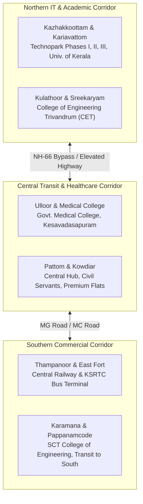
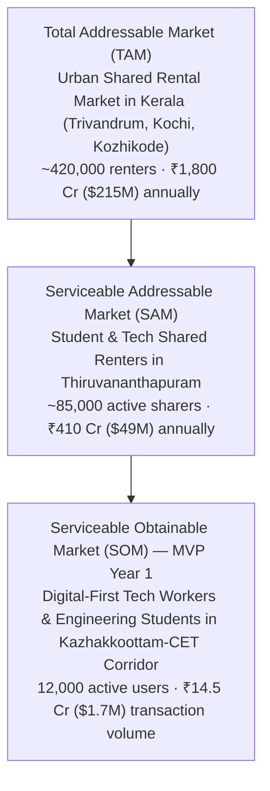
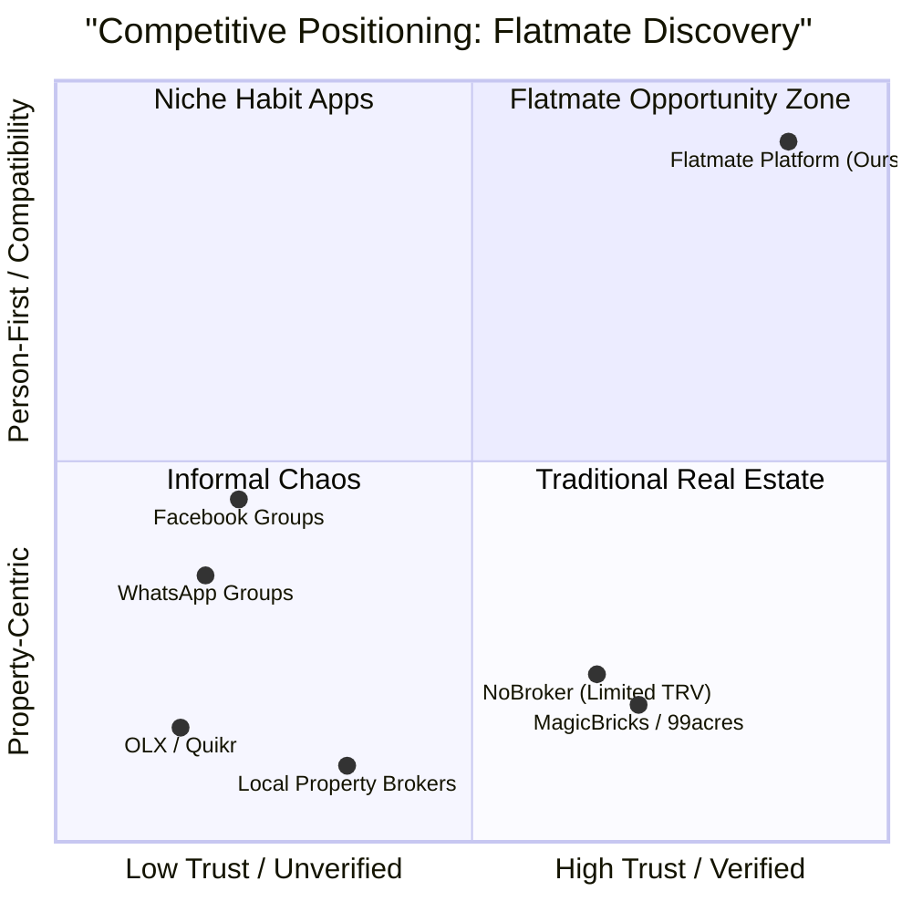

# Flatmate – Market Research & Competitive Intelligence

**Document Version**: 1.0.0  
**Phase**: Workflow A (Ideation & Discovery)  
**Author**: Product Strategist  
**Target Market**: Thiruvananthapuram (Trivandrum), Kerala, India  
**Status**: Ready for Human Sign-off  

---

## 1. Executive Summary

Thiruvananthapuram (Trivandrum), the state capital of Kerala, represents a rapidly modernizing urban center characterised by an expanding knowledge economy, high literacy, and a distinct demographic split between premier higher education institutions and a fast-growing IT/technology corridor. 

Historically known for government administration, Trivandrum has transformed into Kerala's IT powerhouse with **Technopark** (spanning Phases I, II, III, and upcoming Technocity / Taurus Downtown), housing over 70,000 technology professionals across 450+ companies. Concurrently, the city hosts premier academic institutions, including the **College of Engineering Trivandrum (CET)**, **Barton Hill Government Engineering College**, **SCT College of Engineering**, **University of Kerala Kariavattom Campus**, and the **Government Medical College**.

This confluence creates a high-turnover rental accommodation market with significant unmet needs around roommate compatibility, privacy, and trust. While metro cities like Bengaluru, Mumbai, and Delhi have seen niche flatmate experiments, **Tier-2 tech hubs like Trivandrum remain completely underserved by modern co-living discovery platforms**, relying on unmoderated social channels, predatory broker networks, and classified listings.

---

## 2. Geographic & Urban Topology of Trivandrum

Trivandrum's residential rental market is clustered along key transit corridors and commercial/educational hubs.

### 2.1 Micro-Market Analysis

| Micro-Market | Dominant Demographics | Rental Typology | Typical Rent Range (Per Room / Per Month) | Key Landmarks & Transit |
| :--- | :--- | :--- | :--- | :--- |
| **Kazhakkoottam & Kariavattom** | Technopark engineers (UST, Infosys, Allianz), Univ. of Kerala researchers | High-rise apartments (2BHK/3BHK), gated communities, independent villas | ₹6,000 – ₹11,000 (shared flat) / ₹12,000 – ₹18,000 (private 1BHK) | Technopark Main Gate, Phase III campus, Kariavattom Sports Complex, Kazhakkoottam Elevated Flyover |
| **Kulathoor & Sreekaryam** | CET students, fresh IT graduates, IT park interns | Independent houses, multi-story sublets, traditional villas | ₹3,500 – ₹6,500 (shared room) / ₹6,000 – ₹9,000 (private room in 3BHK) | CET Campus, Loyola Junction, Bypass Link Road |
| **Ulloor & Medical College** | Medical students, resident doctors, nurses, paramedical staff | Older apartment complexes, traditional duplex homes | ₹4,500 – ₹7,500 (shared flat) | Trivandrum Medical College, SUT Hospital, Kesavadasapuram Junction |
| **Pattom, Kowdiar & Vellayambalam** | Mid-to-senior IT consultants, government officers, media professionals | Premium high-rises, luxury residential apartments | ₹8,000 – ₹15,000 (per room in luxury 3BHK) | Kowdiar Palace Road, Trivandrum Club, Central Secretariat access |
| **Karamana & Pappanamcode** | SCT College of Engineering students, south-corridor commuters | Student lodges, traditional Kerala nalukettu-converted flats | ₹3,000 – ₹5,000 (shared accommodation) | SCT Engineering, Neeramankara, Pappanamcode Industrial Estate |

### 2.2 Transit & Commute Dynamics
- **NH-66 Kazhakkoottam Bypass & Elevated Highway**: Connects the IT corridor to central Trivandrum. Most IT professionals prefer living within a 3 to 7 km radius of Phase I/II/III to avoid rush-hour bottlenecks.
- **KSRTC Swift & City Circular Buses**: Affordable transit connecting Sreekaryam, Kazhakkoottam, and East Fort; heavily utilized by students and interns.
- **Two-Wheeler Prevalence**: Over 70% of students and junior IT professionals rely on scooters/motorcycles, making dedicated two-wheeler parking a critical accommodation filter.

---

## 3. Demographics & Market Sizing (TAM / SAM / SOM)

### 3.1 Market Sizing Methodology

#### Total Addressable Market (TAM)
- **Scope**: All urban renters seeking shared accommodation in major Kerala knowledge hubs (Thiruvananthapuram, Kochi/Infopark, Kozhikode/Cyberpark).
- **Volume**: ~420,000 young adults (students + mobile workforce).
- **Market Value**: ₹1,800 Crore (~$215M USD) annually based on an average monthly rental spend of ₹6,500/month per individual.

#### Serviceable Addressable Market (SAM)
- **Scope**: College students and IT/knowledge workers seeking shared apartments, flatmates, or rooms in Thiruvananthapuram district.
- **Volume**:
  - **Higher Education Students**: ~35,000 living outside family homes (CET, SCT, Univ of Kerala, GMC, Marian, Mar Baselios, Barton Hill).
  - **Technopark & Corporate Workforce**: ~50,000 young professionals living in non-permanent shared rentals (excluding homeowners/family residents).
  - **Total SAM**: **~85,000 individuals**.
- **Market Value**: ₹410 Crore (~$49M USD) annually.

#### Serviceable Obtainable Market (SOM) — Initial MVP Launch (Year 1)
- **Target Micro-Market**: The Northern IT Corridor (Kazhakkoottam, Kariavattom, Kulathoor, Sreekaryam).
- **Target Demographic**: Technopark freshers & junior engineers (0–4 years experience) + Final-year CET/University students.
- **Realistic Year 1 Target**: **12,000 registered active users**, with 3,500 successful mutual matches formed.

---

## 4. Rental Economics & Cost Structure

### 4.1 Cost Breakdown by Micro-Market & Accommodation Type

| Micro-Market | Shared 2BHK Flat (Total Rent) | Shared 3BHK Flat (Total Rent) | Per-Person Share (Double Occupancy) | Per-Person Share (Single Private Room) | Security Deposit (Months) |
| :--- | :--- | :--- | :--- | :--- | :--- |
| **Kazhakkoottam (Near Technopark)** | ₹14,000 – ₹18,000 | ₹20,000 – ₹28,000 | ₹4,500 – ₹6,000 | ₹8,000 – ₹12,000 | 3 to 5 months |
| **Kulathoor / Sreekaryam (Near CET)** | ₹10,000 – ₹14,000 | ₹15,000 – ₹21,000 | ₹3,000 – ₹4,500 | ₹5,500 – ₹8,000 | 2 to 3 months |
| **Ulloor / Medical College** | ₹12,000 – ₹16,000 | ₹18,000 – ₹24,000 | ₹4,000 – ₹5,500 | ₹7,000 – ₹9,500 | 3 to 4 months |
| **Pattom / Kowdiar** | ₹18,000 – ₹26,000 | ₹26,000 – ₹38,000 | ₹6,500 – ₹9,000 | ₹12,000 – ₹18,000 | 4 to 6 months |

### 4.2 Ancillary Shared Living Expenses in Trivandrum
In addition to base rent, shared flat living in Trivandrum incurs regular monthly ancillary expenses that drive roommate friction:
1. **Electricity (KSEB)**: ₹800 – ₹1,500/month (non-AC) up to ₹3,500 – ₹6,000/month during humid summer months with AC usage.
2. **High-Speed Fiber Internet (Asianet / Kerala Vision / BSNL / Airtel)**: ₹700 – ₹1,100/month.
3. **Domestic Cook / Maid**: ₹1,500 – ₹2,500/person/month.
4. **Maintenance & Water (Residents Association)**: ₹1,000 – ₹2,500/flat/month.
5. **Cooking Gas (LPG cylinder)**: ~₹900 every 45–60 days.

---

## 5. Competitive Landscape & Deep Benchmarking

Trivandrum currently relies on informal, fragmented, and predatory channels.

### 5.1 Comprehensive Competitor Comparison Matrix

| Feature / Dimension | Flatmate (Ours) | Facebook Groups ("Flat & Flatmates TRV") | WhatsApp / Telegram Channels | Local Property Brokers | NoBroker / MagicBricks | Flatmate.in |
| :--- | :--- | :--- | :--- | :--- | :--- | :--- |
| **Discovery Model** | **Person-First + Compatibility** | Post-based bulletin board | Linear chat broadcast | Broker pushes inventory | Property-First listing | Mixed / Classified |
| **Accommodation Optional?** | **Yes (4 Modalities)** | Implicitly mixed | Unstructured | No | No (Property required) | Partial |
| **Compatibility Matching** | **Deterministic multi-vector score** | None (manual reading) | None | None | None | Basic checklist |
| **Identity Verification** | **College ID / Work Email Badge** | None (fake accounts rife) | None (anonymous numbers) | None | Phone OTP only | Phone OTP |
| **Phone Privacy** | **Masked / In-app chat after match** | Publicly displayed | Publicly displayed | Distributed to strangers | Landlord direct call | Paid reveal |
| **Trivandrum Focus** | **Native micro-markets & culture** | High volume, low quality | High noise | Hyperlocal, high fee | Minimal penetration | Minimal/Zero TRV presence |
| **Cost to Tenant** | **Free discovery (Freemium MVP)** | Free | Free | 15–30 days rent | Freemium / Paid passes | Paid contacts |
| **Anti-Harassment** | **Double opt-in match required** | None (DM anyone) | None | None | None | Basic report |

### 5.2 Key Competitor Deep Dives

#### 1. Facebook & WhatsApp Groups
- *Current State*: The dominant informal method in Trivandrum (groups like *"Technopark Flatmates"*, *"Trivandrum Rentals"*).
- *Weaknesses*: No moderation; phone numbers are scraped by brokers and stalkers; posts vanish under spam within 40 minutes; female users report receiving unsolicited WhatsApp calls and inappropriate messages; zero compatibility scoring.

#### 2. Local Offline Brokers
- *Current State*: Control a significant portion of gated communities and standalone houses in Kazhakkoottam and Kowdiar.
- *Weaknesses*: Charge 1 month's rent (₹15,000–₹25,000) from both tenant and landlord; no interest in roommate compatibility; often misrepresent flat rules and landlord quirks.

#### 3. Real Estate Portals (MagicBricks, 99acres, Housing.com)
- *Current State*: Built for families purchasing properties or landlords leasing entire flats.
- *Weaknesses*: Irrelevant for a student or junior engineer who just wants one room in an existing flat or a peer to search with; completely blind to human lifestyle vectors.

#### 4. Metro Flatmate Apps (Flatmate.in, Roomster)
- *Current State*: Focus almost exclusively on Delhi-NCR, Mumbai, and Bengaluru.
- *Weaknesses*: Negligible listings in Kerala; lack awareness of local micro-markets (Kazhakkoottam, Kariavattom, Sreekaryam) and regional socio-cultural dynamics (e.g., KSEB billing, regional dietary preferences).

---

## 6. Regulatory & Cultural Context in Kerala

### 6.1 India's Digital Personal Data Protection (DPDP) Act 2023
As a technology platform processing user personal data in India, Flatmate must strictly adhere to the DPDP Act:
1. **Consent-Driven Processing**: Explicit, affirmative consent must be obtained before capturing lifestyle attributes, location, or workplace credentials.
2. **Purpose Limitation**: Personal data collected for compatibility matching cannot be shared with external third-party advertisers or brokers.
3. **Data Minimization & Redaction**: Government IDs or corporate badges used for verification must be verified and immediately purged or cryptographically tokenized; raw ID scans must not be stored in unencrypted databases.
4. **Right to Erasure**: Users must have a single-click mechanism to delete their account and scrub all associated profiles, messages, and vector responses.

### 6.2 Kerala Cultural Realities & Resident Welfare Associations (RWAs)
- **Landlord & RWA Conservatism**: Residential communities in Trivandrum (especially older neighborhoods in Kowdiar, Sasthamangalam, and Ulloor) frequently enforce moral codes regarding opposite-sex guests, late-night entry, and loud noise.
- **Safety Expectations**: Female students and working women place safety, verified identities, and harassment prevention as their non-negotiable P0 requirements. A platform that ensures psychological safety will instantly win organic brand advocacy in the community.
- **Bilingual Nuance**: While tech professionals are fluent in English, onboarding and help documentation should respect local colloquial terms (e.g., *"Mess fee"*, *"Bypass road"*, *"PG with food"*, *"Technopark Phase 1 back gate"*).
