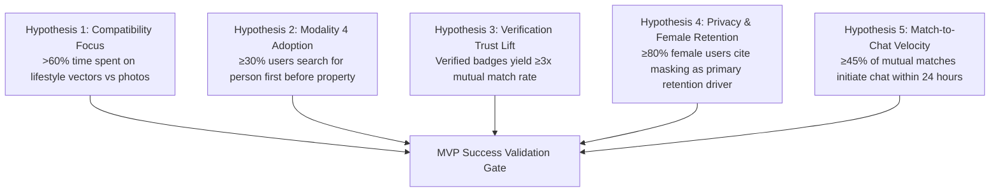
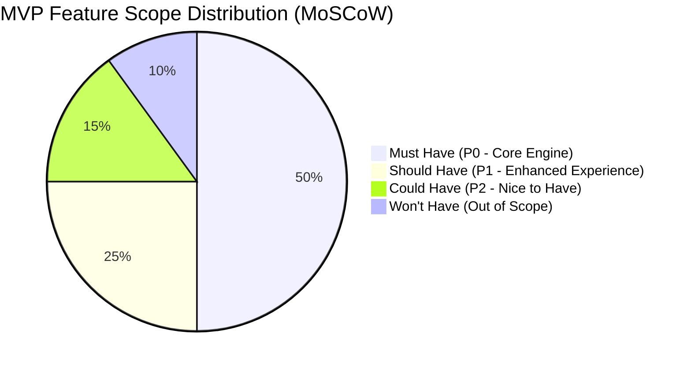
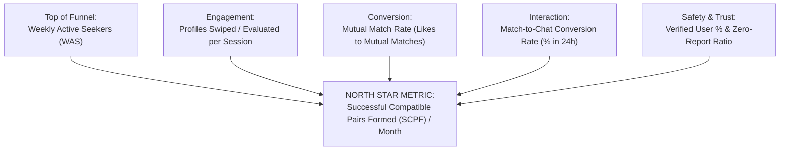
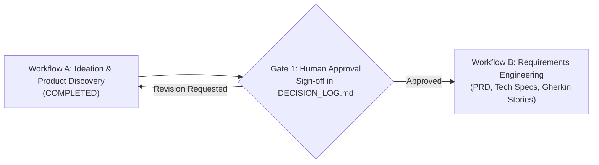

# Flatmate – MVP Scope & Validation Hypotheses

**Document Version**: 1.0.0  
**Phase**: Workflow A (Ideation & Discovery)  
**Author**: Product Strategist  
**Target Market**: Thiruvananthapuram (Trivandrum), Kerala, India  
**Status**: Ready for Human Sign-off  

---

## 1. MVP Philosophy & Guiding Principles

The Flatmate Minimum Viable Product (MVP) is engineered to validate a singular core belief: **people want to discover and choose their flatmates based on human compatibility, lifestyle harmony, and mutual trust before committing to real estate**.

### Guiding Principles
1. **Person-First over Property-First**: Accommodating listings is strictly secondary; matching compatible humans is paramount.
2. **Deterministic Matching Engine**: Compatibility calculations are rule-based, explainable, and transparent. AI is assistive (summarizing compatibility nuances), never an unexplainable black box that dictates match outcomes.
3. **Radical Safety & Privacy**: No phone numbers, exact addresses, or social handles are exposed publicly. Mutual opt-in is required before any chat begins.
4. **Lean Scope Discipline**: Features that do not directly contribute to forming a trusted, compatible flatmate pair (such as payment processing, credit checks, or legal lease drafting) are strictly deferred post-MVP.

---

## 2. Falsifiable Hypotheses

To ensure evidence-driven product validation, the MVP will test five explicit, falsifiable hypotheses.

### Hypothesis 1: Compatibility Prioritization
- **Statement**: Users value lifestyle compatibility vectors (sleep, diet, cleanliness, guest policy) more than physical room photos when deciding to initiate contact.
- **Validation Metric**: Over 60% of user profile engagement time on discovery cards is spent expanding and viewing lifestyle breakdown vectors rather than gallery photos.
- **Invalidation Threshold**: Less than 35% of users expand compatibility details; users make decisions purely on photo thumbnails and budget numbers.

### Hypothesis 2: Modality 4 (Teaming Up) Adoption
- **Statement**: A substantial portion of renters in Trivandrum desire to find a peer *first* to scout a flat together rather than joining an existing lease.
- **Validation Metric**: At least 30% of onboarding users in Trivandrum select **Modality 4 (Find person first to search together)** as their primary modality.
- **Invalidation Threshold**: Less than 10% of users select Modality 4, indicating the market only seeks existing vacant rooms.

### Hypothesis 3: Verification Badge Trust Lift
- **Statement**: Affiliation verification (CET student ID or Technopark corporate email badge) drastically increases trust and response velocity.
- **Validation Metric**: Profiles with a verified institutional/work badge achieve at least 3.0x higher mutual match rates compared to unverified profiles.
- **Invalidation Threshold**: Verified profiles receive less than 1.3x difference in match rates, indicating badges do not meaningfully sway user trust.

### Hypothesis 4: Privacy Protection as a Growth Driver for Women
- **Statement**: Masking personal phone numbers and requiring double opt-in matches eliminates harassment anxiety and accelerates organic female user acquisition.
- **Validation Metric**: At least 80% of female respondents in post-onboarding micro-surveys rate phone masking and double opt-in as the "decisive factor" in choosing Flatmate over Facebook/WhatsApp groups; female-to-male ratio reaches ≥35% within 90 days.
- **Invalidation Threshold**: High female drop-off (>60% drop before onboarding completion) or female adoption remains below 15%.

### Hypothesis 5: Match-to-Conversation Velocity
- **Statement**: High compatibility scores reduce social awkwardness and accelerate conversation initiation between matched pairs.
- **Validation Metric**: At least 45% of mutual matches initiate an in-app conversation within 24 hours of matching.
- **Invalidation Threshold**: Less than 15% of mutual matches exchange messages, indicating superficial swiping behavior without intent.

---

## 3. MoSCoW Feature Prioritization for MVP

### 3.1 Must-Have (P0 – MVP Launch Blocker)
These features are non-negotiable for the MVP launch. Without them, the core value proposition cannot be delivered.

1. **Authentication & Identity Verification**:
   - Phone OTP / Email authentication.
   - College / Corporate domain email verification (e.g., `@cet.ac.in`, `@ust.com`, `@infosys.com`) granting a verified badge.
2. **User Profile & Modality Selection**:
   - Selection of one of the 4 Discovery Modalities:
     1. *Has a room available, seeking flatmate.*
     2. *Seeking accommodation and flatmate.*
     3. *Has flat, wants to relocate with new flatmate.*
     4. *Seeking compatible person first to search together.*
   - Core Profile: Age, gender, occupation, micro-market preference (Kazhakkoottam, Kariavattom, Sreekaryam, Ulloor, Pattom, Kowdiar), budget range.
3. **Structured Lifestyle Vectors (7 Dimensions)**:
   - *Sleep Routine*: Early bird / Night owl / Shift worker.
   - *Cleanliness*: Low / Moderate / High / Strict.
   - *Dietary Preferences*: Vegetarian / Eggetarian / Non-veg / Halal; kitchen sharing comfort.
   - *Social / Guests*: Low (no guests) / Moderate (occasional friends) / High (frequent gatherings).
   - *Smoking / Alcohol / Vaping*: Non-smoker / Smoker (balcony only) / Teetotaler / Casual drinker.
   - *Financial Discipline*: Strict 1st of month / Flexible / Shared expense tracking preference.
   - *Work Schedule*: Regular office / Hybrid / 100% WFH / Night shift.
4. **Deterministic Compatibility Scoring Engine**:
   - Weighted mathematical compatibility algorithm comparing vector overlaps.
   - Transparent compatibility breakdown displayed on profile cards (0% – 100%).
5. **Discovery Interface (Card Deck & List View)**:
   - Mobile-first card deck (swipe / pass / like) and quick-toggle list view.
   - Filtering by Gender Preference, Budget Range, Modality, and Trivandrum Micro-Markets.
6. **Mutual Double Opt-In Matching**:
   - Direct messaging unlocked **only** when both users express mutual interest.
   - Zero unsolicited messages or contact leaks.
7. **In-App 1-on-1 Real-Time Messaging**:
   - Secure text messaging between mutually matched pairs.
   - Masked identity (no phone numbers or external links required).
8. **Trust, Safety & Moderation**:
   - One-click user block and report mechanism (spam, harassment, inappropriate behavior, fake profiles).
   - Immediate hiding of reported users from discovery decks pending review.

---

### 3.2 Should-Have (P1 – Target for Rapid Fast-Follow / MVP v1.1)
High-value capabilities to be rolled out immediately following initial P0 stabilization.

1. **Room Listing Attachment (For Modalities 1 & 3)**:
   - Ability for room hosts to attach 1 to 4 verified room photos, rent breakdown, and amenities (AC, Wi-Fi, attached bath, parking).
2. **AI-Assisted Compatibility Summarizer (Gemini API Integration)**:
   - Assistive natural-language summary explaining key alignment highlights and potential friction points (e.g., *"Great alignment on hygiene and budget; discuss your night shift schedule"*).
3. **Location Coarsening & Landmarks**:
   - Landmark-based radius search (e.g., *"Within 3 km of Technopark Phase I Main Gate"* or *"Within 2 km of CET campus"*).
4. **Profile Completion & Verification Reminders**:
   - Gentle prompts nudging users to complete remaining compatibility vectors to boost visibility.

---

### 3.3 Could-Have (P2 – Future Iterations / Backlog)
Desirable features to explore once initial product-market fit metrics are proven.

1. **In-Chat Lifestyle Icebreakers**:
   - Automated conversation prompts based on mutual lifestyle vectors (e.g., *"You both enjoy cooking weekend meals!"*).
2. **Shared Expense Estimator Tool**:
   - Quick utility calculator in chat estimating monthly KSEB, Wi-Fi, and maid costs per person.
3. **Saved Favorites / Bookmarks**:
   - Bookmark profiles to revisit before making a decision.

---

### 3.4 Won't-Have for MVP (Out of Scope)
Explicitly excluded from MVP scope to prevent timeline bloat and regulatory complexity.

1. **In-App Rent Payment Escrow / Financial Transactions**: Users settle rents directly via their own UPI/bank accounts. No in-app payment gateway.
2. **Legal Lease Agreement Drafting & E-Signatures**: Contract generation will not be handled in MVP.
3. **Landlord / Property Owner Management Portal**: The platform is strictly tenant-to-tenant and person-to-person.
4. **In-App Video or Audio Calling**: Communication begins via in-app chat; users transition to external calling only after mutual comfort.
5. **Native iOS & Android Binary Builds**: Initial launch is 100% focused on a **Mobile-First Responsive Web Application (PWA-ready)** to minimize deployment friction.

---

## 4. North Star Metric & Key Performance Indicators (KPIs)

### 4.1 North Star Metric
- **Successful Compatible Pairs Formed (SCPF)**:
  - *Definition*: The number of mutually matched pairs who exchange at least 10 reciprocal messages over a 48-hour window and indicate successful room sharing or flat hunt agreement in a follow-up micro-pulse prompt.

### 4.2 Primary Supporting KPIs

| Metric Category | KPI Name | MVP Target (Month 1–3) | Measurement Method |
| :--- | :--- | :--- | :--- |
| **Growth & Acquisition** | Weekly Active Seekers (WAS) | 1,500 active users | Logged-in users viewing ≥5 profile cards/week |
| **Trust & Verification** | Profile Verification Rate | ≥40% verified badges | Accounts with verified college or corporate email |
| **Discovery Engagement** | Card Engagement Depth | ≥8 cards viewed/session | Analytics telemetry on card deck views |
| **Matching Efficiency** | Mutual Match Rate | 12% to 18% of likes | Total mutual matches / total positive swipes |
| **Communication Velocity**| Match-to-Chat Conversion | ≥45% within 24 hours | Matches initiating ≥1 message within 24 hours |
| **Safety & Moderation** | Moderation Resolution Time | < 4 hours | Time from report submission to agent/system action |

---

## 5. Validation Roadmap & Workflow B Transition Gate

### Transition Checklist for Requirements Analyst:
- [x] Problem Statement defined with all 4 discovery modalities and cultural frictions.
- [x] Market research completed with Trivandrum micro-markets, demographics, and competitive benchmarking.
- [x] 4 granular user personas established with empathy profiles and lifestyle vectors.
- [x] Value Proposition Canvas and defensible competitive moats documented.
- [x] MVP scope bounded using MoSCoW prioritization with 5 falsifiable hypotheses.
- [ ] Chief Orchestrator review and human sign-off recorded.
