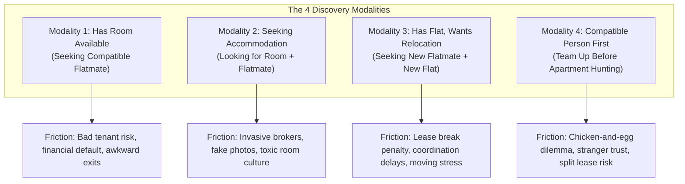
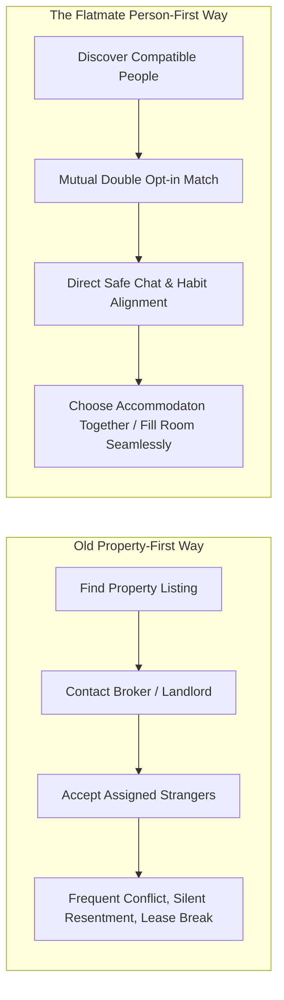

# Flatmate – Problem Statement & Friction Analysis

**Document Version**: 1.0.0  
**Phase**: Workflow A (Ideation & Discovery)  
**Author**: Product Strategist  
**Target Market**: Thiruvananthapuram (Trivandrum), Kerala, India  
**Status**: Ready for Human Sign-off  

---

## 1. Executive Summary

Finding a flatmate in urban India remains one of the most stressful, fragmented, and socially fraught life events for students and young working professionals. While traditional real-estate platforms (MagicBricks, 99acres, Housing.com) have digitized property listings, they treat accommodation as purely transactional real estate: square footage, bathrooms, and broker commission. 

However, **a shared living experience does not fail because of room dimensions—it fails because of human incompatibility**.

In Thiruvananthapuram (Trivandrum), home to major IT corridors (Technopark Phases I–III, Kinfra) and premier academic institutions (College of Engineering Trivandrum [CET], SCT College of Engineering, University of Kerala Kariavattom Campus, Government Medical College), tens of thousands of young adults relocate every year. They are forced to rely on unvetted Facebook groups, noisy WhatsApp threads, or exploitative local brokers. 

The resulting living situations frequently devolve into lifestyle clashes, financial disputes, privacy violations, moral policing, or abrupt lease terminations. Flatmate solves this fundamental failure by flipping the paradigm: **person-first compatibility discovery before property leasing, with accommodation being completely optional**.

---

## 2. The 4 User Discovery Modalities & Friction Points

Unlike traditional rental platforms that assume every user either owns a property or needs to rent an entire empty flat, Flatmate recognizes **4 distinct discovery modalities**. Each modality carries its own distinct operational friction, emotional anxiety, and financial risk.

### 2.1 Modality 1: Has a Room Available in Existing Flat (Seeking Flatmate)
- **User Situation**: A tenant already holds a lease on a 2BHK or 3BHK flat in Kazhakkoottam or Sreekaryam, and a previous flatmate graduated or changed jobs. They need someone to fill the vacant room immediately to prevent paying double rent.
- **Critical Frictions**:
  1. **Financial Pressure & Rent Bleed**: The existing tenant is legally responsible to the landlord for the full flat rent (e.g., ₹18,000/month). Every week without a flatmate drains their personal savings.
  2. **Information Asymmetry**: Strangers from Facebook or OLX respond with "Interested", but there is no mechanism to verify their background, hygiene standards, or work habits.
  3. **The "Stranger in My Sanctuary" Dread**: Bringing an unvetted person into an established home risks theft, safety threats, substance abuse, or toxic conflicts.
  4. **Awkward Exit Negotiations**: If the newcomer turns out to be incompatible, evicting them without formal intermediary mechanisms is socially awkward and emotionally exhausting.

### 2.2 Modality 2: Seeking Accommodation and Flatmate
- **User Situation**: A fresh graduate joining Infosys at Technopark or a CET student moving out of the college hostel seeking a room in an occupied flat.
- **Critical Frictions**:
  1. **Broker Exploitation**: Local brokers demand 15 to 30 days' rent as non-refundable brokerage just to show run-down apartments.
  2. **Misleading Listings & Ghost Rooms**: Listings on classified portals frequently show bait-and-switch photos; when visited, the room is cramped, windowless, or lacks promised Wi-Fi/power backup.
  3. **Pre-existing Dominance Hierarchy**: Moving into an existing flat where current roommates have established entrenched habits, leaving the newcomer feeling alienated, excluded, or burdened with unfair chores.
  4. **Safety & Identity Vulnerability**: For women and LGBTQ+ individuals, visiting unknown flats or sharing phone numbers publicly on social channels leads to unsolicited messages, stalking, and harassment.

### 2.3 Modality 3: Has Accommodation but Wants to Relocate with a New Flatmate
- **User Situation**: A tenant currently residing in an apartment who is deeply dissatisfied with their current living situation (e.g., noisy flatmates, exorbitant rent hike, bad landlord) and wants to move out, but cannot afford a single 1BHK.
- **Critical Frictions**:
  1. **Lease Termination Deadlines**: Notice periods (typically 1 to 2 months) force the user to coordinate finding a new flatmate and new flat simultaneously.
  2. **Social Discomfort**: Living with existing flatmates while actively looking to move out creates household passive-aggressiveness and tension.
  3. **Logistical Overload**: Managing packers-and-movers, deposit refunds from current landlord, and deposit advance to a new landlord while managing daily work shifts.

### 2.4 Modality 4: Seeking a Compatible Person First (Team Up Before Searching Together)
- **User Situation**: A user does not have a flat, refuses to move into an established group's leftover room, and desires to find 1 or 2 equal partners first to collaboratively scout and lease a fresh 2BHK/3BHK together.
- **Critical Frictions**:
  1. **The "Chicken-and-Egg" Deadlock**: Existing property platforms require an address to create a listing. There is no mainstream platform where two individuals can find each other based on lifestyle compatibility *before* selecting real estate.
  2. **Lack of Discovery Tools**: Users resort to posting vague paragraphs on Reddit (`r/Trivandrum`) or Technopark Facebook groups: *"Looking for a male flatmate to take a 2BHK near UST Global"*, yielding low signal-to-noise ratio and dead-end direct messages.
  3. **Commitment Mismatch**: One party might commit to hunting for a flat, but back out at the last second when a lease deposit is due, stranding the other party.

---

## 3. Cultural, Lifestyle & Behavioral Frictions in Urban Kerala

Flatmate compatibility fails most severely not on macro demographics, but on granular, daily friction vectors that compound over time. In the cultural context of Thiruvananthapuram, Kerala, these friction points have distinct regional nuances:

### 3.1 Sleep Schedules & Work Rhythms
- **The Friction**: Technopark IT companies (e.g., UST, Infosys, Allianz, IBS Software, Tata Elxsi) operate across multiple time zones (US, UK, Middle East). Employees working night shifts (6:00 PM – 3:00 AM or 10:00 PM – 7:00 AM) need complete daylight quiet and dark rooms.
- **The Clash**: Pairing a night-shift software engineer with a CET student attending 8:30 AM lectures or an early-bird government employee causes perpetual sleep deprivation, door-slamming arguments, and resentment.

### 3.2 Cleanliness, Hygiene & Chore Accountability
- **The Friction**: Cleanliness is subjective until dishes pile up in the sink.
- **The Clash**:
  - *Kitchen sink dynamics*: Leaving greasy pans overnight attracts pests (common in Kerala's humid tropical climate).
  - *Bathroom hygiene*: Sharing a single bathroom between two flatmates when one expects dry bathroom floors and the other leaves wet footprints, hair in drains, and empty soap dispensers.
  - *Common area maintenance*: Disagreements over hiring a domestic maid (costing ₹1,500–₹2,500/month per flat) versus manual DIY cleaning schedules.

### 3.3 Dietary Preferences & Kitchen Sharing
- **The Regional Context**: Kerala has a rich and diverse culinary culture, but food choices are intensely sensitive.
- **The Clash**:
  - Strict vegetarians uncomfortable with the smell, storage, or cooking of fish, beef, chicken, or eggs in the same kitchen.
  - Non-vegetarians feeling judged or restricted from preparing traditional coastal Kerala fish curries or meat dishes.
  - Utensil separation: Sharing cookware vs maintaining strict separate pans and refrigerator shelves.

### 3.4 Social Habits, Substance Tolerance & Guest Policies
- **The Friction**: Divergent expectations of home as a "sanctuary" versus home as a "social lounge".
- **The Clash**:
  - *Smoking / Alcohol / Vaping*: Flatmates who strictly oppose smoking indoors or second-hand smoke vs casual smokers.
  - *Romantic Partners & Overnight Guests*: Kerala's residential neighborhoods and resident welfare associations (RWAs) often engage in conservative moral policing. Having frequent overnight guests of the opposite sex can trigger landlord threats of eviction if not aligned between flatmates.
  - *Party frequency & noise*: Weekend late-night gatherings, loud speakers, and unannounced visits from hometown friends.

### 3.5 Financial Discipline & Shared Utility Tracking
- **The Friction**: Rent is only the first cost; shared variable expenses create recurring daily bitterness.
- **The Clash**:
  - *Summer Air Conditioning Bills*: Trivandrum's summer humidity leads to high AC usage. If one roommate runs AC for 12 hours a day and the other only uses a ceiling fan, splitting the ₹4,000 Kerala State Electricity Board (KSEB) bi-monthly bill 50/50 creates intense conflict.
  - *Shared Consumables*: Wi-Fi router bill (₹700–₹1,000/mo), drinking water cans (₹60/can), cooking gas cylinder (₹900), cooking oil, spices, and cleaning supplies.
  - *Delayed Payments*: One flatmate paying rent promptly on the 1st of the month, while the other delays until the 15th, causing late fees and landlord harassment.

### 3.6 Moral Policing, Landlord Surveillance & Safety for Women
- **The Regional Reality**: Trivandrum's residential pockets (Kowdiar, Sreekaryam, Kazhakkoottam, Pattom) are heavily governed by traditional landlords and neighborhood associations.
- **The Clash**:
  - Landlords often impose paternalistic curfews (e.g., gates locked at 9:30 PM), intrusive questions about visitors, and unsolicited house inspections.
  - Female students and professionals face intense scrutiny regarding their working hours and visitors.
  - Finding a flatmate who stands united against unjust landlord intrusion versus one who cowers or tattles is essential for psychological safety.

---

## 4. Why Existing Solutions Consistently Fail

| Channel / Competitor | How It Operates | Why It Fails for Flatmate Discovery |
| :--- | :--- | :--- |
| **Local Property Brokers** | Offline intermediaries charging 15–30 days brokerage fee. | Pushes whatever vacant room pays the highest commission; zero interest in human compatibility, values, or safety. High pressure, zero accountability post-lease. |
| **Facebook Groups** *(e.g., "Flat and Flatmates Trivandrum")* | Public posts with photos and phone numbers. | Unstructured spam, zero verification, high scam risk, phone numbers exposed to stalkers, dead listings from 6 months ago remain active, no compatibility filtering. |
| **WhatsApp / Telegram Groups** | Informal community broadcast channels. | High noise, messages get buried in seconds, zero searchability, invasive privacy exposure, no structured profiles or mutual matching. |
| **OLX / Quikr Classifieds** | Generic marketplace listings. | Infested with broker spam, outdated bait-and-switch listings, zero social context, no safety verification, highly transactional. |
| **NoBroker / 99acres / MagicBricks** | Property-centric listing portals. | Optimised for landlords leasing entire apartments. Forces property-first workflow. Completely ignores roommate habits, personality, and lifestyle vectors. Modality 4 (person first) is non-existent. |

---

## 5. The Flatmate Paradigm Shift

By placing **lifestyle compatibility, trust verification, and person-first discovery** at the core, Flatmate removes the emotional, social, and financial frictions of shared living in Trivandrum.
