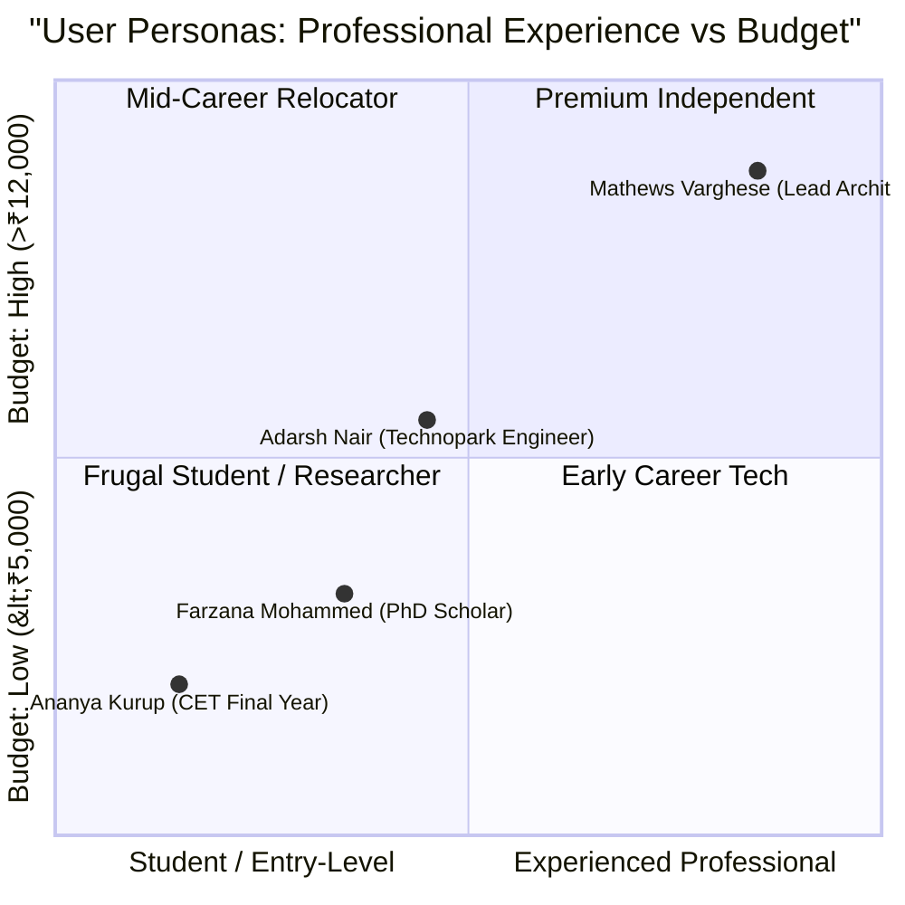

# Flatmate – User Personas & Empathy Profiles

**Document Version**: 1.0.0  
**Phase**: Workflow A (Ideation & Discovery)  
**Author**: Product Strategist  
**Target Market**: Thiruvananthapuram (Trivandrum), Kerala, India  
**Status**: Ready for Human Sign-off  

---

## 1. Persona Overview & Framework

To ensure that the Flatmate platform directly addresses real behavioral nuances, we define four detailed, grounded user personas spanning our primary demographic pillars: **College Students** and **Working Professionals** across Trivandrum's academic and tech hubs.

---

## 2. Granular Persona Profiles

### 2.1 Persona 1: The Technopark Software Engineer

#### Demographics & Context
- **Name**: Adarsh Nair
- **Age**: 24
- **Occupation**: Junior Software Engineer, UST Global (Technopark Phase II)
- **Hometown**: Thrissur, Kerala (moved to Trivandrum 14 months ago)
- **Location**: Currently staying in a cramped PG in Kazhakkoottam, looking to move to a 2BHK/3BHK
- **Monthly Income**: ₹48,000/month
- **Rental Budget**: ₹6,000 – ₹8,500/month (per head)
- **Preferred Modality**: **Modality 4 (Seeking compatible person first to hunt a flat together)** and **Modality 2 (Looking for a room & flatmate)**

#### Empathy Map
| Dimension | Observations |
| :--- | :--- |
| **Says** | *"I don't mind paying slightly more as long as my flatmate is chill, doesn't freak out if I play games on weekends, and splits electricity bills on time."* |
| **Thinks** | *"My current PG is depressing and offers zero privacy. But if I rent a 2BHK alone, I'll blow half my salary on rent and deposits. I need one good guy from Technopark to split a decent flat near the bypass."* |
| **Does** | Scrolls WhatsApp alumni groups and Facebook groups; gets annoyed by broker posts with watermark phone numbers; visits flats on two-wheeler during Saturday afternoons. |
| **Feels** | Drained by workday context-switching; anxious about being locked into an 11-month lease with a roommate who refuses to clean or pay bills. |

#### Goals & Motivations
- Live within a 15-minute two-wheeler commute of Technopark Phase II.
- Have a quiet, comfortable desk setup for hybrid Work-From-Home (2 days/week).
- Share an apartment with a peer who respects sleep schedules and values personal downtime.

#### Frustrations & Pain Points
- Current PG serves oily food and has strict 10:00 PM entry curfews.
- Brokers demand ₹15,000 upfront commission for dirty, unpainted apartments.
- Facebook groups expose his personal phone number, leading to spam calls from real estate agents during work meetings.

#### Lifestyle Vectors
- **Sleep Schedule**: Night owl (Sleeps 1:00 AM – 8:00 AM).
- **Cleanliness**: Moderate; believes in hiring a weekly domestic maid for deep cleaning and taking turns doing daily kitchen dishes.
- **Dietary & Kitchen**: Non-vegetarian (enjoys chicken/fish; orders Swiggy/Zomato on weekdays, cooks simple breakfasts).
- **Social & Guests**: Enjoys having 1 or 2 friends over on Friday nights for movies/PlayStation; strictly no indoor smoking; casual beer drinker.
- **Financial Split**: Pays rent on the 1st of every month via UPI; expects immediate 50/50 division of Wi-Fi and KSEB electricity bills.
- **Work Rhythm**: Hybrid (3 days office in Technopark, 2 days WFH).

---

### 2.2 Persona 2: The CET Final-Year Engineering Student

#### Demographics & Context
- **Name**: Ananya Kurup
- **Age**: 21
- **Occupation**: Final-Year B.Tech Computer Science, College of Engineering Trivandrum (CET)
- **Hometown**: Kozhikode, Kerala
- **Location**: Currently renting a 2BHK flat near Sreekaryam with a graduating senior
- **Monthly Allowance / Stipend**: ₹10,000/month (parental allowance + internship stipend)
- **Rental Budget**: ₹3,500 – ₹4,800/month (per head)
- **Preferred Modality**: **Modality 1 (Has a room available, seeking compatible female flatmate)**

#### Empathy Map
| Dimension | Observations |
| :--- | :--- |
| **Says** | *"I need a female flatmate who is focused on studies, won't invite random people without warning, and won't get us into trouble with our nosy landlord."* |
| **Thinks** | *"My senior is graduating in two months. If I don't find someone compatible to take her room, I cannot afford the ₹9,000 flat rent alone, and my parents will force me into a strict ladies' hostel with a 6:30 PM curfew."* |
| **Does** | Posts in CET campus groups; screens replies aggressively; rejects anyone who doesn't study at CET or work at a verified company; conceals her personal phone number. |
| **Feels** | Protective of her safety and independence; deeply apprehensive about creepy strangers or judgment from neighborhood moral policing. |

#### Goals & Motivations
- Find a verified female student or young professional to fill the second bedroom by next month.
- Protect personal privacy and maintain an uninterrupted, high-focus study environment for placement preparations.
- Maintain rental independence without surrendering to hostel restrictions.

#### Frustrations & Pain Points
- Floods of irrelevant and creepy direct messages when posting on social media channels.
- Landlord interrogates every visitor and threatens rent hikes if rules are violated.
- Fear of flatmates who bring loud crowds or violate agreed-upon safety protocols.

#### Lifestyle Vectors
- **Sleep Schedule**: Moderate (Sleeps 11:30 PM – 7:00 AM).
- **Cleanliness**: High; maintains clean kitchen counters, dry bathroom floor, and a strict rotational cleaning roster.
- **Dietary & Kitchen**: Vegetarian/Eggetarian; prepares simple meals at home and shares grocery costs transparently.
- **Social & Guests**: Low visitor tolerance; female friends allowed for group study; strictly no male overnight guests due to landlord restrictions.
- **Financial Split**: Meticulous budget tracker; splits water, LPG, and internet bills down to the rupee.
- **Safety & Privacy**: Non-negotiable; demands college ID verification and phone number masking until complete trust is established.

---

### 2.3 Persona 3: The Relocating Senior Tech Lead

#### Demographics & Context
- **Name**: Mathews Varghese
- **Age**: 29
- **Occupation**: Lead Cloud Architect, moving from Bengaluru to Allianz Technology (Technopark Phase I)
- **Hometown**: Kottayam, Kerala
- **Location**: Relocating to Trivandrum next month; seeking a premium flat in Kazhakkoottam or Kowdiar
- **Monthly Income**: ₹1,35,000/month
- **Rental Budget**: ₹11,000 – ₹16,000/month (per head for luxury shared 3BHK or independent floor)
- **Preferred Modality**: **Modality 4 (Seeking high-caliber professional peer first before leasing a premium apartment)**

#### Empathy Map
| Dimension | Observations |
| :--- | :--- |
| **Says** | *"I'm done with college-style chaotic bachelor pads. I want a clean, well-furnished home with an adult who respects boundaries, keeps common spaces pristine, and understands professional decorum."* |
| **Thinks** | *"Living alone in a 2BHK costs ₹25,000 plus ₹1,00,000 deposit, which is wasteful. If I team up with another senior engineer or doctor, we can lease a luxury 3BHK penthouse with a gym, pool, and dedicated parking for less than half that."* |
| **Does** | Uses LinkedIn and premium tech networks; avoids local brokers who waste time with sub-par properties; values speed, cleanliness, and clear legal agreements. |
| **Feels** | Time-poor and exhausted by relocation logistics; desires a stress-free transition without domestic drama. |

#### Goals & Motivations
- Secure a modern, fully furnished 3BHK flat near Technopark Phase I with 100% power backup.
- Pair with an established professional who shares similar maturity, career focus, and aesthetic standards.
- Minimize relocation friction and avoid predatory broker fees.

#### Frustrations & Pain Points
- Finding like-minded peers who are willing to invest in quality furnishings, domestic help, and air conditioning.
- Outdated properties in Trivandrum with poor electrical wiring or unreliable water supply.
- Dealing with traditional brokers who do not understand corporate relocation needs.

#### Lifestyle Vectors
- **Sleep Schedule**: Regular (Sleeps 12:00 AM – 7:30 AM).
- **Cleanliness**: Very High; insists on daily full-time maid for cooking, dishwashing, and floor mopping.
- **Dietary & Kitchen**: Non-vegetarian; values healthy eating, high-protein diet; shares kitchen with clear boundary respect.
- **Social & Guests**: Professional socializer; occasional weekend dinner parties or colleagues over for drinks; values respectful quiet on weeknights.
- **Financial Split**: Instant automated bank transfers; willing to pay a premium for convenience and high-speed multi-gigabit broadband.
- **Work Rhythm**: Hybrid / Global calls (requires dedicated quiet room for evening client conferences).

---

### 2.4 Persona 4: The University Postgraduate Researcher

#### Demographics & Context
- **Name**: Farzana Mohammed
- **Age**: 26
- **Occupation**: Ph.D. Scholar in Computational Biology, University of Kerala (Kariavattom Campus)
- **Hometown**: Malappuram, Kerala
- **Location**: Currently in a university hostel near Kariavattom; looking to relocate to an independent apartment
- **Monthly Fellowship**: ₹37,000/month (JRF Fellowship)
- **Rental Budget**: ₹4,500 – ₹6,500/month
- **Preferred Modality**: **Modality 3 (Relocating from hostel, seeking new flatmate & flat near Kariavattom)**

#### Empathy Map
| Dimension | Observations |
| :--- | :--- |
| **Says** | *"I need a quiet, peaceful space where I can read papers late at night without roommates yelling or playing loud Instagram reels. Academic peace of mind is my top priority."* |
| **Thinks** | *"Hostel life is no longer sustainable for doctoral research. The noise, shared bathrooms, and food restrictions are breaking my concentration. I need a dependable female flatmate—perhaps another PhD scholar or young lecturer—to split an apartment nearby."* |
| **Does** | Spends 12 hours a day at the research lab; studies in the department library; searches notice boards and student circles for accommodation leads. |
| **Feels** | Mentally exhausted from doctoral workload; anxious about spending too much time house-hunting; desires a calm, respectful sanctuary. |

#### Goals & Motivations
- Find a quiet, independent room within walking or cycling distance of the Kariavattom university campus.
- Pair with a female scholar, teacher, or tech professional with similar introverted and studious habits.
- Maintain high dietary hygiene and predictable monthly living expenses.

#### Frustrations & Pain Points
- Undergraduates in shared accommodation keeping unpredictable hours and creating noise.
- Landlords demanding proof of employment and treating research scholars with skepticism.
- Unreliable internet connection affecting late-night data analysis and paper submissions.

#### Lifestyle Vectors
- **Sleep Schedule**: Flexible / Academic (Often studies until 2:00 AM, wakes at 8:30 AM).
- **Cleanliness**: High; values order, quiet, and spotless shared spaces.
- **Dietary & Kitchen**: Halal / Vegetarian cooking; prepares traditional Kerala dishes; enjoys quiet tea breaks.
- **Social & Guests**: Low social noise; introverted; visits hometown once a month; rarely hosts guests.
- **Financial Split**: Highly disciplined; pays all dues immediately upon receiving monthly fellowship credit.
- **Safety & Privacy**: High; seeks an environment free of judgment, intrusive inquiries, or neighborhood surveillance.

---

## 3. Persona Comparison & Vector Alignment Matrix

| Attribute / Vector | Adarsh Nair (Technopark Engineer) | Ananya Kurup (CET Final Year) | Mathews Varghese (Relocating Lead) | Farzana Mohammed (PhD Researcher) |
| :--- | :--- | :--- | :--- | :--- |
| **Target Micro-Market** | Kazhakkoottam (Near Tech Phase II) | Kulathoor / Sreekaryam | Kazhakkoottam / Kowdiar | Kariavattom / Pangappara |
| **Primary Modality** | Modality 4 (Team up first) | Modality 1 (Room available) | Modality 4 (Team up first) | Modality 3 (Relocating) |
| **Monthly Budget** | ₹6,000 – ₹8,500 | ₹3,500 – ₹4,800 | ₹11,000 – ₹16,000 | ₹4,500 – ₹6,500 |
| **Sleep Rhythm** | 1:00 AM – 8:00 AM | 11:30 PM – 7:00 AM | 12:00 AM – 7:30 AM | 2:00 AM – 8:30 AM |
| **Cleanliness Standard** | Moderate (maid + shared duty) | High (strict roster) | Very High (full-time maid) | High (orderly & quiet) |
| **Dietary Preference** | Non-veg (flexible) | Veg / Eggetarian | Non-veg (high-protein) | Halal / Veg |
| **Social / Guest Tolerance** | Moderate (weekend gaming) | Low (female study only) | High (professional decorum) | Very Low (quiet sanctuary) |
| **Verification Priority** | Moderate (Work badge) | Critical (College ID + Phone Mask) | High (Corporate domain) | High (Univ affiliation) |
| **Key Platform Hook** | Routine compatibility score | Women safety & masked identity | High-caliber professional filter | Proximity to lab + quiet index |
