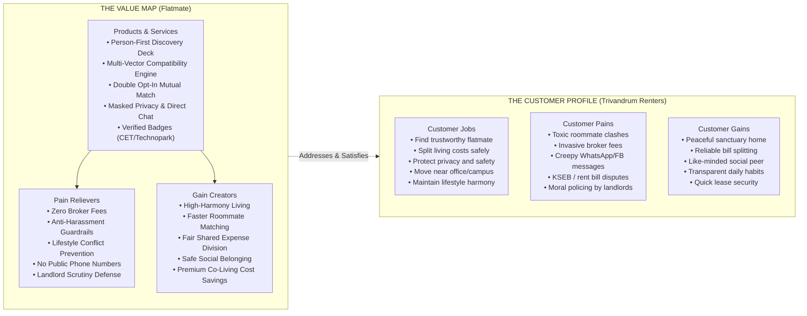
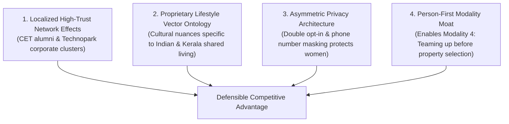

# Flatmate – Value Proposition & Competitive Moats

**Document Version**: 1.0.0  
**Phase**: Workflow A (Ideation & Discovery)  
**Author**: Product Strategist  
**Target Market**: Thiruvananthapuram (Trivandrum), Kerala, India  
**Status**: Ready for Human Sign-off  

---

## 1. Executive Summary

Traditional real estate portals (MagicBricks, 99acres) and local property brokers view shared accommodation as a property transaction: their customer is the landlord, and their inventory is bricks and mortar. They force users to adapt to whoever happens to occupy a room, leading to severe personality mismatches, emotional distress, and financial losses.

**Flatmate flips this model upside down.** Flatmate is a **person-first compatibility platform** that treats shared living as a long-term human relationship. By prioritizing compatibility vectors, psychological safety, and mutual opt-in discovery, Flatmate empowers students and working professionals in Trivandrum to choose *who* they live with before deciding *where* they live.

---

## 2. Strategyzer Value Proposition Canvas

---

## 3. Customer Profile Breakdown

### 3.1 Customer Jobs (What Users are Trying to Accomplish)

#### Functional Jobs
- Find an affordable, hygienic, and convenient place to live within a reasonable commute of Technopark or college campuses (CET, Univ of Kerala).
- Replace an outgoing roommate to avoid bearing the burden of double rent.
- Find a responsible co-tenant to split security deposits (₹30,000 – ₹80,000) and recurring bills (rent, KSEB electricity, high-speed Wi-Fi).
- Verify the identity and background of a stranger before inviting them into an apartment.

#### Social Jobs
- Avoid social embarrassment or awkward conflicts with roommates in front of peers.
- Live with someone who shares similar professional or academic status.
- Maintain a reputable standing with landlords and residential welfare associations (RWAs) in Trivandrum.

#### Emotional & Psychological Jobs
- Feel safe, respected, and unthreatened in one's private living space.
- Experience the psychological relief of coming home to a peaceful, conflict-free sanctuary after demanding 10-hour work shifts or lab sessions.
- Overcome the loneliness and alienation of relocating to a new city without friends or family.

---

## 4. Value Map Breakdown

### 4.1 Products & Services
1. **Person-First Discovery Deck & List**: Engaging, intuitive swipeable and scrollable profile cards displaying lifestyle vectors, personal bios, and living habits.
2. **Deterministic Compatibility Scoring Engine**: A transparent, multi-dimensional algorithm calculating compatibility percentages across 7 key vectors: Sleep Rhythms, Cleanliness, Food & Kitchen Sharing, Social/Guests, Financial Discipline, Work-from-Home Habits, and Pet/Substance Preferences.
3. **Mutual Double Opt-In Matching**: Contact and direct messaging can only be unlocked when **both** parties express mutual interest, completely eliminating unsolicited messages.
4. **Institutional Verification Badges**: Verified badges tied to official college domains (e.g., `@cet.ac.in`, `@keralauniversity.ac.in`) or Technopark corporate domains (e.g., `@ust.com`, `@infosys.com`, `@allianz.com`).
5. **Hyperlocal Micro-Market Filtering**: Filter candidates across key Trivandrum transit corridors (Kazhakkoottam, Kariavattom, Sreekaryam, Ulloor, Pattom, Kowdiar).
6. **Assistive AI Explanations**: Contextual, non-deterministic summaries generated by Gemini API explaining the nuances of compatibility (e.g., *"Adarsh and Mathews have 88% compatibility: both value high cleanliness and quiet weeknights, but note that Adarsh is a night owl while Mathews wakes early"*).

### 4.2 Pain Relievers (How Flatmate Relieves Friction)

| User Pain Point | How Flatmate Relieves It |
| :--- | :--- |
| **Predatory Broker Fees** | 100% direct peer-to-peer matching with zero broker commissions, saving each user ₹8,000 – ₹20,000 upfront. |
| **Invasive Stalking & Harassment** | Zero public phone number disclosure. Location is coarsened to neighborhood clusters (no building names until matched). Women have full control over who sees their profile. |
| **Toxic Roommate Clashes** | Objective lifestyle vector matching prevents sleep disruption, kitchen conflict, and cleanliness mismatches before signing a lease. |
| **Dead Listings & Zombie Threads** | Active availability toggles; profiles auto-expire or pause when a room is filled or a teammate is found. |
| **Financial Default & Late Rent** | Financial split expectations and payment discipline scores are surfaced upfront during profile discovery. |

### 4.3 Gain Creators (How Flatmate Creates Value)

| Desired Gain | How Flatmate Creates It |
| :--- | :--- |
| **Peace of Mind & Home Sanctuary** | Ensuring that home is a restful sanctuary by matching people with harmonious routines and social noise levels. |
| **Accelerated Relocation** | Reducing the average flatmate discovery cycle from 3–4 chaotic weeks to 48–72 hours of targeted mutual matches. |
| **Access to Superior Properties** | Modality 4 (teaming up first) enables two or three individuals to pool budgets and rent luxury flats (with gyms, pools, and security) they could never afford alone. |
| **Trust & Belonging** | Verified corporate and academic badges create an instant foundation of trust and accountability. |

---

## 5. Defensible Competitive Moats

Flatmate builds defensible long-term competitive advantages that cannot be easily replicated by classifieds or legacy real estate portals:

### 5.1 Localized High-Trust Network Effects
- In concentrated tech and academic clusters like Kazhakkoottam and CET, word-of-mouth adoption spreads via office Slack channels and student batches.
- Once a critical mass of verified CET students and Technopark employees join Flatmate, any incoming fresher or new hire is organically directed to Flatmate rather than chaotic Facebook groups.

### 5.2 Proprietary Lifestyle Vector Ontology
- Generic dating apps fail because they optimize for romantic chemistry; generic rental portals fail because they optimize for square footage.
- Flatmate owns the specific domain ontology of shared co-living in India: KSEB bill splits, maid arrangements, vegetarian/non-vegetarian kitchen segregation, and landlord curfew navigation.

### 5.3 Asymmetric Privacy & Safety Architecture
- In Kerala's cultural environment, safety for women is the paramount gatekeeper of platform adoption.
- Platforms that expose phone numbers (Facebook, WhatsApp, OLX) suffer high churn and abandonment by female users. Flatmate's strict double opt-in, masked discovery, and zero-tolerance reporting build unshakeable brand trust.

### 5.4 The "Modality 4" Strategic Lock-in
- Real estate portals cannot serve Modality 4 (seeking a person first before searching for a property) because their entire monetization and database architecture relies on existing property listings.
- Flatmate captures the user at the very top of the funnel—before they even search for a house.

---

## 6. Strategic Positioning Statement

Following Geoffrey Moore's positioning framework:

> **For** young working professionals (Technopark ecosystem) and college students (CET, University of Kerala) in Thiruvananthapuram,  
> **Who** struggle with stressful roommate mismatches, invasive broker commissions, and unsafe social media classifieds,  
> **Flatmate** is a person-first co-living compatibility platform  
> **That** connects verified individuals based on living habits, daily routines, and shared values—with accommodation being completely optional.  
> **Unlike** generic real-estate portals (MagicBricks, 99acres), predatory local brokers, and chaotic WhatsApp groups,  
> **Our platform** guarantees psychological safety, mutual double opt-in matching, verified affiliations, and deterministic compatibility scoring to ensure shared living is peaceful, affordable, and conflict-free.
