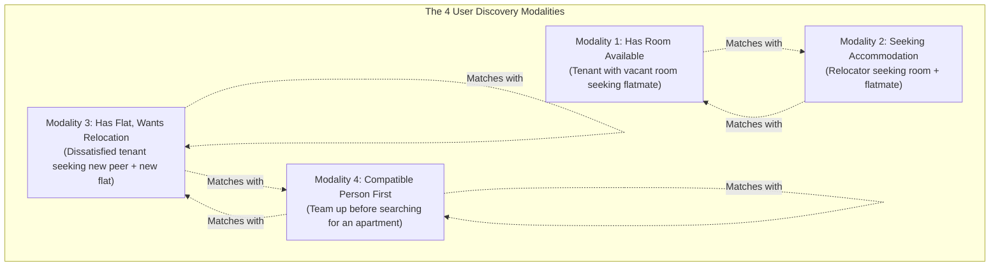
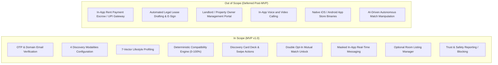
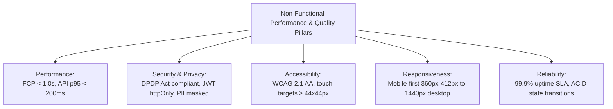
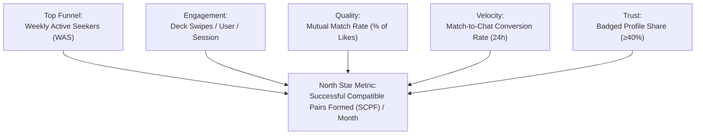

# Product Requirements Document (PRD) – Project Flatmate

**Document Title**: Flatmate Core Platform – Minimum Viable Product (MVP v1.0)  
**Author**: Requirements Analyst  
**Reviewers**: Product Strategist, UX Designer, Solution Architect, Chief Orchestrator  
**Status**: Ready for Human Sign-off (Level 2 Complete -> Level 3 human gate)  
**Date**: 2026-11-13  
**Target Release**: MVP v1.0 (Initial Launch: Thiruvananthapuram, Kerala, India)

---

## 1. Executive Summary & Problem Context

### 1.1 Problem Statement
Finding a compatible flatmate in urban India is fraught with social friction, cultural clashes, privacy violations, and financial risk. While traditional real estate portals (e.g., MagicBricks, 99acres) digitize square footage and broker listings, shared living arrangements fail not because of floor dimensions, but because of **human incompatibility**.

In Thiruvananthapuram (Trivandrum)—Kerala's premier IT hub (Technopark Phases I–III, Kinfra) and academic center (College of Engineering Trivandrum [CET], SCT, University of Kerala Kariavattom Campus)—thousands of young professionals and students relocate annually. They are currently forced into unvetted WhatsApp groups, noisy Facebook threads, or exploitative broker networks. Women, students, and night-shift IT workers face particular vulnerabilities: unsolicited phone calls, moral policing from conservative neighborhood associations, lifestyle clashes over sleep or food, and unexpected lease breakages.

Flatmate solves this systemic failure by introducing a **person-first flatmate discovery and lifestyle compatibility platform**, where accommodation listings are completely optional and trust, safety, and mutual consent are foundational.

### 1.2 Target Audience & The 4 Discovery Modalities
Flatmate explicitly accommodates four distinct discovery modalities rather than forcing a rigid "room owner vs room seeker" binary:

- **Modality 1 (Has Room Available)**: Existing leaseholder needs to fill a vacant bedroom immediately to stop rent bleed without sacrificing personal sanctuary safety.
- **Modality 2 (Seeking Accommodation)**: Fresh graduate or relocated professional seeking a move-in ready room in a safe flat with vetted roommates.
- **Modality 3 (Has Flat, Wants Relocation)**: Renter unhappy with their current living situation seeking to transition smoothly to a new flat with a compatible companion.
- **Modality 4 (Compatible Person First)**: Renters teaming up as equal partners to scout and sign a new lease together, avoiding the subordinate dynamics of filling someone else's spare room.

### 1.3 Business Objectives & Core Hypotheses
Flatmate MVP is engineered to validate 5 falsifiable product hypotheses:
1. **Compatibility Prioritization (H1)**: >60% of user profile engagement time on discovery cards is spent reviewing 7-vector lifestyle compatibility details rather than purely viewing gallery photos.
2. **Modality 4 Adoption (H2)**: ≥30% of onboarding users select Modality 4 (team up first), proving demand for person-first matching before real estate selection.
3. **Verification Trust Lift (H3)**: Profiles with verified institutional/corporate badges achieve ≥3.0x higher mutual match rates compared to unverified profiles.
4. **Privacy & Female Retention (H4)**: Masked contact details and strict double opt-in matching achieve ≥80% satisfaction in female user surveys and maintain a ≥35% female user ratio.
5. **Match-to-Chat Velocity (H5)**: ≥45% of mutual matches initiate an in-app conversation within 24 hours of matching.

---

## 2. Scope & Non-Goals

### 2.1 In Scope (MVP v1.0)
1. **Authentication & Badging**: Phone OTP authentication with JWT sessions; academic (`@cet.ac.in`) and corporate (`@ust.com`, `@infosys.com`) domain email badge verification.
2. **Modality & Micro-Market Configuration**: Full support for Modalities 1–4 across Trivandrum key zones (Kazhakkoottam, Kariavattom, Sreekaryam, Ulloor, Pattom, Kowdiar, Manacaud).
3. **7-Vector Compatibility Model**: Standardized questionnaire capturing Sleep Schedule, Cleanliness, Dietary/Kitchen sharing, Social/Guest policy, Substance tolerance, Financial discipline, and Work rhythm.
4. **Deterministic Matching Engine**: Transparent, weighted mathematical scoring (0%–100%) with hard dealbreaker filtering (gender, non-negotiable dietary/smoking rules).
5. **Mobile-First Discovery Deck**: Card stack interface supporting swipe left (Pass), swipe right (Like), Super-Like, and full lifestyle card expansion; accompanied by a compact list view.
6. **Double Opt-In Matching**: Direct messaging is locked until both parties swipe right, preventing unsolicited contact.
7. **Real-Time Masked Chat**: 1-on-1 WebSocket text messaging with DPDP-compliant contact masking (no phone numbers or exact residential addresses exposed).
8. **Optional Room Listing Attachment**: Room hosts (Modalities 1 & 3) can upload up to 4 room photos, rent breakdown, security deposit, and basic amenities.
9. **Trust, Safety & Moderation**: Instant user block, report categorization (harassment, scam, fake, moral policing), and automated discovery quarantine upon report threshold trigger.

### 2.2 Out of Scope (Strict Non-Goals for MVP)
- **Financial Escrow & Rent Collection**: No in-app payment transactions; users settle deposits through personal UPI.
- **Lease Drafting & Digital Signatures**: Legal agreement templates and Aadhaar e-signatures are deferred to Phase 2.
- **Landlord / Broker Portal**: The platform exclusively serves flatmate-to-flatmate discovery. Commercial brokers and standalone landlords are prohibited.
- **Native Mobile Apps (App Store / Play Store)**: The MVP is delivered strictly as a responsive, PWA-ready Next.js web application.
- **Voice / Video Calling**: In-app communication is limited to text. Users transition to phone calls or in-person meetings at their own discretion.

---

## 3. User Personas & Scenarios

| Persona | Archetype | Modality | Primary Goal | Critical Pain Point |
| :--- | :--- | :--- | :--- | :--- |
| **Adarsh Nair (24)** | Technopark Software Engineer | M4 (Team Up First) & M2 | Find a fellow techie to split a 2BHK flat near Kazhakkoottam. | Current PG offers zero privacy; terrified of unhygienic or noisy flatmates who ruin sleep. |
| **Ananya Kurup (21)** | CET Final-Year Engineering Student | M2 (Seeking Room + Flatmate) | Move out of college hostel into an existing flat near Sreekaryam. | Hostels enforce 6:30 PM curfews; Facebook groups expose her phone number to harassment. |
| **Mathews Varghese (31)** | Senior Architect, Technopark | M1 (Has Room Available) | Fill an empty master bedroom in his leased 3BHK luxury flat in Kowdiar. | Carrying ₹18,000 monthly rent alone; needs an educated, financially responsible professional. |
| **Farzana Mohammed (27)** | PhD Research Scholar, Kariavattom | M4 (Team Up First) & M3 | Team up with another female researcher/professional to rent a quiet 2BHK. | Dietary sensitivities (Halal/kitchen separation) and needs absolute quiet for doctoral writing. |

### Walkthrough Scenario: Adarsh Nair (Modality 4 - Teaming Up First)
1. **Onboarding**: Adarsh signs up with his phone number via OTP, selects **Modality 4 (Seeking person first to search together)**, enters his budget (₹6,000–₹8,500), and validates his corporate email (`@ust.com`) to earn the verified badge.
2. **Compatibility Profiling**: He completes the 7 vectors: Night Owl (sleeps at 1:30 AM), High Cleanliness, Non-vegetarian (cooks occasionally), Moderate Guests (weekend gaming only), Non-smoker, Strict 1st of month rent payer, Hybrid WFH (2 days/week).
3. **Discovery Deck**: Flatmate serves Adarsh candidate cards filtered for male flatmates in Kazhakkoottam/Kariavattom. He views a card with a **91% Compatibility Score**.
4. **Deep Dive**: Adarsh taps the card to expand the lifestyle breakdown. He sees green checks across Sleep Schedule, Cleanliness, and Rent Discipline, with a yellow advisory note on weekend guests.
5. **Mutual Opt-in**: Adarsh swipes right (Like). Four hours later, the candidate (Rohit, also a Technopark engineer) swipes right on Adarsh.
6. **Chat & Team-Up**: The app unlocks a private chat room. Rohit and Adarsh discuss flat viewings along the bypass without either person exposing their private phone numbers or social profiles.

---

## 4. Functional Requirements Summary

The platform's functional scope is divided into 9 core capability domains. Detailed technical specifications are documented in `docs/requirements/functional-requirements.md`.

| Domain ID | Functional Domain | FR Range | MoSCoW | Backlog Mapping |
| :--- | :--- | :--- | :--- | :--- |
| **DOM-01** | Authentication & Identity Verification | FR-01 – FR-03 | Must Have | Epic 1 (US-01, US-02, US-03) |
| **DOM-02** | Profile & Discovery Modality Configuration | FR-04 – FR-06 | Must Have | Epic 1 (US-04), Epic 2 (US-05) |
| **DOM-03** | 7-Vector Lifestyle Compatibility Profiling | FR-07 – FR-13 | Must Have | Epic 2 (US-06, US-07, US-08) |
| **DOM-04** | Deterministic Compatibility Scoring Engine | FR-14 – FR-16 | Must Have | Epic 3 (US-09, US-10, US-11) |
| **DOM-05** | Discovery Deck & Swiping Interactions | FR-17 – FR-19 | Must Have | Epic 4 (US-12, US-13, US-14, US-15) |
| **DOM-06** | Mutual Matching & Double Opt-in Unlock | FR-20 – FR-21 | Must Have | Epic 5 (US-16, US-17, US-18) |
| **DOM-07** | In-App Real-Time Messaging & Privacy | FR-22 – FR-24 | Must Have | Epic 6 (US-19, US-20, US-21, US-22) |
| **DOM-08** | Optional Room Listing Manager | FR-25 – FR-26 | Should Have | Epic 7 (US-23, US-24, US-25) |
| **DOM-09** | Trust, Safety & Harassment Mitigation | FR-27 – FR-28 | Must Have | Epic 8 (US-26, US-27, US-28) |

---

## 5. Non-Functional Requirements Summary

Full non-functional benchmarks, testing criteria, and DPDP compliance standards are detailed in `docs/requirements/non-functional-requirements.md`.

- **Performance**: Mobile First Contentful Paint (FCP) < 1.0s; Largest Contentful Paint (LCP) < 1.5s; API p95 latency < 200ms across all matching and discovery queries.
- **Security & Data Privacy**: Full adherence to India's Digital Personal Data Protection (DPDP) Act 2023. Phone numbers and email addresses encrypted at rest (AES-256) and never shared. Geolocation coarsened to neighborhood/suburb centroids.
- **Accessibility**: Strict WCAG 2.1 Level AA compliance. Minimum touch targets of 44x44px on all interactive controls. High contrast (>4.5:1) text. Alternative keyboard/screen-reader navigation for discovery cards.
- **Responsiveness**: Fluid layout across screen widths from 360px (entry-level Android) to 1440px (desktop monitors). PWA manifest enabled with offline fallback shell.
- **Reliability & Scalability**: 99.9% availability during peak hours (07:00 – 23:00 IST). Horizontal scaling to support 5,000 concurrent active users.

---

## 6. Business Rules & Edge Cases

### 6.1 Business Rules

#### Rule 1: Roommate Gender Preference Enforcement
- **Specification**: Users specify their preferred flatmate gender: "Female Only", "Male Only", or "Any / Open to All".
- **Hard Enforcement**: A discovery feed query MUST filter candidates using a strict bidirectional equality check:
  `Candidate.Gender IN User.GenderPreferences AND User.Gender IN Candidate.GenderPreferences`.
- **Safety Disclosure**: If a user selects "Any / Open to All", a prominent safety advisory regarding Kerala cultural/RWA dynamics is presented.

#### Rule 2: Mutual Double Opt-In Communication Gate
- **Specification**: Direct messaging capabilities are locked until **both** users have recorded an explicit positive interaction (`LIKE` or `SUPER_LIKE`).
- **Enforcement**: No user can initiate contact, view contact identifiers, or send message requests unilaterally.

#### Rule 3: Deterministic Compatibility Calculation
- **Specification**: Compatibility scores (0% to 100%) are calculated via a transparent, weighted formula across the 7 vectors:
  $$\text{Score} = \sum_{i=1}^{7} (W_i \times S_i) - \text{Penalty}_{\text{dealbreaker}}$$
- **Weights ($W_i$)**:
  - Sleep Routine & Chronotype: 20%
  - Cleanliness & Hygiene Expectations: 20%
  - Dietary Habits & Kitchen Sharing: 15%
  - Social Habits & Guest Policies: 15%
  - Substance Tolerance (Smoking/Alcohol): 15%
  - Financial Discipline & Rent Schedule: 10%
  - Work Rhythm / WFH Intensity: 5%
- **Dealbreaker Override**: If either user marks an incompatible vector as a strict dealbreaker (e.g., "Must be non-smoker" or "Strict vegetarian kitchen"), the candidate is filtered out of the deck entirely or penalized with an immediate score cap of 25%.

#### Rule 4: Modality Compatibility Matching Matrix
Discovery feeds cross-reference modalities to prevent futile matches:

| User Modality | Can Match With | Cannot Match With |
| :--- | :--- | :--- |
| **M1: Has Room Available** | M2 (Seeking Room), M3 (Relocating) | M1 (Has Room), M4 (Team Up First) |
| **M2: Seeking Accommodation** | M1 (Has Room) | M2 (Seeking Room)* |
| **M3: Relocating** | M1 (Has Room), M3 (Relocating), M4 (Team Up) | None |
| **M4: Team Up First** | M4 (Team Up First), M3 (Relocating) | M1 (Has Room)* |

*\*Note: If an M2 user wishes to team up, the app prompts them to update or dual-flag their profile to include Modality 4.*

### 6.2 Edge Cases & System Behaviors

1. **Zero Candidate Profiles in Target Micro-Market**:
   - *System Behavior*: When no profiles match the strict filters, display an empathetic empty state illustration: *"No flatmates found in Kazhakkoottam within ₹8,000 budget"*. Provide immediate single-tap suggestions to expand search radius to adjacent suburbs (e.g., Kariavattom, Sreekaryam) or broaden budget by ±₹1,500.
2. **Account Deactivation / Blocking Mid-Conversation**:
   - *System Behavior*: If User B blocks User A or deletes their account, User A's active conversation room is instantly disabled. Messages remain visible in read-only mode with the title *"Flatmate Member (Inactive)"*. The chat input bar is replaced with: *"This conversation is no longer active."*
3. **Flaky Network / Offline State During Swiping**:
   - *System Behavior*: Swipe decisions are queued in client-side IndexedDB/localStorage. When connectivity is restored, the queue is replayed with deterministic idempotency keys (`idempotency_key = user_id + target_id + action + timestamp`).
4. **Harassment / Abuse Report Threshold**:
   - *System Behavior*: If an account receives 2 unique reports within 24 hours or 3 lifetime reports for harassment or fake profile, the system automatically triggers an immediate discovery quarantine: the user's profile is hidden from all discovery decks pending manual moderator review.

---

## 7. Metrics & Analytics

### 7.1 North Star Metric
- **Successful Compatible Pairs Formed (SCPF)**:
  - *Definition*: Number of mutually matched pairs per month who exchange ≥10 reciprocal messages over a 48-hour period and confirm flatmate partnership in a follow-up in-app micro-survey.
  - *Target*: ≥150 SCPF per month within 90 days of Trivandrum launch.

### 7.2 Secondary Key Performance Indicators (KPIs)
- **Weekly Active Seekers (WAS)**: Target 1,500 active users viewing ≥5 profile cards weekly.
- **Mutual Match Rate**: Target 12% – 18% of all positive swipes resulting in mutual matches.
- **Match-to-Chat Velocity**: Target ≥45% of mutual matches initiating conversation within 24 hours.
- **Institutional Verification Rate**: Target ≥40% of active profiles holding verified CET student or Technopark corporate email badges.
- **Moderation Resolution SLA**: 100% of safety reports reviewed and resolved in <4 hours.

---

## 8. Approvals & Sign-offs

| Role | Name | Status | Date |
| :--- | :--- | :--- | :--- |
| **Requirements Analyst** | AI Requirements Specialist | **Approved (Draft Finalized)** | 2026-11-13 |
| **Product Strategist** | AI Product Strategist | **Reviewed & Aligned** | 2026-11-13 |
| **UX Designer** | AI UX Designer | **Reviewed (Journeys Validated)** | 2026-11-13 |
| **Solution Architect** | AI Solution Architect | **Reviewed (Modular Feasibility)** | 2026-11-13 |
| **Chief Orchestrator** | AI Chief Orchestrator | **Validated for Gate Review** | 2026-11-13 |
| **Human User** | Product Owner (Human) | *Pending Level 3 Sign-Off* | `[Awaiting Checkpoint]` |
