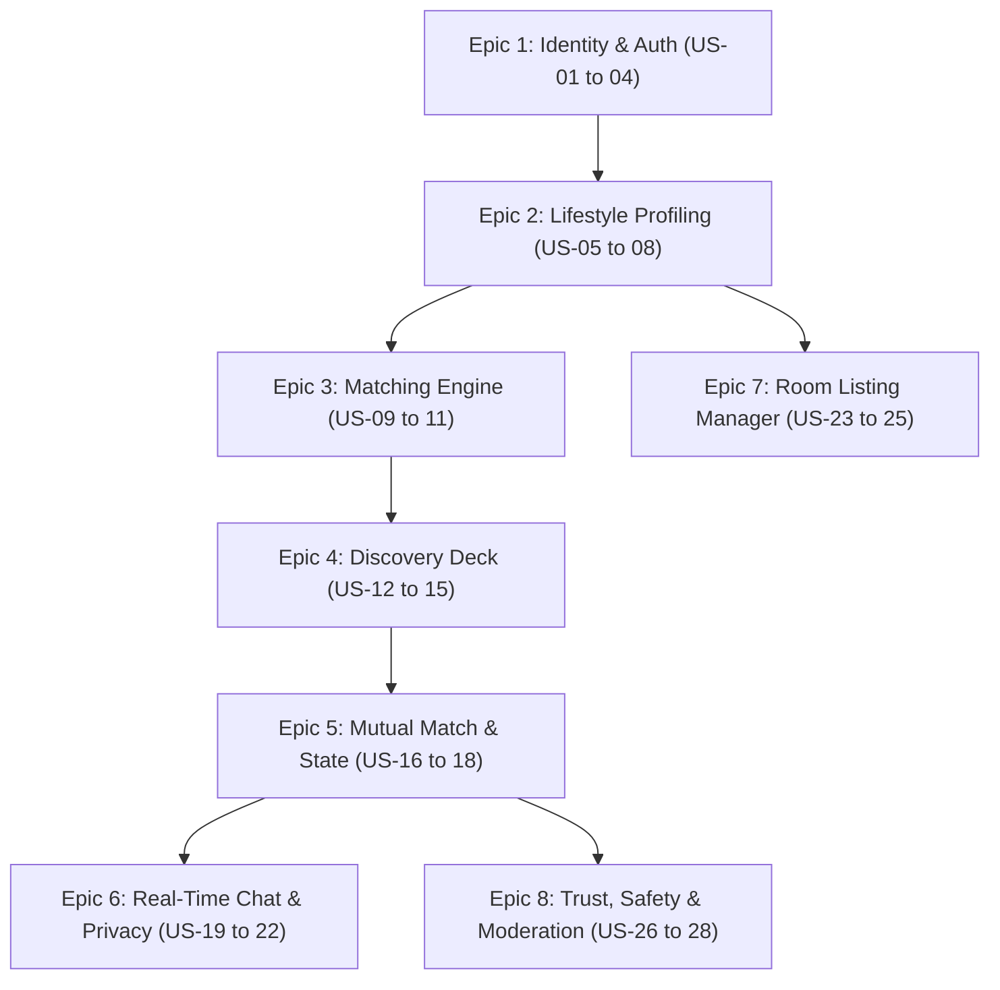

# Flatmate – Product Backlog & User Story Repository

**Document Version**: 1.0.0  
**Phase**: Workflow B (Requirements Engineering)  
**Author**: Requirements Analyst  
**Status**: Ready for Human Sign-off  
**Date**: 2026-11-13  
**Target Release**: MVP v1.0

---

## 1. Backlog Overview & INVEST Compliance

This backlog contains all user stories required to deliver the Flatmate MVP. Every story satisfies the **INVEST** principles:
- **I**ndependent: Can be developed, tested, and shipped in isolation.
- **N**egotiable: Open to UI/technical optimization within approved requirements.
- **V**aluable: Delivers distinct user or safety value.
- **E**stimable: Clear scope allowing reliable story point sizing (Fibonacci 1, 2, 3, 5, 8).
- **S**mall: Sized to complete within an engineering iteration.
- **T**estable: Accompanied by Given-When-Then acceptance criteria.



---

## 2. Epic 1: Identity, Authentication & Profile Setup

### US-01: Phone OTP Authentication & Secure Session Setup
- **Epic**: Epic 1 - Identity, Authentication & Profile Setup
- **Priority**: Must Have (P0)
- **Estimate**: 3 Story Points
- **Assigned Agent**: Backend Engineer & Frontend Engineer
- **PRD Reference**: `FR-01`, `NFR-SEC-01`, `NFR-SEC-06`

#### 1. User Story Statement
**As a** prospective flatmate seeker in Trivandrum,  
**I want** to sign up and log in using my mobile phone number with an SMS OTP,  
**So that** I have a fast, frictionless, and secure login experience without remembering passwords.

#### 2. Acceptance Criteria (Given-When-Then)
```gherkin
Scenario 1: Happy Path - Successful Phone Number Authentication
  Given a user on the Flatmate landing screen
  When the user enters a valid 10-digit Indian phone number "9876543210" and taps "Send OTP"
  Then the system generates a 6-digit cryptographic OTP, dispatches it via SMS gateway within 5 seconds, and transitions to the OTP entry screen
  When the user submits the correct 6-digit OTP within 300 seconds
  Then the system verifies the OTP, issues a JWT in an httpOnly secure cookie, and directs the user to profile setup (if new) or discovery deck (if returning)

Scenario 2: Validation Failure - Invalid Phone Format and Rate Limiting
  Given a user on the authentication screen
  When the user enters an invalid number "12345" or "987654321" (less than 10 digits)
  Then the system disables the submit button and displays "Please enter a valid 10-digit Indian mobile number"
  When a user requests OTP more than 3 times within 15 minutes for the same number
  Then the system blocks subsequent requests with HTTP 429 and displays "Too many OTP requests. Please try again in 15 minutes."

Scenario 3: Boundary / Expiry Case - Expired or Incorrect OTP Submission
  Given a user with a dispatched OTP
  When the user submits the OTP after 301 seconds or enters an incorrect 6-digit code
  Then the system rejects the token, displays "Invalid or expired OTP. Please try again", and increments the failed attempt counter
  And if failed attempts reach 5, the phone number is locked for 30 minutes
```

#### 3. Technical Constraints & Design References
- **API Endpoints**: `POST /api/v1/auth/otp/send`, `POST /api/v1/auth/otp/verify`
- **Security Check**: Rate limiter applied via Redis; JWT cookie set with `SameSite=Strict; Secure; HttpOnly`.
- **UI Spec**: Clean mobile-first phone input field with country code fixed to `+91`.

---

### US-02: Institutional & Corporate Domain Email Verification
- **Epic**: Epic 1 - Identity, Authentication & Profile Setup
- **Priority**: Must Have (P0)
- **Estimate**: 3 Story Points
- **Assigned Agent**: Backend Engineer
- **PRD Reference**: `FR-02`, `NFR-SEC-01`

#### 1. User Story Statement
**As an** IT professional in Technopark or student at CET,  
**I want** to verify my institutional or corporate email address,  
**So that** I can earn a verified badge that proves my authenticity and increases peer trust.

#### 2. Acceptance Criteria (Given-When-Then)
```gherkin
Scenario 1: Happy Path - Corporate Email Verification
  Given an authenticated user on the Verification Setup screen
  When the user inputs their corporate email "adarsh.nair@ust.com" and submits
  Then the system checks the domain against the approved whitelist, generates a secure verification token, and sends a verification link to that email
  When the user clicks the verification link within 24 hours
  Then the system marks email_verified = true, stores organization = "UST Global", and displays a success confirmation: "Corporate Identity Verified"

Scenario 2: Edge Case - Domain Not on Whitelist
  Given an authenticated user submitting an email "user@unknownstartup.org"
  When the system checks the domain whitelist and finds no match
  Then the system displays an informational banner: "Domain not recognized in our automated directory. Would you like to request an affiliation review?"
  And allows the user to submit an employer name for manual review without blocking core app usage

Scenario 3: Security Boundary - Email Reuse Attempt
  Given a corporate email "adarsh.nair@ust.com" already verified by User A
  When User B attempts to verify the exact same email address
  Then the system rejects the submission with HTTP 409 Conflict: "This institutional email is already associated with another account."
```

#### 3. Technical Constraints & Design References
- **API Endpoints**: `POST /api/v1/auth/verify-email/request`, `POST /api/v1/auth/verify-email/confirm`
- **Whitelist Table**: Seeded with Trivandrum colleges (`cet.ac.in`, `sctce.ac.in`, `keralauniversity.ac.in`) and Technopark domains (`ust.com`, `infosys.com`, `allianz.com`, `ibsplc.com`, `tataelxsi.co.in`).

---

### US-03: Visual Trust Badging on Profile & Discovery Cards
- **Epic**: Epic 1 - Identity, Authentication & Profile Setup
- **Priority**: Must Have (P0)
- **Estimate**: 2 Story Points
- **Assigned Agent**: Frontend Engineer
- **PRD Reference**: `FR-03`, `NFR-SEC-05`, `NFR-A11Y-01`

#### 1. User Story Statement
**As a** discovery deck user,  
**I want** to see verified badges on candidate profile cards,  
**So that** I can immediately identify vetted professionals and students while feeling safe.

#### 2. Acceptance Criteria (Given-When-Then)
```gherkin
Scenario 1: Happy Path - Displaying Verified Professional Badge
  Given a candidate profile with verified corporate affiliation at Technopark
  When the profile card is rendered in the discovery deck or detailed sheet
  Then a blue verified shield icon is displayed next to the user's name with accessible label "Verified Professional: UST Global"
  And the user's private email address is completely excluded from the JSON API response

Scenario 2: Happy Path - Displaying Verified Student Badge
  Given a candidate profile with verified student status at CET
  When the card is rendered
  Then a green graduation cap badge is displayed with accessible label "Verified Student: College of Engineering Trivandrum"

Scenario 3: Edge Case - Unverified Profile Display
  Given a candidate profile with no verified email
  When the card is rendered
  Then no shield or cap icon is rendered, and a neutral, respectful "Identity Unverified" pill is shown in the expanded details view
```

#### 3. Technical Constraints & Design References
- **Component**: `<TrustBadge type="corporate | student" organization={org} />`
- **Accessibility**: Screen reader announcement `aria-label="Verified Professional at UST Global"`.

---

### US-04: Discovery Modality Selection & Routing
- **Epic**: Epic 1 - Identity, Authentication & Profile Setup
- **Priority**: Must Have (P0)
- **Estimate**: 2 Story Points
- **Assigned Agent**: Frontend Engineer & Backend Engineer
- **PRD Reference**: `FR-04`

#### 1. User Story Statement
**As a** new user onboarding to Flatmate,  
**I want** to choose my specific living scenario from 4 clear modalities,  
**So that** the app tailors my onboarding experience and discovery feed to my exact situation.

#### 2. Acceptance Criteria (Given-When-Then)
```gherkin
Scenario 1: Happy Path - Selecting Modality 4 (Team Up First)
  Given a newly registered user on the Modality Selection screen
  When the user selects "Seeking compatible person first (team up to hunt flat together)" and taps "Continue"
  Then the user's modality is saved as "MODALITY_4" in the database
  And the app routes directly to the 7-Vector Lifestyle Questionnaire, skipping room listing creation

Scenario 2: Happy Path - Selecting Modality 1 (Has Room Available)
  Given a user on the Modality Selection screen
  When the user selects "I have a room available in my flat" and taps "Continue"
  Then the user's modality is saved as "MODALITY_1"
  And the app queues the "Add Room Details" setup step following lifestyle questionnaire completion

Scenario 3: Validation Case - Mandatory Selection
  Given a user on the Modality Selection screen
  When the user attempts to tap "Continue" without selecting any modality card
  Then the continue button remains disabled and an indicator prompts: "Please choose the option that best describes your situation."
```

#### 3. Technical Constraints & Design References
- **API Endpoint**: `PUT /api/v1/users/me/modality`
- **Payload Schema**: `{ modality: "MODALITY_1" | "MODALITY_2" | "MODALITY_3" | "MODALITY_4" }`

---

## 3. Epic 2: Demographics & 7-Vector Lifestyle Compatibility Profiling

### US-05: Demographic Profile & Micro-Market Configuration
- **Epic**: Epic 2 - Demographics & Lifestyle Profiling
- **Priority**: Must Have (P0)
- **Estimate**: 3 Story Points
- **Assigned Agent**: Frontend Engineer & Backend Engineer
- **PRD Reference**: `FR-05`, `FR-06`, `NFR-SEC-03`

#### 1. User Story Statement
**As a** flatmate seeker in Trivandrum,  
**I want** to configure my age, gender, occupation, photos, target micro-markets, and monthly budget,  
**So that** I only see candidates who fit my demographic comfort zone and geographic search area.

#### 2. Acceptance Criteria (Given-When-Then)
```gherkin
Scenario 1: Happy Path - Complete Demographic Setup
  Given an authenticated user on the profile details screen
  When the user provides name "Adarsh N", gender "MALE", date of birth yielding age 24, occupation "Software Engineer", selects micro-markets ["Kazhakkoottam", "Kariavattom"], budget range 6000 to 8500 INR, and uploads 2 profile photos
  Then the profile is saved successfully with HTTP 200 and the user progresses to the lifestyle questionnaire

Scenario 2: Validation Failure - Age Under 18
  Given a user entering a date of birth resulting in an age of 17 years
  When the user attempts to submit
  Then the system rejects the input with: "You must be at least 18 years old to use Flatmate."

Scenario 3: Error Case - Oversized or Non-Image File Upload
  Given a user uploading an image file exceeding 5MB or with a .pdf extension
  When the file upload is triggered
  Then the client immediately rejects the upload with: "Images must be in JPEG, PNG, or WebP format and under 5MB."
```

#### 3. Technical Constraints & Design References
- **API Endpoint**: `PUT /api/v1/users/me/profile`, `POST /api/v1/users/me/photos`
- **Validation**: Zod schema validating string lengths, micro-market enum, and budget integer ranges.

---

### US-06: Sleep & Chronotype and Cleanliness Profiling
- **Epic**: Epic 2 - Demographics & Lifestyle Profiling
- **Priority**: Must Have (P0)
- **Estimate**: 3 Story Points
- **Assigned Agent**: Frontend Engineer & Backend Engineer
- **PRD Reference**: `FR-07`, `FR-08`

#### 1. User Story Statement
**As a** flatmate seeker,  
**I want** to specify my sleep hours, work shifts, chore routine, and cleanliness standards,  
**So that** I don't end up living with someone whose sleep cycle or hygiene habits conflict with mine.

#### 2. Acceptance Criteria (Given-When-Then)
```gherkin
Scenario 1: Happy Path - Sleep and Cleanliness Input
  Given a user on the Lifestyle Questionnaire (Step 1 of 3)
  When the user selects Sleep Pattern: "NIGHT_OWL", Shift: "US_SHIFT (18:00 - 03:00)", Light Sensitivity: "LIGHT_SLEEPER", Cleanliness: "METICULOUS", Sink Rule: "IMMEDIATE_WASH", and flags Cleanliness as a "Dealbreaker"
  Then the system records Vector 1 and Vector 2 with dealbreaker flags set to true

Scenario 2: Edge Case - Editing Vectors in Settings
  Given a user with existing lifestyle preferences
  When the user navigates to "Edit Compatibility Profile" and changes Cleanliness from "METICULOUS" to "MODERATE"
  Then the system updates the database and invalidates the cached compatibility score feed for that user
```

#### 3. Technical Constraints & Design References
- **API Endpoint**: `PUT /api/v1/users/me/lifestyle-vectors`
- **UI Spec**: Single-tap chips with descriptive subtitles (e.g. *"Early Bird: Asleep by 10:30 PM, up by 6:00 AM"*).

---

### US-07: Dietary Preferences & Social Guest Policy Configuration
- **Epic**: Epic 2 - Demographics & Lifestyle Profiling
- **Priority**: Must Have (P0)
- **Estimate**: 3 Story Points
- **Assigned Agent**: Frontend Engineer & Backend Engineer
- **PRD Reference**: `FR-09`, `FR-10`

#### 1. User Story Statement
**As a** resident with dietary and social boundary preferences,  
**I want** to set my dietary choices, kitchen sharing rules, and guest/party policies,  
**So that** I am paired with flatmates who respect my cultural boundaries and household peace.

#### 2. Acceptance Criteria (Given-When-Then)
```gherkin
Scenario 1: Happy Path - Strict Vegetarian Kitchen Preference
  Given a user completing Step 2 of the Lifestyle Questionnaire
  When the user selects Diet: "STRICT_VEGETARIAN", Kitchen Sharing: "VEG_ONLY_KITCHEN", and toggles "Strict Dealbreaker: ON"
  Then the system saves the preferences with dealbreaker = true
  And guarantees that candidates who cook meat/fish are excluded from the user's feed

Scenario 2: Happy Path - Guest Policy Selection
  Given a user completing the guest section
  When the user selects Guest Frequency: "OCCASIONAL_FRIENDS", Overnight Guests: "SAME_GENDER_ONLY", and Party Preference: "NEVER_AT_HOME"
  Then the system records Vector 4 parameters successfully
```

#### 3. Technical Constraints & Design References
- **API Endpoint**: `PUT /api/v1/users/me/lifestyle-vectors`
- **Enums**: `DietaryEnum`, `KitchenPolicyEnum`, `GuestFrequencyEnum`, `OvernightGuestEnum`.

---

### US-08: Substances, Financial Discipline & Work Rhythm Configuration
- **Epic**: Epic 2 - Demographics & Lifestyle Profiling
- **Priority**: Must Have (P0)
- **Estimate**: 3 Story Points
- **Assigned Agent**: Frontend Engineer & Backend Engineer
- **PRD Reference**: `FR-11`, `FR-12`, `FR-13`

#### 1. User Story Statement
**As a** responsible tenant,  
**I want** to declare my smoking/drinking habits, rent settlement punctuality, and work-from-home schedule,  
**So that** my matches share financial discipline and household work environment expectations.

#### 2. Acceptance Criteria (Given-When-Then)
```gherkin
Scenario 1: Happy Path - Non-Smoker and Strict Rent Discipline
  Given a user completing Step 3 of the questionnaire
  When the user selects Smoking: "NON_SMOKER_STRICT" (with dealbreaker toggle ON), Alcohol: "SOCIAL_DRINKER", Rent Payment: "STRICT_1ST_OF_MONTH", AC Bill: "PROPORTIONAL_TO_USAGE", and Work Mode: "HYBRID"
  Then the system saves all 7 vectors and marks the lifestyle questionnaire as 100% complete

Scenario 2: Boundary Case - Missing Required Fields
  Given a user attempting to complete the questionnaire while leaving Substance habits unselected
  When the user taps "Finish Profile"
  Then the system scrolls to the unselected field and highlights it with "Please indicate your substance habits to finalize your profile"
```

#### 3. Technical Constraints & Design References
- **API Endpoint**: `PUT /api/v1/users/me/lifestyle-vectors`
- **State Check**: User record `profile_completed` flag set to `true` upon successful submission.

---

## 4. Epic 3: Deterministic Matching Engine & Compatibility Insights

### US-09: Deterministic 7-Vector Compatibility Scoring Calculation
- **Epic**: Epic 3 - Deterministic Matching Engine
- **Priority**: Must Have (P0)
- **Estimate**: 5 Story Points
- **Assigned Agent**: Backend Engineer
- **PRD Reference**: `FR-14`, `NFR-PERF-03`

#### 1. User Story Statement
**As a** user searching for flatmates,  
**I want** the system to calculate an objective compatibility score (0% to 100%) for every candidate,  
**So that** I can immediately understand how well someone matches my lifestyle without subjective guesswork.

#### 2. Acceptance Criteria (Given-When-Then)
```gherkin
Scenario 1: Happy Path - High Affinity Vector Calculation
  Given User A and User B both with completed 7-vector profiles
  When both users have identical Sleep (Night Owl), Cleanliness (Meticulous), Diet (Non-veg, kitchen ok), Non-smokers, Strict Rent on 1st, and Hybrid work
  Then the scoring engine calculates an overall score of 100% (or ≥95%)
  And returns the candidate in the top percentile of the feed

Scenario 2: Happy Path - Divergent Habits with Weighted Deduction
  Given User A (Early Bird, W1=0.20) and User B (Night Owl, W1=0.20) with no dealbreaker set
  When the scoring engine compares their sleep vectors
  Then the vector affinity score for sleep is evaluated as 0.25 (partial alignment)
  And the total overall score reflects a 15% reduction in the final weighted tally

Scenario 3: Performance Benchmark - Batch Evaluation
  Given a candidate pool of 50 users retrieved from the database
  When the scoring engine executes vector similarity calculations
  Then all 50 scores are computed within 50 milliseconds
```

#### 3. Technical Constraints & Design References
- **Module**: `modules/matching/scoring.service.ts`
- **Formula**: Deterministic weighted matrix; strictly zero LLM non-determinism in mathematical scoring.

---

### US-10: Dealbreaker & Hard Filtering Enforcement
- **Epic**: Epic 3 - Deterministic Matching Engine
- **Priority**: Must Have (P0)
- **Estimate**: 3 Story Points
- **Assigned Agent**: Backend Engineer
- **PRD Reference**: `FR-15`, `PRD Rule 1`, `PRD Rule 4`

#### 1. User Story Statement
**As a** safety-conscious renter with strict non-negotiables,  
**I want** candidates who violate my gender preference or dealbreakers to be filtered out entirely,  
**So that** I never waste time viewing or rejecting incompatible candidates.

#### 2. Acceptance Criteria (Given-When-Then)
```gherkin
Scenario 1: Hard Filter - Gender Preference Enforcement
  Given User A is Female with gender preference "FEMALE_ONLY"
  When the discovery feed is generated for User A
  Then 100% of candidate profiles in the feed have gender = "FEMALE" and preference inclusive of "FEMALE"
  And zero male profiles are returned under any circumstance

Scenario 2: Hard Filter - Smoking Dealbreaker Exclusion
  Given User A has marked "NON_SMOKER_STRICT" with Dealbreaker = true
  When Candidate B is a smoker
  Then Candidate B is completely omitted from User A's discovery feed

Scenario 3: Hard Filter - Modality Incompatibility
  Given User A is Modality 1 (Has room available)
  When candidate queries are executed
  Then other Modality 1 users and Modality 4 users are excluded from User A's feed per the Modality Compatibility Matrix
```

#### 3. Technical Constraints & Design References
- **SQL Query**: Evaluated in PostgreSQL query `WHERE` clauses prior to score sorting to avoid unindexed scans.

---

### US-11: Transparent Compatibility Breakdown & Harmony Insights
- **Epic**: Epic 3 - Deterministic Matching Engine
- **Priority**: Must Have (P0)
- **Estimate**: 3 Story Points
- **Assigned Agent**: Backend Engineer & AI Engineer
- **PRD Reference**: `FR-16`

#### 1. User Story Statement
**As a** discovery deck user,  
**I want** to see an itemized breakdown of why I matched well or poorly with a candidate,  
**So that** I understand potential lifestyle friction points before swiping.

#### 2. Acceptance Criteria (Given-When-Then)
```gherkin
Scenario 1: Happy Path - Vector Alignment Breakdown
  Given a candidate card with an 88% overall compatibility score
  When the user views the expanded breakdown sheet
  Then the UI displays 7 distinct progress bars/pills showing alignment:
    - Sleep: Green (High Harmony)
    - Cleanliness: Green (High Harmony)
    - Diet: Yellow (Discuss: Candidate is Non-Veg while you are Vegetarian)
    - Finances: Green (Strict 1st of Month)

Scenario 2: Assistive AI Harmony Note Generation (P1 Enhancement)
  Given a candidate profile being viewed in the deep-dive sheet
  When the client requests the assistive compatibility summary
  Then the backend passes sanitized vector keys to the Gemini API
  And returns a concise, 2-sentence conversational highlight: "Great harmony on sleep cycles and rent punctuality! Note that they enjoy weekend gaming sessions."
  And no raw user PII is transmitted in the prompt payload
```

#### 3. Technical Constraints & Design References
- **API Endpoint**: `GET /api/v1/matches/candidates/:userId/breakdown`
- **Security Check**: PII sanitizer validates vector payload before passing to LLM.

---

## 5. Epic 4: Discovery Card Deck & Swiping Interactions

### US-12: Discovery Card Deck Feed Rendering
- **Epic**: Epic 4 - Discovery Card Deck
- **Priority**: Must Have (P0)
- **Estimate**: 3 Story Points
- **Assigned Agent**: Frontend Engineer
- **PRD Reference**: `FR-17`, `NFR-RESP-01`, `NFR-A11Y-02`

#### 1. User Story Statement
**As a** user looking for flatmates,  
**I want** a smooth, responsive card deck displaying compatible candidate profiles,  
**So that** I can quickly browse candidates one by one with essential information at a glance.

#### 2. Acceptance Criteria (Given-When-Then)
```gherkin
Scenario 1: Happy Path - Deck Rendering with Candidate Cards
  Given an authenticated user on the discovery feed screen
  When the feed loads
  Then the top candidate card is displayed with primary photo, display name, age, verified badge, micro-market, and compatibility badge (e.g. "91% Match")
  And the next 2 cards in the stack are pre-rendered behind it for fluid animation

Scenario 2: Edge Case - Empty Candidate Pool in Micro-Market
  Given a user searching in "Kowdiar" where all candidate profiles have been swiped
  When the deck is empty
  Then the app renders a friendly empty state: "You've seen all potential flatmates in Kowdiar for now!"
  And provides a single-tap button: "Expand Search to Kazhakkoottam & Sreekaryam"
```

#### 3. Technical Constraints & Design References
- **API Endpoint**: `GET /api/v1/feed?limit=20`
- **UI Spec**: Framer Motion or react-spring card stack physics; 3:4 aspect ratio on mobile.

---

### US-13: Touch Swipe & Button Decision Processing
- **Epic**: Epic 4 - Discovery Card Deck
- **Priority**: Must Have (P0)
- **Estimate**: 3 Story Points
- **Assigned Agent**: Frontend Engineer & Backend Engineer
- **PRD Reference**: `FR-18`

#### 1. User Story Statement
**As a** mobile user,  
**I want** to swipe right to Like, swipe left to Pass, or tap action buttons,  
**So that** I can register my decisions with natural gestures or accessible clicks.

#### 2. Acceptance Criteria (Given-When-Then)
```gherkin
Scenario 1: Happy Path - Swipe Right (Like) Gesture
  Given a user viewing a candidate card
  When the user drags the card to the right beyond 120px threshold or taps the green Heart button
  Then the card animates off-screen to the right with a green "LIKE" overlay stamp
  And the client sends a POST request with action: "LIKE" and candidateId
  And the next card smoothly transitions to the front

Scenario 2: Happy Path - Swipe Left (Pass) Gesture
  Given a user viewing a candidate card
  When the user drags the card to the left or taps the red "X" button
  Then the card animates off-screen to the left with a red "PASS" overlay
  And the client sends a POST request with action: "PASS"

Scenario 3: Optimistic UI & Offline Queueing
  Given a user swiping on spotty mobile data
  When a swipe is made and the network request fails
  Then the swipe is queued locally in IndexedDB with an idempotency key and retried automatically once online without interrupting the user's card flow
```

#### 3. Technical Constraints & Design References
- **API Endpoint**: `POST /api/v1/swipes`
- **Payload**: `{ targetUserId: string, action: "LIKE" | "PASS" | "SUPER_LIKE", idempotencyKey: string }`

---

### US-14: Swipe Undo / Rewind Capability
- **Epic**: Epic 4 - Discovery Card Deck
- **Priority**: Should Have (P1)
- **Estimate**: 2 Story Points
- **Assigned Agent**: Frontend Engineer & Backend Engineer
- **PRD Reference**: `FR-18`

#### 1. User Story Statement
**As an** active swiper,  
**I want** to rewind my immediately preceding swipe action if I made an accidental mistake,  
**So that** I don't lose a compatible flatmate due to an accidental slip.

#### 2. Acceptance Criteria (Given-When-Then)
```gherkin
Scenario 1: Happy Path - Rewind Preceding Pass
  Given a user who accidentally swiped left (Pass) on candidate Rohit
  When the user taps the yellow "Rewind" button within the same active session
  Then the system deletes the preceding swipe record from the database
  And the Rohit card animates back onto the top of the discovery deck

Scenario 2: Boundary Case - Exceeded Rewind Limit
  Given a user who has already used their 1 allowed rewind for the current session
  When the user attempts to tap "Rewind" again
  Then the button is disabled and a tooltip informs: "Rewind is limited to 1 profile per session."
```

#### 3. Technical Constraints & Design References
- **API Endpoint**: `POST /api/v1/swipes/undo`
- **Constraints**: Allowed only if target user has not already been processed into a mutual match.

---

### US-15: Detailed Lifestyle Profile Expansion & Comparison Modal
- **Epic**: Epic 4 - Discovery Card Deck
- **Priority**: Must Have (P0)
- **Estimate**: 3 Story Points
- **Assigned Agent**: Frontend Engineer
- **PRD Reference**: `FR-19`, `NFR-RESP-02`

#### 1. User Story Statement
**As a** thorough flatmate seeker,  
**I want** to tap a candidate card to expand their full lifestyle profile and room details,  
**So that** I can compare our daily habits side-by-side before making a swipe decision.

#### 2. Acceptance Criteria (Given-When-Then)
```gherkin
Scenario 1: Happy Path - Expanding Profile Sheet
  Given a user viewing a candidate card in the deck
  When the user taps anywhere on the card body or taps the "Expand Profile" chevron
  Then a smooth bottom sheet slides up covering 90% of the viewport
  And displays all photo gallery images, bio, verified employer/student badge, and full 7-vector lifestyle comparison matrix

Scenario 2: Side-by-Side Comparison Matrix
  Given the expanded profile sheet
  When viewing the Cleanliness section
  Then the UI shows: "Your Habit: Meticulous (Daily)" vs "Their Habit: Moderate (Every 2 days)" with a harmony indicator

Scenario 3: Dismissing the Sheet
  Given an open profile sheet
  When the user drags down on the handle bar or taps the close button
  Then the sheet collapses smoothly back to the exact candidate card in the deck
```

#### 3. Technical Constraints & Design References
- **Component**: `<CandidateDetailModal />` with accessible focus trapping.

---

## 6. Epic 5: Mutual Double Opt-In Matching & State Transitions

### US-16: Atomic Mutual Match Detection
- **Epic**: Epic 5 - Mutual Matching & Double Opt-in
- **Priority**: Must Have (P0)
- **Estimate**: 5 Story Points
- **Assigned Agent**: Backend Engineer
- **PRD Reference**: `FR-20`, `NFR-REL-04`

#### 1. User Story Statement
**As the** Flatmate platform engine,  
**I want** to detect mutual positive swipes inside an atomic database transaction,  
**So that** mutual matches are reliably identified without race conditions or duplicated conversation channels.

#### 2. Acceptance Criteria (Given-When-Then)
```gherkin
Scenario 1: Happy Path - Mutual Match Triggered
  Given User B previously liked User A (stored as PENDING_MUTUAL)
  When User A records a "LIKE" on User B
  Then the database transaction acquires row-level locks, updates the match status to "MUTUAL_MATCH", and creates a record in the conversations table
  And returns { isMutualMatch: true, matchId: "...", conversationId: "..." }

Scenario 2: Non-Mutual Positive Swipe
  Given User B has not yet swiped on User A
  When User A likes User B
  Then the system records a swipe entry with status "PENDING_MUTUAL"
  And returns { isMutualMatch: false } without notifying User B
```

#### 3. Technical Constraints & Design References
- **Database Query**: PostgreSQL transaction using `SELECT ... FOR UPDATE` on `matches` table.

---

### US-17: Match Celebration Modal & Direct Action Flow
- **Epic**: Epic 5 - Mutual Matching & Double Opt-in
- **Priority**: Must Have (P0)
- **Estimate**: 2 Story Points
- **Assigned Agent**: Frontend Engineer
- **PRD Reference**: `FR-21`

#### 1. User Story Statement
**As a** matched user,  
**I want** to see an immediate celebration modal when a mutual match occurs,  
**So that** I feel delighted and can immediately choose to start chatting or keep exploring.

#### 2. Acceptance Criteria (Given-When-Then)
```gherkin
Scenario 1: Happy Path - Celebration Modal Presentation
  Given a user whose swipe triggers a mutual match
  When the API responds with isMutualMatch = true
  Then an engaging modal opens displaying both profile avatars, a "You and Adarsh Matched!" heading, and compatibility score badge
  And presents two buttons: "Say Hello" (primary) and "Keep Swiping" (secondary)

Scenario 2: Navigation to Chat
  Given the match celebration modal
  When the user taps "Say Hello"
  Then the modal closes and the user is routed directly to the new conversation view `/chat/:conversationId`
```

#### 3. Technical Constraints & Design References
- **Component**: `<MatchModal userA={me} userB={match} score={score} />`
- **Sound & Haptics**: Subtle celebratory haptic pulse (50ms) on supported mobile devices.

---

### US-18: Modality-Specific Match Pairing Logic
- **Epic**: Epic 5 - Mutual Matching & Double Opt-in
- **Priority**: Must Have (P0)
- **Estimate**: 3 Story Points
- **Assigned Agent**: Backend Engineer
- **PRD Reference**: `FR-15`, `PRD Rule 4`

#### 1. User Story Statement
**As a** user with a specific accommodation need (e.g. Modality 2 seeking a room),  
**I want** the matching engine to pair me with complementary modalities (e.g. Modality 1 who has a room),  
**So that** I only match with people whose housing availability fits my timeline.

#### 2. Acceptance Criteria (Given-When-Then)
```gherkin
Scenario 1: Pairing Modality 1 with Modality 2
  Given User A is Modality 1 (Has room available in Kazhakkoottam) and User B is Modality 2 (Seeking room)
  When compatibility calculation is run
  Then they are valid candidates for each other
  And User B's card displays User A's room vacancy and rent details

Scenario 2: Blocking Modality 1 from Matching Modality 1
  Given User A has a room available and User C also has a room available
  When candidate feeds are generated
  Then neither user appears in the other's discovery deck
```

#### 3. Technical Constraints & Design References
- **Rule Engine**: Evaluated via Modality Compatibility Matrix in feed query builder.

---

## 7. Epic 6: In-App Real-Time Messaging & Privacy Protection

### US-19: 1-on-1 Real-Time Text Messaging Channel
- **Epic**: Epic 6 - Real-Time Chat & Privacy
- **Priority**: Must Have (P0)
- **Estimate**: 5 Story Points
- **Assigned Agent**: Backend Engineer & Frontend Engineer
- **PRD Reference**: `FR-22`, `NFR-PERF-04`

#### 1. User Story Statement
**As a** mutually matched user,  
**I want** to chat in real-time with my match inside the app,  
**So that** we can discuss living preferences and schedule flat viewings safely.

#### 2. Acceptance Criteria (Given-When-Then)
```gherkin
Scenario 1: Happy Path - Real-Time Message Exchange
  Given User A and User B have an active mutual match and open the chat view
  When User A types "Hi Adarsh, are you free this Saturday to check flats?" and taps Send
  Then the message appears immediately in User A's chat window with a "Sent" checkmark
  And is delivered to User B's screen via WebSocket in less than 150 milliseconds
  And is persisted in the PostgreSQL messages table

Scenario 2: Long Message Character Boundary
  Given a user typing a message in the chat input
  When the message length reaches 2,000 characters
  Then the input prevents further character entry and displays a counter: "Maximum 2,000 characters reached"
```

#### 3. Technical Constraints & Design References
- **Protocols**: WebSocket with Socket.io / native WS; REST fallback `POST /api/v1/chat/:id/messages`
- **Security Check**: Recipient authorization verified against session before establishing socket room.

---

### US-20: Message Delivery Status Indicators & Offline Storage
- **Epic**: Epic 6 - Real-Time Chat & Privacy
- **Priority**: Must Have (P0)
- **Estimate**: 3 Story Points
- **Assigned Agent**: Frontend Engineer & Backend Engineer
- **PRD Reference**: `FR-22`

#### 1. User Story Statement
**As a** messaging user,  
**I want** clear indicators showing whether my message has been sent, delivered, or read,  
**So that** I know if my match has seen my communication.

#### 2. Acceptance Criteria (Given-When-Then)
```gherkin
Scenario 1: Status Indicators - Sent to Delivered to Read
  Given User A sends a message to User B
  When the server receives the message, it displays a single grey check (Sent)
  When User B's client receives the socket event, it updates to double grey checks (Delivered)
  When User B opens the conversation view containing that message, it updates to double blue checks (Read)

Scenario 2: Offline Recipient
  Given User B is logged out or offline
  When User A sends a message
  Then the message is saved to PostgreSQL with status "SENT"
  And when User B logs in next, the message is fetched and status transitions to "DELIVERED"
```

#### 3. Technical Constraints & Design References
- **Schema**: `messages` table with `status: "SENT" | "DELIVERED" | "READ"`, `read_at: timestamp`.

---

### US-21: DPDP-Compliant Contact Masking & Security Warnings
- **Epic**: Epic 6 - Real-Time Chat & Privacy
- **Priority**: Must Have (P0)
- **Estimate**: 3 Story Points
- **Assigned Agent**: Backend Engineer & Frontend Engineer
- **PRD Reference**: `FR-23`, `NFR-SEC-03`, `NFR-SEC-05`

#### 1. User Story Statement
**As a** privacy-conscious user (especially female or student),  
**I want** the platform to keep my phone number and precise location strictly private,  
**So that** I am protected against stalking, harassment, and unsolicited external calls.

#### 2. Acceptance Criteria (Given-When-Then)
```gherkin
Scenario 1: Privacy Protection - Zero Phone Number Exposure
  Given an active conversation between User A and User B
  When viewing the user header, info drawer, or inspecting network traffic payloads
  Then zero phone numbers, email addresses, or exact street coordinates are present in the response
  And only display name, age, and micro-market centroid (e.g., "Kazhakkoottam") are visible

Scenario 2: Automated Chat Safety Prompt
  Given a user typing a message containing a 10-digit Indian phone number or UPI handle (e.g., "call me on 9876543210")
  When the user taps Send
  Then the app displays a gentle cautionary modal: "For your safety, we recommend keeping conversations within Flatmate until you meet in person in a public space."
  And provides options: "Send Anyway" or "Edit Message"
```

#### 3. Technical Constraints & Design References
- **Regex Guard**: Regex filter scanning for phone numbers (`(\+91|0)?[6-9]\d{9}`) and UPI addresses.

---

### US-22: Conversation Unmatching & Active Chat Management
- **Epic**: Epic 6 - Real-Time Chat & Privacy
- **Priority**: Must Have (P0)
- **Estimate**: 2 Story Points
- **Assigned Agent**: Backend Engineer & Frontend Engineer
- **PRD Reference**: `FR-24`

#### 1. User Story Statement
**As a** matched user,  
**I want** to unmatch a candidate if we realize we are not a good fit,  
**So that** the conversation is cleanly closed and neither of us can message each other further.

#### 2. Acceptance Criteria (Given-When-Then)
```gherkin
Scenario 1: Happy Path - Unmatching a Conversation
  Given an active chat between User A and User B
  When User A selects "Unmatch" from the chat menu and confirms
  Then the match status is updated to "UNMATCHED"
  And the conversation disappears from both users' active inbox
  And neither user can view or message each other again

Scenario 2: UI State for Inactive Conversation
  Given User A unmatches User B
  When User B currently has the chat window open
  Then the input box is immediately disabled with text: "This match is no longer active"
```

#### 3. Technical Constraints & Design References
- **API Endpoint**: `POST /api/v1/chat/:id/unmatch`

---

## 8. Epic 7: Room Listing Manager (Modalities 1 & 3)

### US-23: Room Listing Creation & Amenity Configuration
- **Epic**: Epic 7 - Room Listing Manager
- **Priority**: Should Have (P1)
- **Estimate**: 3 Story Points
- **Assigned Agent**: Frontend Engineer & Backend Engineer
- **PRD Reference**: `FR-25`

#### 1. User Story Statement
**As a** tenant with a vacant room (Modality 1 or 3),  
**I want** to specify room rent, deposit, bathroom type, and key amenities,  
**So that** room seekers have complete clarity on living costs and facilities before swiping.

#### 2. Acceptance Criteria (Given-When-Then)
```gherkin
Scenario 1: Happy Path - Room Listing Setup
  Given a Modality 1 user in onboarding or settings
  When the user inputs Room Type: "PRIVATE_ROOM", Bathroom: "ATTACHED_PRIVATE", Rent: 7500 INR, Deposit: 15000 INR, Available From: "2026-12-01", and checks amenities ["AC", "High-Speed Wi-Fi", "Washing Machine"]
  Then the room listing is created and attached to the user's profile

Scenario 2: Validation Case - Rent Exceeds Upper Limit
  Given a user entering a monthly rent of 0 INR or 75,000 INR
  When the user submits
  Then the system displays validation feedback: "Rent must be between ₹2,000 and ₹50,000/month"
```

#### 3. Technical Constraints & Design References
- **API Endpoint**: `POST /api/v1/rooms`, `PUT /api/v1/rooms/:id`
- **Validation**: Zod schema validating numerical ranges and amenity enums.

---

### US-24: Room Gallery Photo Upload & Verification
- **Epic**: Epic 7 - Room Listing Manager
- **Priority**: Should Have (P1)
- **Estimate**: 3 Story Points
- **Assigned Agent**: Frontend Engineer & Backend Engineer
- **PRD Reference**: `FR-25`

#### 1. User Story Statement
**As a** room host,  
**I want** to upload up to 4 high-resolution photos of the vacant bedroom and shared living areas,  
**So that** potential flatmates can see the real space and feel confident reaching out.

#### 2. Acceptance Criteria (Given-When-Then)
```gherkin
Scenario 1: Happy Path - Multi-Photo Upload
  Given a room host uploading photos
  When the user selects 3 photos (bedroom, bathroom, hall) and uploads them
  Then the images are compressed, stored in object storage via CDN, and thumbnail previews are displayed in the listing editor

Scenario 2: Edge Case - Minimum Photo Requirement
  Given a room host saving an active room listing
  When the user attempts to publish without uploading at least 1 verified room photo
  Then the system requires: "Please upload at least 1 photo of the room before publishing."
```

#### 3. Technical Constraints & Design References
- **API Endpoint**: `POST /api/v1/rooms/:id/photos`
- **Storage**: S3-compatible object storage with image optimization (WebP conversion).

---

### US-25: Room Showcase Display on Discovery Cards
- **Epic**: Epic 7 - Room Listing Manager
- **Priority**: Should Have (P1)
- **Estimate**: 3 Story Points
- **Assigned Agent**: Frontend Engineer
- **PRD Reference**: `FR-26`

#### 1. User Story Statement
**As a** room seeker (Modality 2),  
**I want** to see room details and swipe between profile and room photos on the discovery card,  
**So that** I can evaluate both the human and the physical living space simultaneously.

#### 2. Acceptance Criteria (Given-When-Then)
```gherkin
Scenario 1: Happy Path - Room Details on Card
  Given a Modality 2 user viewing a Modality 1 candidate's card
  When the card is rendered
  Then a tag "Room Available in Kazhakkoottam • ₹7,500/mo" is displayed above the profile name
  And tapping the right side of the photo cycles to the room bedroom photo

Scenario 2: Detailed Room Breakdown in Profile Sheet
  Given the user expands the detailed profile sheet
  When scrolling to the "Accommodation" section
  Then a dedicated card shows rent, deposit, room type (Private), attached bath, and checked amenity icons
```

#### 3. Technical Constraints & Design References
- **Component**: `<RoomShowcaseCard listing={candidate.room} />`

---

## 9. Epic 8: Trust, Safety, Blocking & Abuse Mitigation

### US-26: Instant Bidirectional User Blocking
- **Epic**: Epic 8 - Trust, Safety & Abuse Mitigation
- **Priority**: Must Have (P0)
- **Estimate**: 2 Story Points
- **Assigned Agent**: Backend Engineer & Frontend Engineer
- **PRD Reference**: `FR-27`

#### 1. User Story Statement
**As a** Flatmate user,  
**I want** to instantly block any user who makes me uncomfortable,  
**So that** they can never contact me, see my profile, or appear in my feeds again.

#### 2. Acceptance Criteria (Given-When-Then)
```gherkin
Scenario 1: Happy Path - Blocking from Discovery Card
  Given a user viewing an uncomfortable candidate profile card
  When the user taps the three-dots menu, selects "Block User", and confirms
  Then the system writes a bidirectional block entry to the database
  And the card immediately animates away
  And neither user will ever be shown in each other's feeds

Scenario 2: Blocking an Active Match in Chat
  Given an active chat conversation
  When User A blocks User B
  Then the chat room is immediately terminated, removed from both inboxes, and all socket events are unsubscribed
```

#### 3. Technical Constraints & Design References
- **API Endpoint**: `POST /api/v1/safety/blocks`
- **Payload**: `{ blockedUserId: string, reason?: string }`

---

### US-27: Structured Harassment & Abuse Reporting
- **Epic**: Epic 8 - Trust, Safety & Abuse Mitigation
- **Priority**: Must Have (P0)
- **Estimate**: 3 Story Points
- **Assigned Agent**: Backend Engineer & Frontend Engineer
- **PRD Reference**: `FR-28`

#### 1. User Story Statement
**As a** user who encounters harassment, spam, fake profiles, or moral policing,  
**I want** to submit a structured report with categories and comments,  
**So that** moderators can investigate and take corrective action.

#### 2. Acceptance Criteria (Given-When-Then)
```gherkin
Scenario 1: Happy Path - Submitting Abuse Report
  Given a user in discovery or chat
  When the user taps "Report Profile", selects category "HARASSMENT_OR_ABUSE", enters details: "Sent inappropriate remarks in chat", and taps Submit
  Then the system creates a ticket in the moderation queue with timestamp, reporter ID, reported ID, and snapshot of the last 10 messages (if from chat)
  And displays confirmation: "Thank you for reporting. This user has been blocked from your view."
  And automatically invokes the user block workflow

Scenario 2: Validation Case - Missing Category
  Given the report modal
  When the user attempts to submit without choosing a category
  Then the submit button remains disabled until a category chip is selected
```

#### 3. Technical Constraints & Design References
- **API Endpoint**: `POST /api/v1/safety/reports`
- **Payload**: `{ reportedUserId: string, category: string, description: string, evidenceContext?: object }`

---

### US-28: Automated Quarantine Trigger on Report Threshold
- **Epic**: Epic 8 - Trust, Safety & Abuse Mitigation
- **Priority**: Must Have (P0)
- **Estimate**: 3 Story Points
- **Assigned Agent**: Backend Engineer
- **PRD Reference**: `FR-28`, `PRD Edge Case 4`

#### 1. User Story Statement
**As the** Flatmate Trust & Safety system,  
**I want** to automatically quarantine accounts that receive multiple abuse reports within a short window,  
**So that** potential bad actors are immediately isolated before causing further harm to community members.

#### 2. Acceptance Criteria (Given-When-Then)
```gherkin
Scenario 1: Happy Path - Automatic Quarantine on 2 Reports in 24 Hours
  Given User BadActor has received 1 abuse report at 10:00 AM
  When a second independent user submits a valid abuse report against User BadActor at 02:00 PM on the same day
  Then the system automatically updates User BadActor's account_status to "QUARANTINED"
  And immediately hides User BadActor from all discovery decks
  And disables their ability to swipe or send new messages pending human admin review

Scenario 2: Quarantined User Login Experience
  Given a user whose account is in QUARANTINED status
  When they log into the application
  Then the discovery deck displays a suspension notice: "Your profile is temporarily under safety review. If you believe this is in error, contact support@flatmate.in"
  And all swipe/chat interaction APIs return HTTP 403 Forbidden
```

#### 3. Technical Constraints & Design References
- **Trigger**: Database trigger or application service event hook on `safety_reports` table insertion.
- **Admin Alert**: Dispatches high-priority notification to moderator dashboard.
