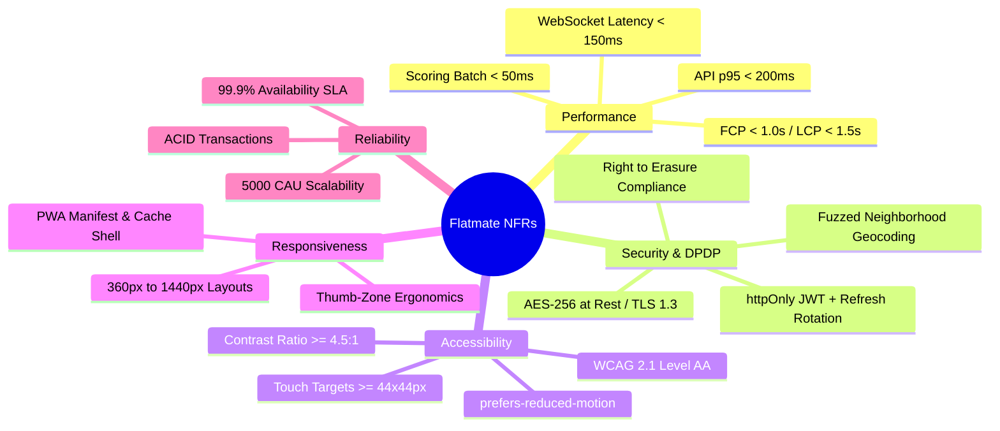

# Flatmate – Non-Functional Requirements Specification (NFRS)

**Document Version**: 1.0.0  
**Phase**: Workflow B (Requirements Engineering)  
**Author**: Requirements Analyst  
**Status**: Ready for Human Sign-off  
**Date**: 2026-11-13  
**Target Release**: MVP v1.0

---

## 1. Overview & Quality Pillars

This document establishes the measurable, verifiable non-functional benchmarks that govern the technical architecture, security baseline, user experience, and deployment of Project **Flatmate**. Every requirement specifies exact metrics, measurement procedures, and pass/fail thresholds.

---

## 2. Performance & Latency Requirements

### NFR-PERF-01: Client-Side Page Load & Core Web Vitals
- **Target Metrics**:
  - First Contentful Paint (FCP): $\le 1.0$ second on simulated 4G mobile network (1.6 Mbps download, 750 Kbps upload, 150ms RTT).
  - Largest Contentful Paint (LCP): $\le 1.5$ seconds on simulated 4G mobile network.
  - Cumulative Layout Shift (CLS): $\le 0.1$ across all viewport sizes.
  - Interaction to Next Paint (INP) / First Input Delay (FID): $\le 100$ milliseconds.
- **Verification Method**: Automated Lighthouse audit during CI/CD build step; Playwright performance traces on Google Chrome mobile emulation (Pixel 7 profile).
- **Pass / Fail Threshold**: Lighthouse Performance Score $\ge 90/100$ on mobile emulation.

### NFR-PERF-02: RESTful API Endpoint Latencies
- **Target Metrics**:
  - Read Endpoints (Profile retrieval, discovery feed fetch): p95 response time $\le 200$ ms; p99 response time $\le 400$ ms.
  - Write Endpoints (Swipe decision, profile update): p95 response time $\le 150$ ms; p99 response time $\le 300$ ms.
  - Authentication Endpoints (OTP verification, session creation): p95 response time $\le 250$ ms.
- **Verification Method**: k6 load test script executing 1,000 synthetic requests/second against staging environment.
- **Pass / Fail Threshold**: 95% of all non-file-upload API calls complete under 200ms.

### NFR-PERF-03: Compatibility Scoring Batch Calculation Latency
- **Target Metrics**: The deterministic 7-vector compatibility scoring engine must evaluate and rank a batch of 50 candidate profiles against the requesting user profile in $\le 50$ milliseconds.
- **Verification Method**: Automated microbenchmark unit test in Vitest evaluating 1,000 randomized user vector pairs.
- **Pass / Fail Threshold**: Batch evaluation time must never exceed 50ms at p95 under standard server CPU load.

### NFR-PERF-04: Real-Time WebSocket Message Latency
- **Target Metrics**: End-to-end latency for 1-on-1 chat messages (from user send action to recipient WebSocket client receipt) must be $\le 150$ milliseconds under standard network conditions.
- **Verification Method**: Automated dual-client Playwright test running WebSocket message exchange with synchronized timestamps.
- **Pass / Fail Threshold**: 95% of real-time messages arrive at client in $<150$ ms.

### NFR-PERF-05: Database Query Execution Benchmark
- **Target Metrics**: Relational database queries for discovery feed generation (filtering by gender, budget, micro-market, and computing vector overlaps) must execute in $\le 30$ milliseconds at p95.
- **Verification Method**: PostgreSQL `EXPLAIN (ANALYZE, BUFFERS)` execution on indexed dataset containing 20,000 seeded user profiles.
- **Pass / Fail Threshold**: Query plan execution time $<30$ ms without sequential table scans.

### NFR-PERF-06: JavaScript Client Bundle Size Budget
- **Target Metrics**: Initial JavaScript bundle transferred to the browser must not exceed $150$ KB (gzipped / Brotli compressed).
- **Verification Method**: Webpack / Next.js bundle analyzer integrated into build pipeline.
- **Pass / Fail Threshold**: Build fails if first-load JS shared bundle exceeds 150 KB.

---

## 3. Security, Privacy & Data Protection (DPDP Act Compliance)

### NFR-SEC-01: Authentication & Token Management
- **Specification**:
  - Sessions must be managed using JSON Web Tokens (JWT) stored exclusively in `httpOnly`, `Secure`, `SameSite=Strict` HTTP cookies to prevent XSS exfiltration.
  - Access Token Expiration: Maximum 15 minutes.
  - Refresh Token Expiration: Maximum 14 days, stored in database with automatic reuse detection and cryptographic token rotation.
- **Pass / Fail Threshold**: Zero tokens stored in `localStorage` or `sessionStorage`.

### NFR-SEC-02: Role-Based Access Control & Route Guarding
- **Specification**: Every API endpoint must enforce defense-in-depth authorization. Client-supplied user IDs or role claims must NEVER be trusted; identity must be strictly derived from verified session state.
- **Pass / Fail Threshold**: Automated API penetration tests verifying that User A cannot read or modify User B's profile, messages, or swipe history (IDOR testing).

### NFR-SEC-03: India DPDP Act 2023 Compliance & Consent
- **Specification**:
  - Explicit, granular consent checkboxes recorded at signup with timestamp and policy version.
  - **Right to Erasure (Data Deletion)**: A single-click "Delete My Account & Data" action in user settings that hard-deletes or irreversibly anonymizes all profile data, photos, swipe logs, and chat messages within 72 hours.
  - Purpose Limitation: User data must never be shared with third-party advertisers or brokers.
- **Pass / Fail Threshold**: Full deletion audit passes verification: zero residual PII in database.

### NFR-SEC-04: Data Encryption at Rest and in Transit
- **Specification**:
  - In Transit: All communications enforced over TLS 1.3 (minimum TLS 1.2). HSTS header enforced with `max-age=31536000; includeSubDomains; preload`.
  - At Rest: Database volume encrypted with AES-256. Sensitive PII columns (user phone numbers, academic verification records, government IDs) encrypted at column level using AES-256-GCM before write.
- **Pass / Fail Threshold**: SSL Labs Grade A+ and raw database export contains zero plain-text phone numbers.

### NFR-SEC-05: PII Masking & Geocoding Coarsening
- **Specification**:
  - Phone numbers and email addresses must be masked when displayed to admins or in support logs (`+91 98****4321`, `a****@ust.com`).
  - Residential location data must be coarsened to the centroid of named micro-markets (e.g. Kazhakkoottam, Kariavattom, Sreekaryam). Exact GPS coordinates must NEVER be queried, stored, or transmitted.
- **Pass / Fail Threshold**: Network payload inspection verifies absence of precise lat/long coordinates.

### NFR-SEC-06: API Rate Limiting & Abuse Prevention
- **Specification**:
  - OTP Request Endpoint: Maximum 3 requests per phone number per 15 minutes.
  - OTP Verification Endpoint: Maximum 5 attempts per phone number per 15 minutes.
  - Swipe Action Endpoint: Maximum 60 swipe events per minute per authenticated user.
  - Chat Message Endpoint: Maximum 30 messages per minute per active conversation.
- **Pass / Fail Threshold**: Automated load tests trigger HTTP 429 Too Many Requests upon threshold breach.

### NFR-SEC-07: OWASP Top 10 Defenses
- **Specification**:
  - **SQL Injection**: 100% parameterized queries via modern ORM / query builder.
  - **XSS**: Strict sanitization of all user-generated content (bios, chat messages) via DOMPurify before render; Content Security Policy (CSP) blocking unauthorized script injection.
  - **CSRF**: Enforced via SameSite=Strict cookies and Anti-CSRF token verification on state-changing requests.
  - **Security Headers**: `X-Content-Type-Options: nosniff`, `X-Frame-Options: DENY`, `Referrer-Policy: strict-origin-when-cross-origin`.
- **Pass / Fail Threshold**: OWASP ZAP automated baseline security scan reports zero High or Critical vulnerabilities.

### NFR-SEC-08: AI Guardrails & Privacy Boundaries
- **Specification**:
  - Compatibility summaries generated via Gemini API must strictly receive anonymized vector tokens (e.g., `{ vector_sleep: "NIGHT_OWL", vector_cleanliness: "METICULOUS" }`).
  - No user names, phone numbers, exact addresses, or chat logs may ever be sent to external LLM APIs.
  - Prompts must enforce structured JSON schema outputs to prevent prompt injection.
- **Pass / Fail Threshold**: AI proxy interceptor tests confirm zero PII payload leakage.

---

## 4. Accessibility & Ergonomic Requirements (WCAG 2.1 AA)

### NFR-A11Y-01: Color Contrast Ratios
- **Specification**: All text, interactive icons, and visual indicators must satisfy WCAG 2.1 Level AA contrast standards:
  - Normal text (< 18pt or < 14pt bold): Contrast ratio $\ge 4.5:1$ against background.
  - Large text ($\ge 18pt$ or $\ge 14pt$ bold) and interactive UI icons: Contrast ratio $\ge 3.0:1$.
- **Verification Method**: Automated axe-core / Playwright accessibility scan.
- **Pass / Fail Threshold**: Zero color contrast violations.

### NFR-A11Y-02: Minimum Touch Target Dimensions
- **Specification**: All interactive UI controls (swipe action buttons, filter tags, navigation tabs, modal close triggers) must have a physical touch target of at least $44 \times 44$ CSS pixels.
- **Verification Method**: Visual CSS inspection and Playwright automated geometry assertion.
- **Pass / Fail Threshold**: 100% of clickable elements meet or exceed 44x44px bounding box.

### NFR-A11Y-03: Keyboard Navigation & Focus Indicators
- **Specification**: All discovery actions (Pass, Like, Super-Like, Profile Expand) must be fully executable via standard keyboard inputs:
  - Arrow Left: Pass candidate
  - Arrow Right: Like candidate
  - Arrow Up: Super-Like candidate
  - Spacebar / Enter: Open detailed profile sheet
  - Escape: Close modal
  - Visible focus ring: High-contrast 2px outline around currently focused element.
- **Pass / Fail Threshold**: Complete user flow navigable without mouse or touch input.

### NFR-A11Y-04: Screen Reader Support & ARIA Semantics
- **Specification**:
  - Meaningful `aria-label` attributes on all icon-only buttons (e.g. `aria-label="Like profile and express interest"`).
  - Dynamic content updates (match celebration, new chat messages, error alerts) must use `aria-live="polite"` or `aria-live="assertive"` announcements.
  - Semantic HTML tags (`<main>`, `<article>`, `<header>`, `<dialog>`) used throughout.
- **Pass / Fail Threshold**: Screen reader audit using VoiceOver / NVDA confirms unobstructed navigation.

### NFR-A11Y-05: Motion Sensitivity (`prefers-reduced-motion`)
- **Specification**: Respect user operating system settings for reduced motion. When `prefers-reduced-motion: reduce` is active, card sliding/rotation animations must be replaced with instant opacity crossfades.
- **Pass / Fail Threshold**: CSS media query inspection and visual snapshot comparison.

---

## 5. Mobile Responsiveness & Viewport Targets

### NFR-RESP-01: Viewport Support Matrix
The application must render flawlessly without horizontal scrolling or broken layouts across five standard viewport classes:

| Viewport Class | Reference Devices | Width Range | Layout Adaptation |
| :--- | :--- | :--- | :--- |
| **Mobile Compact** | iPhone SE, Samsung Galaxy A-series | 360px – 389px | Single-column, stacked controls, bottom navigation bar |
| **Mobile Standard** | iPhone 14/15, Pixel 7, Galaxy S23 | 390px – 428px | Single-column, optimized card aspect ratio (3:4) |
| **Tablet Portrait** | iPad Mini, iPad 10th Gen | 768px – 834px | Centered max-width card container (480px) with padded margins |
| **Desktop Laptop** | MacBook Air, 13-15" Windows Laptops | 1024px – 1280px | Split-screen discovery (Deck on left, expanded lifestyle panel on right) |
| **Desktop Large** | 24"+ External Monitors | 1440px – 1920px | Centered application shell (max-width 1200px) with rich sidebar |

- **Verification Method**: Automated visual regression testing via Playwright across 360px, 390px, 768px, 1024px, and 1440px widths.
- **Pass / Fail Threshold**: Zero pixel overflow, text clipping, or broken element stacks.

### NFR-RESP-02: Ergonomic Thumb-Zone Optimization
- **Specification**: On mobile viewports (360px–428px), all primary high-frequency action buttons (Pass, Like, Chat Input) must be positioned within the natural bottom "thumb zone" (bottom 35% of the viewport height) to allow comfortable single-handed operation.
- **Pass / Fail Threshold**: Primary action buttons sit between 16px and 80px above viewport bottom.

### NFR-RESP-03: Progressive Web Application (PWA) Readiness
- **Specification**:
  - Valid `manifest.json` specifying app name, theme color (`#1E3A8A`), background color, and responsive icons (192x192, 512x512 maskable).
  - Service worker providing offline application shell caching so users can view already-loaded matches when traveling through connectivity dead zones.
  - Install prompt readiness for "Add to Home Screen".
- **Pass / Fail Threshold**: Lighthouse PWA audit category reports 100% compliance.

---

## 6. Scalability, Availability & Reliability

### NFR-REL-01: System Availability SLA
- **Target Metric**: The production service must maintain an uptime availability of $\ge 99.9\%$ during normal operation (maximum allowed unplanned downtime: $<43.8$ minutes per month).
- **Maintenance Window**: Scheduled database maintenance permitted only between 02:00 AM – 04:00 AM IST on Tuesdays.
- **Verification Method**: Automated synthetic heartbeat monitors pinging healthcheck endpoint (`/api/health`) every 60 seconds from multiple geographic nodes.

### NFR-REL-02: Concurrent User Scalability Baseline
- **Target Metric**: System must support 5,000 Concurrent Active Users (CAU) and sustained throughput of 100,000 daily swipe interactions without error rates exceeding 0.1%.
- **Verification Method**: Distributed load testing executing ramp-up to 5,000 virtual users performing discovery swiping, messaging, and profile updates.
- **Pass / Fail Threshold**: API error rate $<0.1\%$; CPU utilization $<70\%$.

### NFR-REL-03: Fault Tolerance & Graceful Degradation
- **Specification**:
  - If the compatibility scoring worker is temporarily delayed, the system must serve cached candidate scores or fallback to location/budget proximity ranking rather than throwing an error.
  - If WebSocket connection drops due to mobile cell tower switching, the client chat client must automatically reconnect with exponential backoff and fall back to HTTP long-polling within 3 seconds.
- **Pass / Fail Threshold**: Zero unhandled exceptions presented to user during simulated socket disconnection.

### NFR-REL-04: Data Consistency & Relational Integrity
- **Specification**:
  - Swipe actions and mutual match transitions must be executed inside ACID database transactions with row-level locking (`SELECT ... FOR UPDATE`) to eliminate race conditions where simultaneous swipes could produce duplicate match rows or orphaned chat channels.
- **Pass / Fail Threshold**: Zero duplicate matches in concurrent swipe stress tests.

### NFR-REL-05: Automated Backup & Recovery
- **Specification**:
  - Automated continuous PostgreSQL WAL archiving with daily point-in-time recovery (PITR) snapshots.
  - Recovery Time Objective (RTO): $\le 1$ hour.
  - Recovery Point Objective (RPO): $\le 5$ minutes.
- **Pass / Fail Threshold**: Staging disaster recovery restoration drill executed in $<45$ minutes with zero data loss.
