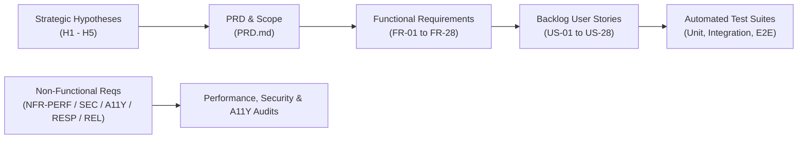
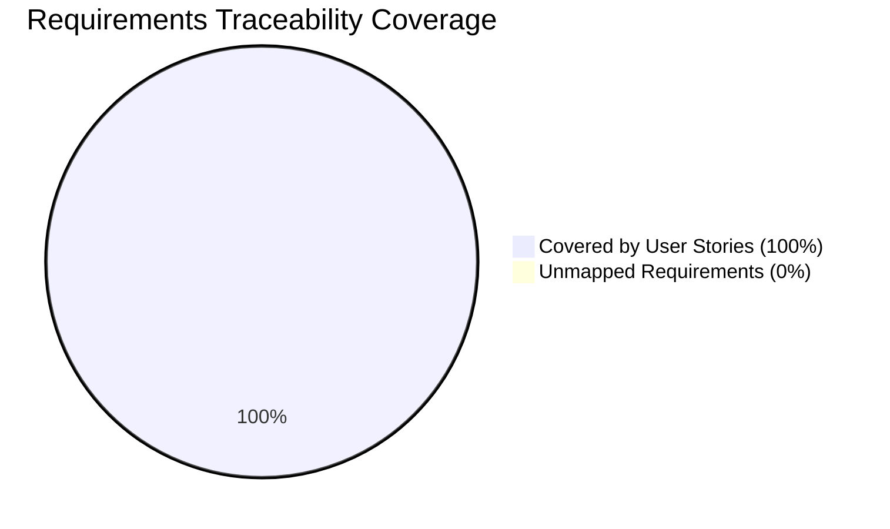

# Flatmate – Requirements Traceability Matrix (RTM)

**Document Version**: 1.0.0  
**Phase**: Workflow B (Requirements Engineering)  
**Author**: Requirements Analyst  
**Status**: Ready for Human Sign-off  
**Date**: 2026-11-13  
**Target Release**: MVP v1.0

---

## 1. Overview & Verification Strategy

The Requirements Traceability Matrix (RTM) establishes a strict bidirectional mapping across the Flatmate product lifecycle:
1. **Strategic Hypotheses & Business Goals** $\leftrightarrow$ **PRD Scope**
2. **PRD Functional Requirements (FR-01 to FR-28)** $\leftrightarrow$ **Backlog User Stories (US-01 to US-28)**
3. **User Stories** $\leftrightarrow$ **Automated Test Cases (Unit, Integration, Contract, E2E)**
4. **Non-Functional Requirements (NFR-PERF, NFR-SEC, NFR-A11Y, NFR-RESP, NFR-REL)** $\leftrightarrow$ **Benchmark Suites**

---

## 2. Strategic Hypothesis to PRD Traceability

| Hypothesis ID | Hypothesis Summary | Validating PRD Section | Supporting FRs | Measurement / Telemetry Target |
| :--- | :--- | :--- | :--- | :--- |
| **H1** | Compatibility Focus: >60% time spent on lifestyle vectors vs photos | PRD §1.3, §4 | FR-07 – FR-16 | Card expansion duration telemetry > 60% session time |
| **H2** | Modality 4 Adoption: ≥30% users search for person first | PRD §1.2, §4 | FR-04 | User registration modality distribution metric |
| **H3** | Verification Trust Lift: Verified badges yield ≥3x mutual match rate | PRD §1.3, §4 | FR-02, FR-03 | Mutual match rate comparison: verified vs unverified |
| **H4** | Privacy & Female Retention: Masking drives ≥80% satisfaction & ≥35% female ratio | PRD §1.3, §6 | FR-23, FR-27, FR-28 | Post-onboarding micro-pulse survey & active cohort gender ratio |
| **H5** | Match-to-Chat Velocity: ≥45% of mutual matches chat in 24 hours | PRD §1.3, §7 | FR-20, FR-21, FR-22 | Time delta from `MUTUAL_MATCH` to first `message_sent` |

---

## 3. Bidirectional Functional Traceability Matrix

| Functional Req ID | Functional Requirement Title | Priority | User Story ID | User Story Title | Test Case ID | Test Level & Type |
| :--- | :--- | :--- | :--- | :--- | :--- | :--- |
| **FR-01** | Phone Number Auth via OTP | Must | **US-01** | Phone OTP Authentication & Secure Session | `TC-AUTH-01` `TC-AUTH-02` | Unit / API Integration (Supertest) |
| **FR-02** | Institutional & Corporate Domain Email Verification | Must | **US-02** | Institutional & Corporate Email Verification | `TC-AUTH-03` `TC-AUTH-04` | Integration / Domain Validator |
| **FR-03** | Visual Trust Badge Display | Must | **US-03** | Visual Trust Badging on Profile & Cards | `TC-UI-01` `TC-SEC-01` | Component Unit (Vitest) & Payload Inspection |
| **FR-04** | Discovery Modality Selection & Routing | Must | **US-04** | Modality Selection & Dynamic Routing | `TC-ONB-01` `TC-E2E-01` | Component Test & Playwright E2E Flow |
| **FR-05** | Core Profile Setup & Demographics | Must | **US-05** | Demographic Profile & Micro-Market Config | `TC-PROF-01` `TC-PROF-02` | API Schema Validation (Zod) & Integration |
| **FR-06** | Trivandrum Micro-Market & Budget Preferences | Must | **US-05** | Demographic Profile & Micro-Market Config | `TC-PROF-03` | API Query Builder Integration |
| **FR-07** | Vector 1: Sleep Schedule & Chronotype | Must | **US-06** | Sleep & Cleanliness Lifestyle Profiling | `TC-VEC-01` | Unit / Schema Test |
| **FR-08** | Vector 2: Cleanliness & Hygiene Expectations | Must | **US-06** | Sleep & Cleanliness Lifestyle Profiling | `TC-VEC-02` | Unit / Schema Test |
| **FR-09** | Vector 3: Dietary Preferences & Kitchen Sharing | Must | **US-07** | Dietary & Guest Policy Configuration | `TC-VEC-03` | Unit / Schema Test |
| **FR-10** | Vector 4: Social Habits & Guest Policy | Must | **US-07** | Dietary & Guest Policy Configuration | `TC-VEC-04` | Unit / Schema Test |
| **FR-11** | Vector 5: Substance Tolerance (Smoking/Alcohol) | Must | **US-08** | Substances, Finances & Work Profiling | `TC-VEC-05` | Unit / Schema Test |
| **FR-12** | Vector 6: Financial Discipline & Rent Splitting | Must | **US-08** | Substances, Finances & Work Profiling | `TC-VEC-06` | Unit / Schema Test |
| **FR-13** | Vector 7: Work Rhythm & WFH Setup | Must | **US-08** | Substances, Finances & Work Profiling | `TC-VEC-07` | Unit / Schema Test |
| **FR-14** | Deterministic Compatibility Scoring Engine | Must | **US-09** | Deterministic Scoring Calculation | `TC-MATCH-01` `TC-MATCH-02` | Algorithm Unit Test (Vitest) & Batch Microbenchmark |
| **FR-15** | Dealbreaker Filtering & Hard Constraints | Must | **US-10** **US-18** | Dealbreaker Enforcement & Modality Pairing | `TC-MATCH-03` `TC-MATCH-04` | SQL Query Integration & Dealbreaker Matrix Test |
| **FR-16** | Transparent Compatibility Breakdown Generation | Must | **US-11** | Compatibility Breakdown & Harmony Insights | `TC-MATCH-05` | Service Integration & PII Sanitizer Test |
| **FR-17** | Discovery Card Deck Feed Retrieval | Must | **US-12** | Discovery Card Deck Feed Rendering | `TC-FEED-01` `TC-FEED-02` | API Integration & Playwright Card Rendering |
| **FR-18** | Swipe Interactions & Decision Processing | Must | **US-13** **US-14** | Touch Swipe Processing & Undo/Rewind | `TC-SWIPE-01` `TC-SWIPE-02` | State Transition Integration & Idempotency Test |
| **FR-19** | Detailed Profile Expansion Modal | Must | **US-15** | Profile Expansion & Comparison Modal | `TC-UI-02` `TC-E2E-02` | Component Test & Playwright Gesture E2E |
| **FR-20** | Mutual Match Detection & State Transition | Must | **US-16** | Atomic Mutual Match Detection | `TC-MATCH-06` `TC-MATCH-07` | ACID Concurrency Test (Concurrent Swipes) |
| **FR-21** | Mutual Match Notification & Double Opt-in | Must | **US-17** | Match Celebration Modal & Direct Flow | `TC-UI-03` `TC-E2E-03` | WebSocket Event Test & Playwright E2E Modal |
| **FR-22** | 1-on-1 Real-Time Text Messaging Engine | Must | **US-19** **US-20** | Real-Time Messaging & Status Indicators | `TC-CHAT-01` `TC-CHAT-02` | WebSocket Client Integration & Latency Test |
| **FR-23** | DPDP Privacy & Contact Information Masking | Must | **US-21** | DPDP Contact Masking & Security Alerts | `TC-SEC-02` `TC-SEC-03` | Automated PII Interceptor & Regex Guard Test |
| **FR-24** | Active Conversation Management & Unmatching | Must | **US-22** | Conversation Unmatching & Chat Controls | `TC-CHAT-03` | State Transition Integration Test |
| **FR-25** | Room Listing Creation & Media Upload | Should | **US-23** **US-24** | Room Listing Creation & Photo Upload | `TC-ROOM-01` `TC-ROOM-02` | Object Storage Mock & Form Validation Test |
| **FR-26** | Room Listing Display in Discovery Deck | Should | **US-25** | Room Showcase Display on Discovery Cards | `TC-UI-04` | Component Render & Photo Toggle Test |
| **FR-27** | Instant User Blocking & Feed Exclusion | Must | **US-26** | Instant Bidirectional User Blocking | `TC-SAFE-01` `TC-SAFE-02` | Database Bidirectional Block Test & Feed Exclusion |
| **FR-28** | Abuse Reporting with Auto-Quarantine Trigger | Must | **US-27** **US-28** | Abuse Reporting & Auto-Quarantine Trigger | `TC-SAFE-03` `TC-SAFE-04` | Event Hook Test & Threshold Quarantine Assertion |

---

## 4. Non-Functional Traceability Matrix

| NFR ID | Quality Requirement | Measurable Target | Verification Tool / Suite | Automated Test ID |
| :--- | :--- | :--- | :--- | :--- |
| **NFR-PERF-01** | Mobile Core Web Vitals | FCP < 1.0s, LCP < 1.5s, CLS < 0.1 | Lighthouse CI / Playwright Traces | `BENCH-PERF-01` |
| **NFR-PERF-02** | API Endpoint Latencies | Read p95 < 200ms, Write p95 < 150ms | k6 Load Test Suite | `BENCH-PERF-02` |
| **NFR-PERF-03** | Batch Compatibility Scoring | 50 candidate profiles evaluated < 50ms | Vitest Microbenchmark | `BENCH-PERF-03` |
| **NFR-PERF-04** | WebSocket Messaging Latency | End-to-end receipt < 150ms | Dual-Client Playwright Test | `BENCH-PERF-04` |
| **NFR-PERF-05** | Database Query Performance | Feed generation query < 30ms p95 | PostgreSQL `EXPLAIN ANALYZE` Script | `BENCH-PERF-05` |
| **NFR-PERF-06** | Client JS Bundle Budget | Shared JS bundle < 150 KB gzipped | Next.js Build Bundle Analyzer | `BENCH-PERF-06` |
| **NFR-SEC-01** | Token Management & Storage | httpOnly JWT + Refresh rotation | Security Integration Test | `BENCH-SEC-01` |
| **NFR-SEC-02** | RBAC & IDOR Defense | Zero unauthorized object access | Automated OWASP IDOR Scanner | `BENCH-SEC-02` |
| **NFR-SEC-03** | DPDP Act Right to Erasure | Zero residual PII post-deletion in 72h | Data Deletion Audit Script | `BENCH-SEC-03` |
| **NFR-SEC-04** | Data Encryption at Rest/Transit| AES-256 at rest, TLS 1.3 in transit | SSL Labs & DB Column Inspection | `BENCH-SEC-04` |
| **NFR-SEC-05** | PII Masking & Coarsened Location| Zero raw phone/lat-long in responses | Response Payload Inspector | `BENCH-SEC-05` |
| **NFR-SEC-06** | Rate Limiting Enforcement | HTTP 429 on threshold breach | k6 Burst Test Suite | `BENCH-SEC-06` |
| **NFR-SEC-07** | OWASP Top 10 Defenses | Zero High/Critical vulnerabilities | OWASP ZAP Baseline Security Scan | `BENCH-SEC-07` |
| **NFR-SEC-08** | AI LLM Privacy Guardrails | Zero PII sent to external LLMs | AI Proxy Assertion Test | `BENCH-SEC-08` |
| **NFR-A11Y-01** | Color Contrast Ratios | Contrast ratio $\ge 4.5:1$ (AA) | axe-core Automated Scanner | `BENCH-A11Y-01` |
| **NFR-A11Y-02** | Minimum Touch Targets | Target size $\ge 44 \times 44$ CSS px | Playwright Bounding Box Test | `BENCH-A11Y-02` |
| **NFR-A11Y-03** | Keyboard Navigation | Complete deck flow operable via keys | Playwright Keyboard Emulation | `BENCH-A11Y-03` |
| **NFR-A11Y-04** | Screen Reader ARIA Semantics | Valid ARIA roles and live regions | Screen Reader Audit Test | `BENCH-A11Y-04` |
| **NFR-A11Y-05** | Reduced Motion Sensitivity | Respects `prefers-reduced-motion` | CSS Media Query Visual Test | `BENCH-A11Y-05` |
| **NFR-RESP-01** | Viewport Adaptability | 360px, 390px, 768px, 1024px, 1440px | Playwright Visual Regression Suite | `BENCH-RESP-01` |
| **NFR-RESP-02** | Ergonomic Thumb-Zone Layout | High-frequency buttons in bottom 35% | Geometry Verification Test | `BENCH-RESP-02` |
| **NFR-RESP-03** | PWA Manifest & Offline Shell | Valid manifest and offline cache | Lighthouse PWA Audit | `BENCH-RESP-03` |
| **NFR-REL-01** | 99.9% Availability SLA | < 43.8 min unplanned downtime/month | Multi-region synthetic pings | `BENCH-REL-01` |
| **NFR-REL-02** | 5,000 CAU Scalability | 100k daily swipes with <0.1% errors | k6 Ramp-Up Scalability Test | `BENCH-REL-02` |
| **NFR-REL-03** | Fault Tolerance & Auto-Fallback | Graceful socket to polling fallback | Chaos Network Disconnect Test | `BENCH-REL-03` |
| **NFR-REL-04** | ACID Transactional Consistency | Zero race condition duplicates | Concurrent Swipe Stress Test | `BENCH-REL-04` |

---

## 5. Traceability Coverage & Gap Analysis

- **Functional Requirements Count**: 28 atomic requirements (`FR-01` through `FR-28`).
- **User Stories Generated**: 28 atomic user stories (`US-01` through `US-28`).
- **Functional Coverage**: **100%** (28/28). Every functional requirement maps directly to at least one user story and test case.
- **Non-Functional Benchmarks Defined**: 24 rigorous NFR targets mapped to automated test identifiers (`BENCH-PERF`, `BENCH-SEC`, `BENCH-A11Y`, `BENCH-RESP`, `BENCH-REL`).
- **Zero Orphaned Stories**: All backlog stories trace backward to an approved PRD functional requirement.
- **Ready for Architecture & Design (Workflow C)**: The technical requirements and acceptance criteria are fully specified for the Solution Architect, UX Designer, and Database Specialist.
