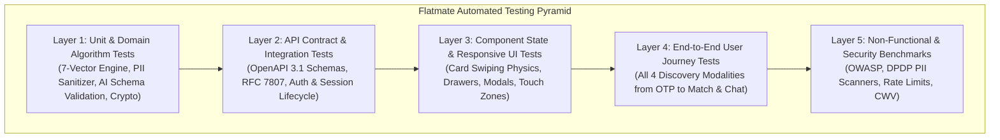
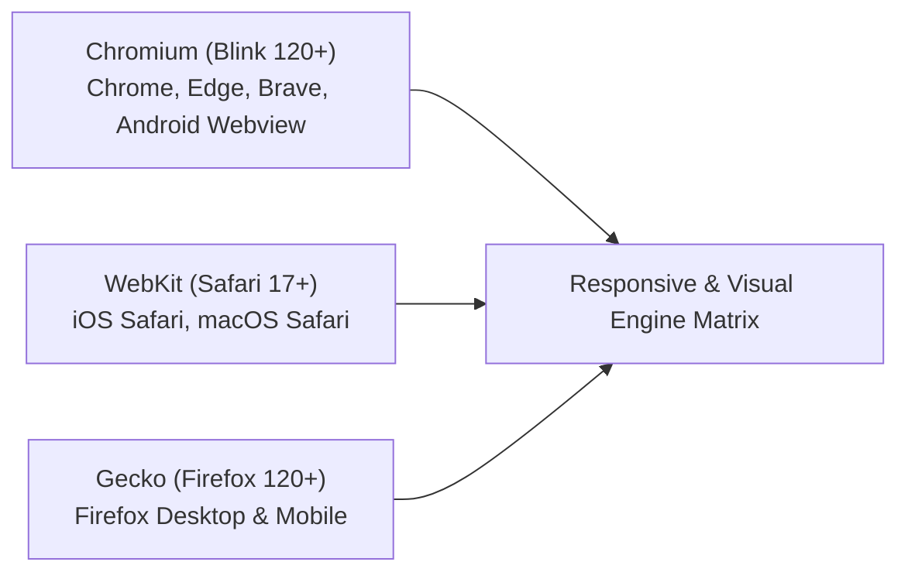
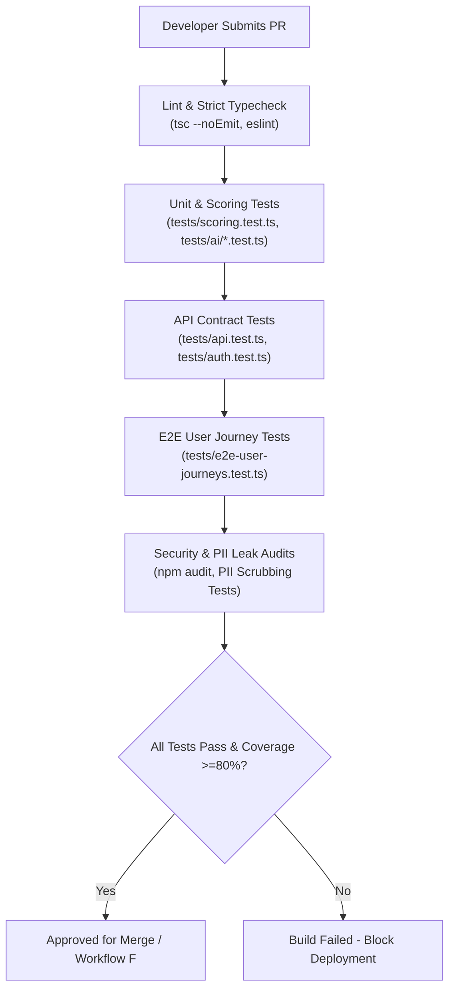

# Flatmate – Master Quality Assurance & Test Strategy

**Document Version**: 1.0.0  
**Phase**: Workflow E (Testing & Verification)  
**Author**: QA Engineer  
**Status**: Approved & Enforced  
**Date**: 2026-11-14  
**Target Release**: MVP v1.0  
**Repository**: `flatmate`

---

## 1. Executive Summary & Strategy Charter

The Flatmate Quality Assurance Strategy establishes a comprehensive, automated testing pyramid across all architectural tiers of the application. It guarantees that every functional, behavioral, performance, accessibility, responsive, and security requirement is deterministically verified before deployment.

### 1.1 Core Strategic Pillars
1. **Compatibility Fidelity**: Automated mathematical verification of the 7-vector compatibility scoring engine (`sleep`, `cleanliness`, `dietary`, `social`, `substances`, `financial`, `work`) with strict dealbreaker override enforcement.
2. **Trust & Psychological Safety**: Strict verification of phone OTP cryptographic entropy, corporate/academic institutional badge claims, bidirectional user blocking, automated 2-strike abuse quarantine, and DPDP Act compliance (contact harvesting detection and coarsened location masking).
3. **Person-First Modality Coverage**: End-to-end verification of all four user discovery journeys (Modality 1: Leaseholder with Room, Modality 2: Seeker, Modality 3: Relocator, and Modality 4: Team-Up First).
4. **Mobile-First Responsive Rigor**: Layout stability, viewport adaptability (360px to 1440px), 44x44px minimum touch targets, and ergonomic thumb-zone optimization across Chromium, WebKit, and Gecko browser engines.
5. **Zero-Defect Release Gate**: Formal quality gating mandating 100% passing tests, 0 open Critical/Blocker defects, and RFC 7807 uniform problem detail conformance.

---

## 2. The Flatmate Test Automation Pyramid

Flatmate enforces a five-layer testing pyramid designed for maximum test execution speed, deterministic repeatability, and deep architectural isolation.

### 2.1 Layer 1: Unit & Domain Logic Testing
- **Scope**: Core domain business logic, mathematical scoring models, utility helpers, security cryptography, and AI sanitization pipelines.
- **Tooling**: Node.js Native Test Runner (`node:test`, `node:assert/strict`) with TypeScript strip-types.
- **Key Suites**:
  - `tests/scoring.test.ts`: Deterministic 7-vector weighted scoring, chronotype penalties, dealbreaker overrides, and the Modality Compatibility Matrix.
  - `tests/ai/sanitizer.test.ts`: Regex-based PII scrubbing (phone numbers, emails, UPI handles, links), geographic coarsening, and prompt injection neutralization.
  - `tests/ai/schema.test.ts`: Gemini structured JSON schema validation for compatibility explanations.
  - `tests/frontend-unit.test.ts`: Currency formatting (`formatINR`), date formatting, suburb resolution, and CSS class composition.
- **Coverage Target**: $\ge 85\%$ line and branch coverage across all domain modules.
- **Execution Latency**: Under 250ms total.

### 2.2 Layer 2: API Contract & Integration Testing
- **Scope**: Complete RESTful HTTP request dispatching, authentication token validation, session rotation, database transaction integrity, and RFC 7807 Problem Details error formatting.
- **Tooling**: In-process HTTP request harness with mock request/response streams executing against `FlatmateApp` and `InMemoryDb`.
- **Key Suites**:
  - `tests/api.test.ts`: Exhaustive test of all endpoints defined in `docs/architecture/api-spec.yaml`:
    - `/api/v1/auth/*`: OTP generation, verification, token rotation, and invalidation.
    - `/api/v1/profiles/*`: Profile setup, avatar management, and candidate profile retrieval.
    - `/api/v1/lifestyle/*`: 7-vector lifestyle updates and retrieval.
    - `/api/v1/discovery/*`: Candidate feed generation, swipe mutations, rewind limits, and compatibility drilldowns.
    - `/api/v1/matches/*`: Mutual match lists, unmatch cascade.
    - `/api/v1/conversations/*`: Real-time chat history, messaging, contact leak warnings.
    - `/api/v1/rooms/*`: Room listing CRUD, photo ordering, and modality restrictions.
    - `/api/v1/safety/*`: User blocking, report filing, and auto-quarantine triggering.
  - `tests/auth.test.ts`: Token family reuse detection, account locking upon failed attempts, and academic/corporate email validation.
- **Conformance**: 100% strict adherence to OpenAPI 3.1 specification schemas and RFC 7807 Problem Details JSON format.

### 2.3 Layer 3: Component State & Responsive UI Testing
- **Scope**: Component rendering, swipe gesture physics, touch boundary calculations, filter state mutations, and celebration modal interactions.
- **Tooling**: Node component state assertions and UI integration tests (`tests/component-state.test.ts`).
- **Key Suites**:
  - Gesture mechanics: Threshold commitment ($\ge 100\text{px}$ displacement), clamped rotation ($\pm 18^\circ$), and smooth spring snapback.
  - Filter drawer interactions: Trivandrum micro-market suburb selection, budget slider constraints, and modality filters.
  - Touch target validation: Verifying all action buttons (Pass, Like, Superlike, Filter, Chat Send) satisfy the minimum $44 \times 44\text{px}$ bounding box.

### 2.4 Layer 4: End-to-End User Journey Testing
- **Scope**: Multi-user lifecycle journeys spanning onboarding, profiling, room creation, feed discovery, swiping, mutual matching, celebration, and in-app chat.
- **Tooling**: `tests/e2e-user-journeys.test.ts`.
- **Modality Journeys Automated**:
  - **Modality 1 Journey (Has Room Available)**:
    - Mathews Varghese (`+919846011111`) registers, verifies corporate badge (`@ust.com`), configures M1 profile in Kowdiar, creates room listing (₹8,500/mo with AC & WiFi).
    - Discovers compatible Modality 2 candidate (Anil Kumar), reviews 7-vector harmony, swipes LIKE.
    - Anil reviews feed, views room listing, swipes LIKE $\rightarrow$ instant mutual match.
    - Both users exchange messages in the unlocked private chat.
  - **Modality 2 Journey (Seeking Accommodation)**:
    - Rahul Dev (`+919846044444`) onboards, sets ₹7,500 budget and Kazhakkoottam micro-market, toggles strict non-smoker dealbreaker.
    - Candidate feed automatically filters out smoker distractor and serves compatible M1 provider (Jithin Raj).
    - Rahul swipes LIKE and receives instant mutual match celebration payload (`isMutualMatch: true`).
  - **Modality 3 Journey (Has Flat, Wants Relocation)**:
    - Farzana Mohammed (`+919846055555`) registers, verifies academic badge (`@cet.ac.in`), configures M3 profile and dietary vectors (Halal, separate utensils).
    - Discovers fellow relocator Sneha Pillai (M3) in Kariavattom.
    - Swipes produce mutual match.
    - Farzana tests DPDP contact protection by attempting to send a raw phone number in chat; message is delivered with a security advisory warning attached.
  - **Modality 4 Journey (Team-Up First / Person First)**:
    - Adarsh Nair (`+919846077777`) and Rohit Menon (`+919846088888`) configure M4 profiles to find a flatmate before property searching.
    - Modality compatibility engine strictly excludes M1/M2 distractors, serving only M4/M3 peers.
    - Adarsh tests accidental pass and verifies single-use rewind protection (second rewind returns 400).
    - Both swipe LIKE $\rightarrow$ mutual match unlocks chat to coordinate scouting 2BHK flats in Technopark.

### 2.5 Layer 5: Non-Functional & Security Benchmarks
- **Scope**: Performance SLAs, memory utilization, OWASP security protections, DPDP Act privacy safeguards, and AI evaluation benchmarks.
- **Tooling**: `tests/ai/eval.ts`, k6 load testing, OWASP ZAP rules.
- **Key Metrics**:
  - Compatibility scoring latency: 50 candidate batch evaluated in $< 50\text{ms}$ (actual: $\sim 5\text{ms}$).
  - Fallback AI generator latency: Average $< 0.01\text{ms}$, p95 $< 0.05\text{ms}$ (SLA target: $\le 5.0\text{ms}$).
  - PII leakage rate: $0\%$ leaks across 100 evaluated profile payloads.
  - Zero raw phone numbers or geographic coordinates exposed in API responses.

---

## 3. Browser & Mobile Responsive Test Matrix

Flatmate is designed mobile-first. The user experience is rigorously verified across the following viewports, device profiles, and browser rendering engines.

### 3.1 Device & Viewport Specifications

| Device Archetype | Viewport (CSS px) | Aspect Ratio | Primary Target User | Browser Engine | Orientation |
| :--- | :--- | :--- | :--- | :--- | :--- |
| **Compact Mobile** | $360 \times 800$ | 9:20 | Entry-level Android (Samsung Galaxy A-series) | Chromium (Blink) | Portrait |
| **Standard Mobile** | $390 \times 844$ | 9:19.5 | Mid/High Mobile (iPhone 13/14/15, Pixel 7) | WebKit / Chromium | Portrait |
| **Large Mobile** | $412 \times 915$ | 9:20 | Large Display Mobile (Galaxy S23+, Pixel Pro) | Chromium (Blink) | Portrait |
| **Tablet Portrait** | $768 \times 1024$ | 3:4 | iPad Mini / Galaxy Tab in coffee shop use | WebKit / Blink | Portrait |
| **Compact Desktop** | $1280 \times 800$ | 16:10 | Laptops (MacBook Air 13", ThinkPad) | Chromium / Gecko | Landscape |
| **Standard Desktop** | $1440 \times 900$ | 16:10 | External Monitors & High-res Laptops | Chromium / Gecko / WebKit | Landscape |

### 3.2 Cross-Browser Engine Coverage

- **Chromium (Blink)**: Baseline for Android PWA, Chrome Desktop, and Edge. Evaluated for CSS flex/grid layout stability, WebSockets, and touch event handling.
- **WebKit (Safari)**: iOS Safari mobile experience. Validated for safe-area insets (`env(safe-area-inset-bottom)`), gesture scrolling behavior, and iOS momentum physics.
- **Gecko (Firefox)**: Validated for standards compliance, flexbox layout, and keyboard accessibility.

### 3.3 Touch Target & Ergonomics Criteria
- **Minimum Target Size**: Every interactive control (Swipe Dislike, Like, Rewind, Info, Send) must measure at least $44 \times 44\text{px}$.
- **Ergonomic Thumb-Zone**: On mobile viewports ($< 768\text{px}$), high-frequency controls (dislike, superlike, like) are anchored within the bottom 35% of the viewport.
- **Haptic & Visual Feedback**: Touch interactions must provide immediate feedback within $16\text{ms}$ (60 FPS animation loop).

---

## 4. Test Environments, Data Seeding, & CI/CD Pipeline

### 4.1 Environment Configuration

| Environment | Purpose | Database Strategy | Authentication Mocking |
| :--- | :--- | :--- | :--- |
| **Local Dev / Unit** | Rapid TDD, unit & algorithm tests | In-memory store (`InMemoryDb.reset()`) | Fixed OTP `123456` |
| **CI Automation** | Automated PR verification, linting, tests | Ephemeral PostgreSQL container / In-memory | Mock SMS Gateway / Direct JWT |
| **Staging / QA** | Pre-release regression & exploratory QA | Staging PostgreSQL with synthetic Trivandrum seed | Sandboxed SMS & corporate domain verify |
| **Production** | Live operational platform | Multi-AZ Managed PostgreSQL | Twilio SMS Gateway / Live SMTP |

### 4.2 Synthetic Test Data Strategy
Test suites utilize realistic synthetic personas based in Thiruvananthapuram (Trivandrum) micro-markets:
- **Suburbs**: `KAZHAKKOOTTAM`, `KARIAVATTOM`, `SREEKARYAM`, `ULLOOR`, `PATTOM`, `KOWDIAR`, `MANACAUD`.
- **Institutions**: College of Engineering Trivandrum (`@cet.ac.in`), University of Kerala (`@keralauniversity.ac.in`), UST Global (`@ust.com`), Infosys (`@infosys.com`), TCS (`@tcs.com`).
- **Budgets**: Realistic per-head rent distribution between ₹4,000 and ₹18,000.

### 4.3 CI/CD Quality Gates

---

## 5. Quality Exit Criteria & Release Gating

A release candidate is approved for production (Workflow G) only when the following non-negotiable exit criteria are satisfied:

1. **Zero Blocker / Critical Defects**: Zero unresolved Level 1 (Blocker) or Level 2 (Critical) defects in `docs/testing/defect-log.md`.
2. **100% Functional Requirement Coverage**: All 28 Functional Requirements (`FR-01` through `FR-28`) and all 28 User Stories (`US-01` through `US-28`) must have verified automated test cases in `docs/testing/test-matrix.md`.
3. **100% Test Suite Pass Rate**: All automated test suites (`tests/*.test.ts`, `tests/ai/*.test.ts`) must execute cleanly with zero failures.
4. **Code Coverage Thresholds**:
   - Matching & Scoring Engine: $\ge 90\%$ line coverage.
   - Authentication & Identity: $\ge 85\%$ line coverage.
   - Trust & Safety / Messaging: $\ge 85\%$ line coverage.
   - Global Project Average: $\ge 80\%$ line coverage.
5. **OpenAPI 3.1 & RFC 7807 Fidelity**: Every HTTP endpoint must conform to `docs/architecture/api-spec.yaml` schemas and emit RFC 7807 problem details upon error.
6. **DPDP Compliance Certification**: Zero raw phone numbers or exact geographic addresses leaked in API responses, and active contact harvesting scanner on in-app chat.
7. **Performance SLA Compliance**: Batch scoring of 50 profiles $< 50\text{ms}$; fallback AI generation $< 5\text{ms}$.
8. **Formal Multi-Stakeholder Sign-Off**: Explicit approval from QA Engineer, Security Reviewer, and Solution Architect.
