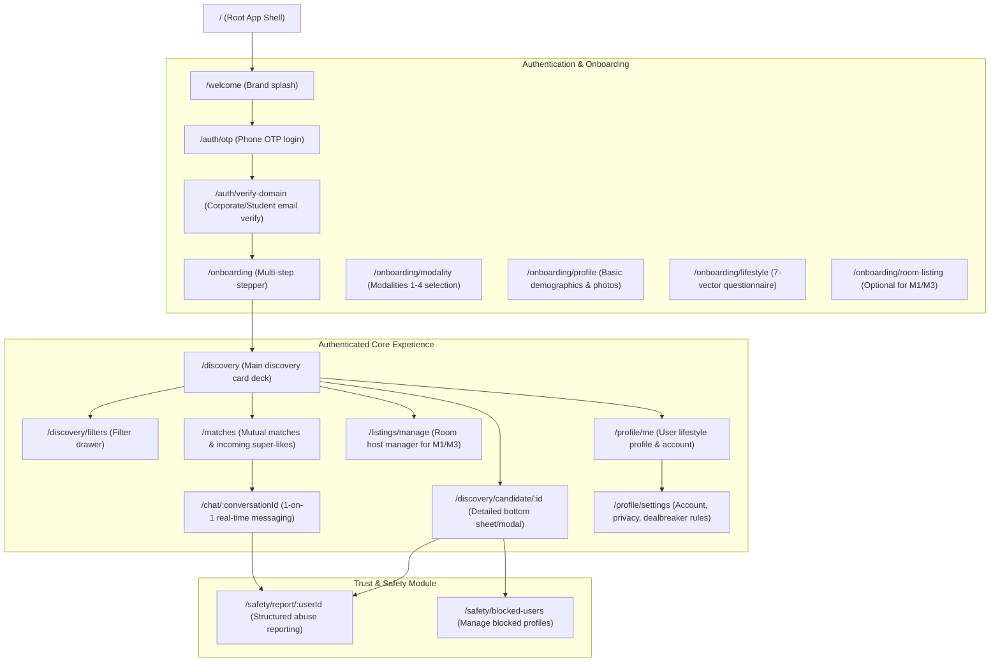
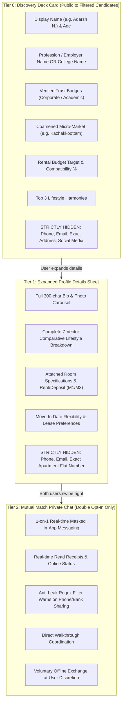

# Flatmate Information Architecture (IA) Specification

**Version**: 1.0.0  
**Phase**: Workflow C (Architecture & Design)  
**Author**: UX/UI Designer  
**Reviewers**: Solution Architect, Frontend Engineer, Requirements Analyst  
**Status**: Completed (Level 2 Review Ready)  
**Target Market**: Thiruvananthapuram (Trivandrum), Kerala, India  

---

## 1. Global Sitemap & Application Route Hierarchy

Flatmate is structured as a clean, single-page application (SPA) model using the Next.js App Router. The sitemap separates authenticated discovery, lifestyle configuration, private communication, and safety controls into distinct, secure route segments.



---

## 2. Navigation Architecture & Viewport Paradigms

Flatmate provides a specialized navigation paradigm for mobile viewports that flips to a productive multi-pane workspace on desktop.

### 2.1 Mobile Navigation: Persistent Bottom Tab Bar (360px – 640px)
- Fixed at the bottom of the viewport ($56\text{px}$ compact, $64\text{px}$ standard).
- Elevation: `elevation-floating`, `border-t border-slate-200 bg-white/95 backdrop-blur-md`.
- Items:
  1. **Discover** (`/discovery`): Compass icon. Primary feed for candidate cards.
  2. **Matches** (`/matches`): Double-check / heart icon. Badge counter for unaddressed mutual matches.
  3. **Chat** (`/chat`): Message bubble icon. Badge counter for unread incoming messages.
  4. **My Profile / Room** (`/profile/me`): User avatar circle. Quick access to personal lifestyle vectors and room listing.

### 2.2 Desktop Navigation: Sticky Left Rail & Context Inspector (1024px – 1440px+)
- Fixed left sidebar ($260\text{px}$ – $280\text{px}$ width).
- Items:
  - Brand header with active Micro-Market selector.
  - Primary navigation links with keyboard shortcut hints (`[1] Discover`, `[2] Matches`, `[3] Messages`, `[4] Room Listing`, `[5] Settings`).
  - Active user card with verified domain badge at the bottom of sidebar.
- Context Inspector (Right column, $440\text{px}$ width):
  - Automatically loads the candidate's comparative 7-vector breakdown alongside the central card deck, eliminating modal opening friction on desktop.

---

## 3. Interactive State Machines

### 3.1 Candidate Discovery Card Deck State Machine

```mermaid
stateDiagram-v2
    [*] --> InitializingFeed: Route to /discovery
    InitializingFeed --> LoadingDeck: Fetch batch (20 candidates)
    LoadingDeck --> TopCardActive: Batch loaded & sorted by compatibility
    LoadingDeck --> EmptyState: 0 candidates match filters

    TopCardActive --> CardDragging: User touch-drag or trackpad gesture
    CardDragging --> TopCardActive: Release below threshold (Snap back)
    CardDragging --> CardLiked: Drag Right (&Delta;X > 100px) or Press Right Arrow
    CardDragging --> CardPassed: Drag Left (&Delta;X < -100px) or Press Left Arrow
    CardDragging --> CardSuperLiked: Drag Up (&Delta;Y < -100px) or Press Up Arrow

    TopCardActive --> DetailsExpanded: Tap card body / Press Spacebar
    DetailsExpanded --> TopCardActive: Dismiss sheet / Press Escape
    DetailsExpanded --> CardLiked: Like from sheet CTA
    DetailsExpanded --> CardPassed: Pass from sheet CTA

    CardLiked --> EvaluateMutualMatch: Emit optimistic LIKE payload
    CardPassed --> AdvanceDeck: Emit optimistic PASS payload
    CardSuperLiked --> EvaluateMutualMatch: Emit optimistic SUPER_LIKE

    EvaluateMutualMatch --> MatchCelebrationDialog: Mutual Like confirmed
    EvaluateMutualMatch --> AdvanceDeck: No mutual like yet (Pending)
    MatchCelebrationDialog --> ChatRoute: Tap "Start Chatting Now"
    MatchCelebrationDialog --> AdvanceDeck: Tap "Keep Swiping"

    AdvanceDeck --> TopCardActive: Next candidate available
    AdvanceDeck --> FetchNextBatch: 3 cards remaining in buffer
    AdvanceDeck --> EmptyState: All candidates in zone reviewed

    EmptyState --> FilterDrawer: Tap "Adjust Filters / Expand Micro-Market"
```

### 3.2 Mutual Match & Double Opt-In Lifecycle

```mermaid
stateDiagram-v2
    [*] --> Discovered: User A views User B's card in deck
    Discovered --> Passed: User A swipes Left (Excluded from User A)
    Discovered --> PendingSingleLike: User A swipes Right (User B hasn't seen A yet)
    
    PendingSingleLike --> MutualMatchUnlocked: User B subsequently swipes Right on User A
    Discovered --> MutualMatchUnlocked: User B had ALREADY swiped Right (Instant match!)

    MutualMatchUnlocked --> ActiveConversation: Double opt-in confirmed; Chat conversation created
    ActiveConversation --> ArchivedConversation: User hides conversation from active inbox
    ArchivedConversation --> ActiveConversation: New message received or manually unarchived
    ActiveConversation --> TerminatedUnmatched: Either party taps "Unmatch"
    ActiveConversation --> QuarantinedBlocked: Either party blocks or reports for harassment

    TerminatedUnmatched --> [*]: Chat shredded, feed access revoked
    QuarantinedBlocked --> [*]: Bidirectional exclusion enforced
```



---

## 4. Progressive Data Disclosure & Privacy Architecture

Flatmate strictly complies with India's **Digital Personal Data Protection (DPDP) Act 2023** by enforcing tiered, progressive disclosure. Raw personal identifying information (PII) is never exposed across the discovery surfaces.



---

## 5. Notification Architecture & Push Events

To drive engagement without harassment or notification fatigue, notifications are strictly rate-limited and categorized:

| Notification Category | Trigger Event | Priority | Channel | UX Presentation |
| :--- | :--- | :--- | :--- | :--- |
| **Mutual Match** | User B likes User A (completing match) | High | In-App Modal + Push | Interactive celebration banner: *"You and Adarsh matched! (94% Compatibility)"* |
| **Super-Like Received** | Candidate sends Super-Like to user | High | In-App Pill + Push | Coral Star alert: *"Someone in Kazhakkoottam Super-Liked your profile!"* |
| **New Message** | Recipient is offline or away from chat | High | In-App Badge + Push | Masked preview: *"Adarsh sent a message: Hey! Are you looking near..."* |
| **Trust Verification** | Institutional email domain verified | Normal | In-App Toast | Emerald checkmark: *"Your Technopark corporate badge is now active."* |
| **Feed Batch Refresh** | New compatible profiles added to zone | Low (Max 1/day) | Push / Inactive | Re-engagement prompt: *"3 new compatible flatmates joined in Sreekaryam."* |

---

## 6. Information Architecture Quality Sign-Off

- [x] Global sitemap captures all public, onboarding, discovery, chat, and safety routes.
- [x] Clear responsive transitions specified between mobile bottom tab bar and desktop sticky navigation.
- [x] State machines model the discovery card deck, mutual match double opt-in, and chat lifecycle.
- [x] Progressive data disclosure guarantees DPDP Act privacy compliance across all tiers.
- [x] Notification taxonomy prevents notification spam while ensuring real-time match awareness.
