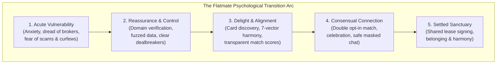
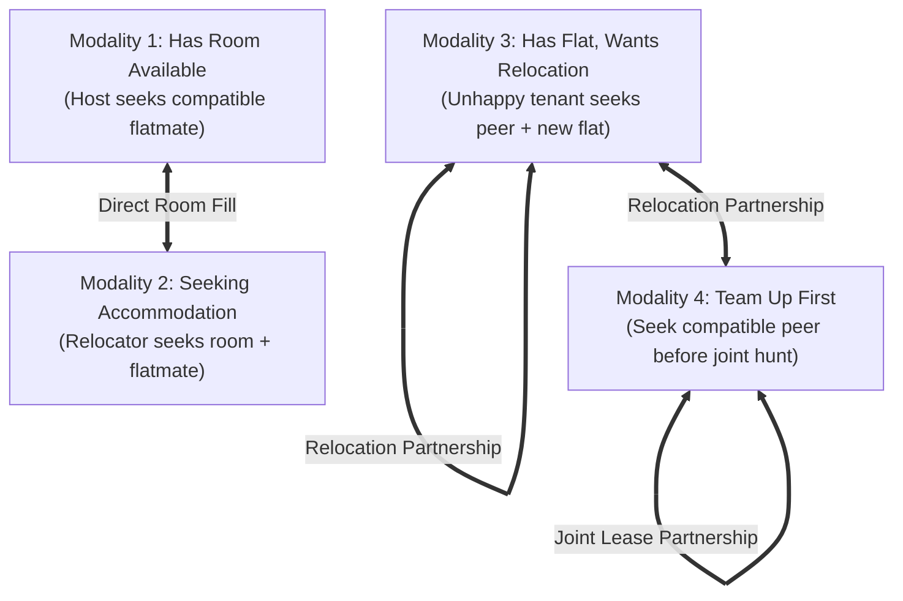
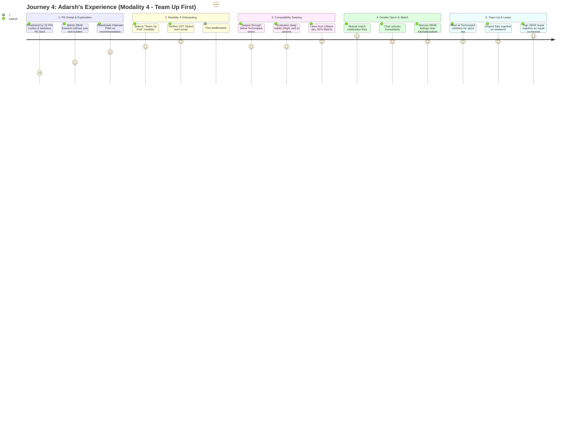

# Flatmate End-to-End User Journeys & Modality Experience Maps

**Version**: 1.0.0  
**Phase**: Workflow C (Architecture & Design)  
**Author**: UX/UI Designer  
**Reviewers**: Product Strategist, Requirements Analyst, Solution Architect  
**Status**: Completed (Level 2 Review Ready)  
**Target Market**: Thiruvananthapuram (Trivandrum), Kerala, India  

---

## 1. Journey Framework & Emotional Landscape

Finding a flatmate in urban India is rarely a clinical transaction; it is an emotionally charged event loaded with fears of harassment, privacy exposure, social disharmony, and financial vulnerability. Flatmate models each experience around **human psychological safety**, transforming a high-friction chore into an empowering discovery.



### The 4 Discovery Modalities Overview



---

## 2. Granular Journey Maps for the 4 Core Modalities

---

### Journey 1: Modality 1 – Has Room Available, Seeking Flatmate
**Persona Archetype**: **Ananya Kurup (21)** – Final-Year B.Tech Student, College of Engineering Trivandrum (CET).  
**Context**: Her senior roommate is graduating. Ananya occupies a 2BHK flat near Sreekaryam (₹9,000/mo total). If she cannot find a compatible female flatmate within 30 days to pay ₹4,500/mo, she will face severe financial strain or be forced into a restrictive ladies' hostel with a 6:30 PM curfew.

```mermaid
journey
    title Journey 1: Ananya's Experience (Modality 1 - Has Room Available)
    section 1. Urgency & Onboarding
      Facing ₹9k rent bleed alone: 1: Ananya
      Downloads Flatmate PWA: 4: Ananya
      Selects Modality 1 & Verifies @cet.ac.in: 6: Ananya
      Sets dealbreakers (Strict Female, Non-Smoker): 7: Ananya
    section 2. Listing & Profiling
      Uploads room photo & details (₹4,500/mo): 6: Ananya
      Answers 7-vector questionnaire (Early bird, sanctuary): 6: Ananya
    section 3. Discovery & Screening
      Reviews incoming candidates in deck: 6: Ananya
      Screens for verified CET/Technopark peers: 7: Ananya
      Passes on unverified / late-night party profiles: 6: Ananya
    section 4. Matching & Safe Chat
      Swipes right on Farzana (PhD Scholar, 96% match): 7: Ananya
      Instant Double Opt-In Celebration: 8: Ananya
      Masked in-app chat (no phone number exposed): 8: Ananya
    section 5. Resolution & Move-in
      Invites Farzana for daytime flat walkthrough: 7: Ananya
      Both sign roommate agreement; rent split settled: 9: Ananya
```

#### Detailed Step-by-Step Experience Blueprint:
1. **Trigger & Acute Pain Point**:
   - *State*: High anxiety. Traditional Facebook/OLX groups expose her personal contact to predatory messages and moral policing.
   - *Goal*: Find a verified female student or young professional to share her Sreekaryam flat.
2. **Onboarding & Verification**:
   - *Action*: Signs up using phone OTP. Selects `MODALITY_1: Has Room Available`. Submits her university email (`ananya@cet.ac.in`) to obtain the **Verified Student Badge**.
   - *System Guardrail*: Her phone number and exact street address are automatically masked.
3. **Room Attachment & Lifestyle Profiling**:
   - *Action*: Attaches 3 photos of the spare bedroom, attached bathroom, and kitchen. Enters rent (`₹4,500/mo`) and refundable deposit (`₹12,000`).
   - *Dealbreakers Pinned*: Gender (`Female Only`), Smoking (`Strict Non-Smoker`), Overnight Guests (`Female Only / Quiet Sanctuary`).
4. **Feed Evaluation & Swiping**:
   - *Action*: Ananya views candidate cards of female accommodation seekers (Modality 2) looking in Sreekaryam / Kariavattom.
   - *UX Highlight*: Each card shows the candidate's verified university/work badge, compatibility score, and lifestyle harmony pill tags.
5. **Mutual Match & Safe In-App Chat**:
   - *Moment*: Ananya likes Farzana Mohammed (PhD scholar, 96% compatibility). Farzana had already liked Ananya's room card.
   - *Celebration Modal*: *"It's a Flatmate Match!"* with 96% harmony badge.
   - *Chat UX*: Ananya opens the in-app chat. Yellow DPDP banner warns against sharing bank details. Farzana and Ananya discuss study habits and kitchen routines.
6. **Physical Walkthrough & Resolution**:
   - *Action*: Farzana visits the Sreekaryam flat on Saturday afternoon.
   - *Outcome*: Relief and mutual trust. Farzana transfers deposit directly, moving in on the 1st of next month.

---

### Journey 2: Modality 2 – Seeking Accommodation and Flatmate
**Persona Archetype**: **Farzana Mohammed (24)** – PhD Scholar, University of Kerala (Kariavattom Campus).  
**Context**: Moving to Trivandrum from Malappuram on a tight ₹4,000/mo stipend. Reluctant to stay in unhygienic, overcrowded university dormitories with unvetted roommates. Needs a quiet study sanctuary within 2 km of Kariavattom campus.

```mermaid
journey
    title Journey 2: Farzana's Experience (Modality 2 - Seeking Accommodation)
    section 1. Arrival & Anxiety
      Relocating to Trivandrum with tight budget: 2: Farzana
      Fear of moral policing & bad roommates: 2: Farzana
      Discovers Flatmate via campus peer: 5: Farzana
    section 2. Profile Setup
      Selects Modality 2 (Seeking room + flatmate): 6: Farzana
      Verifies @keralauniversity.ac.in domain: 7: Farzana
      Sets budget slider (₹3k - ₹5k/mo): 6: Farzana
    section 3. Discovery
      Filters for Kariavattom & Sreekaryam rooms: 6: Farzana
      Explores room photos & 7-vector score on cards: 7: Farzana
      Views Ananya's Sreekaryam 2BHK card (96% score): 8: Farzana
    section 4. Connection
      Likes Ananya's room card: 7: Farzana
      Instant Match alert notification arrives: 8: Farzana
      In-app chat verifies quiet night study routine: 8: Farzana
    section 5. Settlement
      Visits room in daylight accompanied by sister: 7: Farzana
      Confirms room; feels respected and safe: 9: Farzana
```

#### Detailed Step-by-Step Experience Blueprint:
1. **Trigger & Pain Point**:
   - *State*: Apprehensive about local conservatism, safety in unfamiliar neighborhoods, and tight finances.
   - *Goal*: Secure a verified room in a flat with an academically minded female peer.
2. **Onboarding & Configuration**:
   - *Action*: Selects `MODALITY_2: Seeking Accommodation & Flatmate`.
   - *Preferences*: Micro-markets set to `Kariavattom`, `Sreekaryam`. Budget capped at `₹4,800/mo`.
   - *Vectors Configured*: Sleep pattern (`Night Owl - study until 1am`), Kitchen (`Halal/Non-Veg friendly`, `Clean sink before bed`), Social (`Sanctuary, no parties`).
3. **Card Deck Discovery**:
   - *Action*: Farzana swipes through room host profiles (Modality 1) and fellow seekers.
   - *Card Anatomy*: Farzana sees Ananya's card. Swiping horizontally on the photo carousel shows the bedroom desk, attached bathroom, and kitchen.
   - *Compatibility Score*: Shows **96% Match**. The breakdown indicates perfect harmony in cleanliness, quiet home environment, and verified student credentials.
4. **Action & Match Celebration**:
   - *Action*: Farzana swipes right (Like). The match dialog triggers immediately since Ananya's listing is actively seeking someone of Farzana's profile.
5. **Private In-App Conversation**:
   - *Action*: Farzana asks about internet speed (for academic papers) and kitchen rules. Ananya confirms high-speed Wi-Fi and shared grocery splitting via Splitwise.
6. **Move-in Success**:
   - *Outcome*: Farzana moves into a peaceful, dignified room at ₹4,500/mo, completely bypassing brokers.

---

### Journey 3: Modality 3 – Has Flat, Wants Relocation with New Flatmate
**Persona Archetype**: **Mathews Varghese (31)** – Lead Architect, Infosys (Technopark Phase I).  
**Context**: Currently staying in a 3BHK in Pattom with two loud, messy roommates who host late-night parties. Mathews values peace, cleanliness, and a designated WFH space. He wants to transition to a premium 2BHK in Kowdiar or Kazhakkoottam with an equally mature, disciplined professional.

```mermaid
journey
    title Journey 3: Mathews's Experience (Modality 3 - Has Flat, Wants Relocation)
    section 1. Frustration & Motivation
      Sleep disrupted by messy roommates in Pattom: 1: Mathews
      Decides to relocate upon lease expiration: 4: Mathews
      Signs up for Flatmate: 6: Mathews
    section 2. Relocation Profile
      Selects Modality 3 (Relocating with new peer): 6: Mathews
      Verifies Infosys corporate credentials: 7: Mathews
      Configures higher budget (₹10k - ₹15k/mo): 6: Mathews
    section 3. Dual Discovery Feed
      Discovers fellow IT professionals relocating: 7: Mathews
      Inspects Vector 6 (Equal rent split & AC billing): 7: Mathews
      Swipes right on senior tech lead in Kowdiar: 7: Mathews
    section 4. Alignment & Strategy
      Mutual match with Nikhil (TCS Lead, 91% Match): 8: Mathews
      Chat coordinates lease termination dates: 8: Mathews
      Agree to co-scout premium Kowdiar 2BHK: 8: Mathews
    section 5. Relocation
      Jointly inspect gated society apartment: 8: Mathews
      Sign 1-year shared lease; peaceful sanctuary achieved: 9: Mathews
```

#### Detailed Step-by-Step Experience Blueprint:
1. **Trigger & Pain Point**:
   - *State*: Burnout and chronic domestic irritation. Cannot concentrate on remote client calls; tired of cleaning up after others.
   - *Goal*: Smoothly exit his current lease and partner with an equally professional roommate who treats the home as a serene sanctuary.
2. **Onboarding Configuration**:
   - *Action*: Selects `MODALITY_3: Relocating with New Flatmate`.
   - *Verification*: Submits `mathews@infosys.com` -> verified with Blue Corporate Shield.
   - *Vectors*: Cleanliness (`Meticulous - daily cleaning`), Shift (`Regular Day 9am-6pm`), AC Bill (`Proportional or equal split on 1st`), Guest policy (`Quiet, daytime only`).
3. **Targeted Feed Filtering**:
   - *Action*: Opens Filter Drawer. Sets budget to `₹9,000 - ₹16,000/mo`, micro-markets to `Kowdiar`, `Vellayambalam`, `Kazhakkoottam`, and age range to `26 - 36`.
4. **Discovery & Alignment Evaluation**:
   - *Action*: Discovers Nikhil, a Senior Architect at TCS also looking to relocate from an overcrowded flat.
   - *Compatibility Score*: Shows **91% Match**. Vector breakdown confirms identical chore ethics, early morning gym routines, and strict no-indoor-smoking preferences.
5. **Coordination & Joint Scouting**:
   - *Action*: Through in-app chat, they compare notice periods with their existing landlords (both 30-day notice).
   - *Coordination*: They schedule a Saturday coffee at Kowdiar to meet in person and inspect two shortlisted 2BHK apartments in a premium gated society.
6. **Lease Signing & Successful Transition**:
   - *Outcome*: Mathews transitions smoothly into a modern 2BHK with Nikhil. Zero broker disputes, zero roommate friction.

---

### Journey 4: Modality 4 – Seeking Compatible Person First to Search Together
**Persona Archetype**: **Adarsh Nair (24)** – Junior Software Engineer, UST Global (Technopark Phase II).  
**Context**: Cramped in an overpriced PG in Kazhakkoottam with an 10:00 PM curfew and unpalatable food. Wants to rent a spacious 2BHK with a two-wheeler commute to UST, but cannot afford the ₹16,000 rent alone and refuses to sign a lease with a stranger without testing compatibility first.



#### Detailed Step-by-Step Experience Blueprint:
1. **Trigger & Pain Point**:
   - *State*: Frustrated with PG restrictions and lack of independence. Terrified of moving into someone else's established flat where he is treated as a subordinate guest.
   - *Goal*: Find an equal partner to team up with, pool deposits, choose a new apartment together, and negotiate fair ground rules from Day 1.
2. **Onboarding & Preference Capture**:
   - *Action*: Selects `MODALITY_4: Seeking Compatible Person First`.
   - *Verification*: Verifies `@ust.com` email -> receives Blue Shield badge.
   - *Vectors Configured*: Sleep (`Night Owl - 1am`), Shift (`Normal Day`), Cleanliness (`Moderate + hire maid`), Social (`Weekend gaming ok`), Finances (`Split rent 1st of month via UPI`).
3. **Discovery Deck Interaction**:
   - *Action*: Swipes through Modality 4 and Modality 3 candidate cards.
   - *Micro-Interaction*: Adarsh swipes left on unverified profiles or early birds who require absolute silence after 9:30 PM.
   - *Key Match*: Discovers Arun, an Allianz developer at Technopark Phase I with a **92% Compatibility Score**.
4. **Match Celebration & Unlocking Chat**:
   - *Action*: Both swipe right. Mutual Match dialog opens.
   - *Icebreaker Prompt*: The system offers a contextual prompt: *"You both work in Technopark and love weekend gaming. Why not ask Arun what games he plays?"*
5. **Real-Time Collaboration**:
   - *In-App Chat*: Adarsh and Arun chat about their budget (₹7,000–₹8,000/mo each) and preferred complexes (Artech Lake Residency, Oceanus).
   - *In-Person Verification*: They meet for lunch at the Technopark food court to confirm natural chemistry.
6. **Joint Flat Hunting & Shared Lease**:
   - *Outcome*: Two weeks later, they lease a modern 2BHK flat near the bypass. Both names are on the rental agreement as equal co-tenants.

---

## 3. Psychological Safety Heuristics Embedded Across Journeys

| Safety Heuristic | Problem Mitigated | UX Implementation in Flatmate |
| :--- | :--- | :--- |
| **Strict Double Opt-In** | Unsolicited messages, stalking, unwanted advances | Direct messaging remains cryptographically locked until **both** users have registered a mutual swipe. |
| **Masked PII & Fuzzed Coordinates** | Doxxing, invasive visits, moral policing | Raw phone numbers and emails are never displayed in client payloads. Locations are coarsened to micro-market level (`Kazhakkoottam`, `Kowdiar`). |
| **Institutional Domain Badging** | Impersonation, fake profiles, commercial broker deceit | Distinct Blue Corporate (`UST`, `Infosys`) and Green Academic (`CET`, `Kerala Univ`) badges verify offline legitimacy. |
| **Proactive Anti-Leak Regex Warnings** | Premature off-platform migration to WhatsApp | Chat client scans for phone numbers/bank details and displays an immediate educational security warning banner. |
| **Instant Bidirectional Block & Report** | Harassment, abusive behavior, spam brokers | Single-tap block instantly removes user from feeds and purges active chats bidirectionally without alerting the blocked user. |

---

## 4. User Journeys Quality Sign-Off

- [x] All 4 user modalities (M1, M2, M3, M4) mapped end-to-end with distinct emotional arcs and clear personas.
- [x] Psychological safety guardrails explicitly integrated into every touchpoint.
- [x] Deterministic 7-vector lifestyle profiling and scoring embedded into the decision moments.
- [x] Friction points mitigated with mobile-first UI patterns and clear system feedback.
