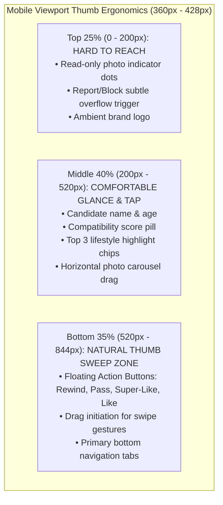

# Flatmate Responsive Wireframes & Interaction Specifications

**Version**: 1.0.0  
**Phase**: Workflow C (Architecture & Design)  
**Author**: UX/UI Designer  
**Reviewers**: Frontend Engineer, Solution Architect  
**Status**: Completed (Level 2 Review Ready)  
**Compliance**: Mobile-First, WCAG 2.1 AA, Responsive 360px – 1440px  

---

## 1. Viewport Adaptation Matrix & Layout System

Flatmate is designed strictly **Mobile-First**. Every interface is conceived at 360px/390px mobile viewports to guarantee optimal one-handed thumb ergonomics, and fluidly scales up to tablet and desktop viewports without awkward stretching or empty dead-zones.

### 1.1 Responsive Grid & Breakpoint Matrix

| Viewport Tier | Breakpoint Width | Layout Architecture | Navigation Pattern | Discovery Presentation | Modal / Sheet Pattern |
| :--- | :--- | :--- | :--- | :--- | :--- |
| **Mobile Compact** | `360px - 389px` | 1 Column (100% width, 16px gutter) | Fixed Bottom Nav Bar (56px) | Single Stacked Card (3:4 ratio) | Bottom Sheet Drawer (drag down) |
| **Mobile Standard**| `390px - 639px` | 1 Column (100% width, 16px gutter) | Fixed Bottom Nav Bar (64px) | Single Stacked Card (3:4 ratio) | Bottom Sheet Drawer (drag down) |
| **Tablet Portrait**| `640px - 1023px`| Centered Column (max 520px, 32px pad)| Top App Header + Bottom Nav | Centered Discovery Stack | Centered Floating Modal (540px) |
| **Desktop Laptop** | `1024px - 1439px`| 2-Pane Split (320px Nav + 704px Main)| Left Sticky Sidebar (260px) | Dual Pane: Card Left, Details Right | Embedded Sliding Inspector Panel |
| **Desktop Ultra**  | `1440px+` | 3-Column Shell (Max 1280px container)| Left Sidebar (280px) + Discovery Center (520px) + Active Chat/Preview Right (440px) | Left Navigation, Center Deck, Right Instant Match Preview | Centered Modal with Backdrop Blur |

---

## 2. Thumb-Zone Optimization & Gesture Physics

On mobile devices, over 75% of one-handed interactions occur within the natural sweep of the thumb.



### 2.1 Swipe Gesture Physics
- **Swipe Threshold**: Card commits to decision if horizontal drag $\Delta X > 100\text{px}$ OR flick velocity $> 0.55\text{px/ms}$.
- **Rotation Physics**: Card rotates smoothly up to $\pm 18^\circ$ proportional to $\Delta X / \text{Viewport Width}$.
- **Decision Overlays**:
  - Dragging Right: Emerald **"LIKE"** stamp appears at top-left of card, fading in from $0\%$ opacity at $\Delta X = 20\text{px}$ to $100\%$ at $\Delta X = 100\text{px}$.
  - Dragging Left: Rose **"PASS"** stamp appears at top-right of card, fading in similarly.
  - Dragging Up: Warm Coral **"SUPER LIKE"** badge scales up from card center.
- **Snap-Back Elasticity**: If released below threshold, card snaps back to center using spring curve `cubic-bezier(0.175, 0.885, 0.32, 1.275)` over $240\text{ms}$.
- **Reduced Motion Fallback**: For users with `prefers-reduced-motion: reduce`, swiping animations are disabled. Action buttons trigger an instant $150\text{ms}$ crossfade to the next card.

---

## 3. Screen Wireframes & Detailed UI Specifications

---

### Screen 1: Onboarding & Lifestyle Profiling Stepper

**Purpose**: Guide user through identity verification, discovery modality selection, and 7-vector lifestyle profiling without cognitive overload.

#### Mobile Viewport (390px)
```
+---------------------------------------------------+ [390px]
| [<- Back]              Step 3 of 4         [Skip] |
| ====== Progress Indicator: [======----] ========= |
|                                                   |
| # What's your daily living rhythm?               |
| Help us match you with compatible flatmates.      |
|                                                   |
| 1. SLEEP & CHRONOTYPE                             |
| +-----------------------------------------------+ |
| | (o) Early Bird       | ( ) Night Owl          | |
| |     Sleeps by 10:30PM |     Sleeps after 1:00AM| |
| +-----------------------------------------------+ |
| | [ ] Non-negotiable dealbreaker for me           | |
|                                                   |
| 2. CLEANLINESS STANDARDS                          |
| +-----------------------------------------------+ |
| | ( ) Relaxed    | (o) Moderate    | ( ) Meticulous |
| |   Weekend chore |   Every 2 days |   Daily chore  |
| +-----------------------------------------------+ |
| | Dishes in Sink:                                 |
| | [ Immediate Wash ] (o) Before Bed  [ Next Day ] |
| | [x] Non-negotiable dealbreaker for me           | |
|                                                   |
| 3. DIETARY & KITCHEN HABITS                       |
| +-----------------------------------------------+ |
| | Your Diet:                                      |
| | [ Strict Veg ] [ Eggetarian ] (o) Non-Veg       |
| | Kitchen Policy:                                 |
| | [ Veg Kitchen Only ] (o) Separate Utensils OK   |
| |                      [ No Restrictions ]        |
| +-----------------------------------------------+ |
| | [ ] Non-negotiable dealbreaker for me           | |
|                                                   |
| 4. SOCIAL & GUESTS POLICY                         |
| +-----------------------------------------------+ |
| | Home Environment:                               |
| | (o) Quiet Sanctuary  | ( ) Social Lounge        |
| | Overnight Guests:                               |
| | [ No Overnight ] (o) Same Gender  [ Flexible ]  |
| +-----------------------------------------------+ |
|                                                   |
| [===============================================] |
| [            Continue to Work & Finances >      ] | [Fixed Bottom]
+---------------------------------------------------+
```

#### Responsive Desktop Viewport (1440px)
On desktop screens, the stepper utilizes a centered 2-column layout (`max-w-4xl`):
- **Left Column (340px)**: Sticky progress sidebar illustrating the 7 lifestyle vectors, completion checklist, and privacy assurance note ("Your exact responses are never sold; used solely for matching calculations").
- **Right Column (560px)**: Form container with spacious radio cards, keyboard hotkeys (1-4), and instant compatibility simulation feedback.

---

### Screen 2: Discovery Card Deck

**Purpose**: The central feed where users discover prospective flatmates ranked by deterministic compatibility score.

#### Mobile Viewport (390px)
```
+---------------------------------------------------+ [390px]
| (F) Flatmate          [ Kazhakkoottam v ]   [ =| ]| Top Bar
|---------------------------------------------------|
|                                                   |
| +-----------------------------------------------+ |
| | [- - - -] (Photo 1 of 4)               ( : )  | |
| |                                               | |
| |                                               | |
| |               [ CANDIDATE PHOTO ]             | |
| |                                               | |
| |                                               | |
| | [Shield: UST Global]       [M4: Team Up First]| |
| | - - - - - - - - - - - - - - - - - - - - - - - | |
| | Adarsh Nair, 24             +---------------+ | |
| | Software Engineer @ UST     |   94% MATCH   | | |
| | Kazhakkoottam * ₹7,500/mo   +---------------+ | |
| |                                               | |
| | [v Early Bird] [v Non-Smoker] [v Hybrid WFH]  | |
| |                                               | |
| | "Looking for a relaxed flatmate to lease a    | |
| |  2BHK near Technopark Phase II..."            | |
| |                                               | |
| |             [ Tap for Full Details v ]        | |
| +-----------------------------------------------+ |
|                                                   |
|         ( O )       ( X )     ( * )     ( <3 )    | Action Row
|        Rewind       Pass      Super      Like     | (48/56px)
|---------------------------------------------------|
|   [Discovery]      [Matches]      [Chat]     [Me] | Bottom Nav
+---------------------------------------------------+
```

#### Responsive Desktop Viewport (1440px - 3 Column Layout)
```
+-----------------------------------------------------------------------------------------------------------------------+ [1440px]
|  FLATMATE       |  Search Micro-Market: [Kazhakkoottam        v]  |  Logged in as: Mathews Varghese (Infosys)  (Avatar) |
+-----------------+-------------------------------------------------+---------------------------------------------------+
| NAVIGATION      | DISCOVERY DECK (Center, 520px)                  | INSPECTOR / REAL-TIME PREVIEW (Right, 440px)      |
|                 |                                                 |                                                   |
| [*] Discovery   | +---------------------------------------------+ | +-----------------------------------------------+ |
| [ ] Matches (4) | | [- - - -] Photo 1/4                   ( : ) | | | COMPATIBILITY BREAKDOWN WITH ADARSH           | |
| [ ] Active Chat | |                                             | | | Overall Score: 94% (High Harmony)            | |
| [ ] My Listings | |             [ ADARSH NAIR, 24 ]             | | +-----------------------------------------------+ |
| [ ] Settings    | |                                             | | | Vector Alignment Analysis:                    | |
|                 | | [Shield: UST]             [M4: Team Up]     | | | 1. Sleep: Both Early Birds      [ 100% Match ]| |
|                 | | - - - - - - - - - - - - - - - - - - - - - - | | | 2. Cleanliness: Moderate habits [  90% Match ]| |
| KEYBOARD TIPS:  | | Adarsh Nair, 24             +-------------+ | | | 3. Kitchen: Non-Veg / Sep Utens [  85% Match ]| |
| [<-] : Pass     | | Software Engineer @ UST     |  94% MATCH  | | | 4. Guests: Weekend daytime only [  95% Match ]| |
| [->] : Like     | | Kazhakkoottam * ₹7,500/mo   +-------------+ | | | 5. Substances: Non-smokers      [ 100% Match ]| |
| [ ^] : Super    | |                                             | | | 6. Finances: Split 1st of month [ 100% Match ]| |
| [Sp] : Expand   | | [Early Bird] [Non-Smoker] [Hybrid WFH]      | | | 7. Work: Both Technopark hybrid [  90% Match ]| |
|                 | +---------------------------------------------+ | +-----------------------------------------------+ |
|                 |                                                 | | Discussion Points:                              | |
|                 |       ( Undo )   ( PASS )   ( LIKE )            | | * Adarsh plays weekend PlayStation in hall.     | |
|                 |       [Key: Z]   [Key: <-]  [Key: ->]           | |                                                 | |
|                 |                                                 | | [ Send Instant Super-Like & Message ]           | |
|                 |                                                 | +-----------------------------------------------+ |
+-----------------+-------------------------------------------------+---------------------------------------------------+
```

---

### Screen 3: Detailed Profile Expansion Modal / Bottom Sheet

**Purpose**: Present comprehensive 7-vector lifestyle breakdown, room specs (if Modality 1/3), bio, and verified credentials before deciding to Like or Pass.

#### Mobile Viewport Bottom Sheet (390px)
```
+---------------------------------------------------+ [390px]
|                    [ === Drag Bar === ]           |
| [X Close]                                   [ : ] |
|---------------------------------------------------|
|                                                   |
| [ < Carousel: Photo 2 of 4 (Living Room Desk) > ] |
|                                                   |
| Adarsh Nair, 24  [Verified Professional Shield]   |
| Software Engineer at UST Global                   |
| Micro-Market: Kazhakkoottam (800m from Phase II)  |
| Budget Target: ₹6,500 - ₹8,500 / month            |
| Move-in Date: 1st of Next Month (Flexible)        |
|                                                   |
| ABOUT ME                                          |
| "Moved from Thrissur last year. Looking for a     |
| neat flatmate to rent a 2BHK. I keep common areas |
| clean, enjoy weekend movies, and work from home   |
| on Tuesdays and Thursdays."                       |
|                                                   |
| 7-VECTOR COMPATIBILITY COMPARISON                 |
| +-----------------------------------------------+ |
| | Dimension        | Adarsh        | Your Habit | |
| |------------------+---------------+------------| |
| | [v] Sleep        | Early Bird    | Early Bird | |
| | [v] Cleanliness  | Moderate      | Moderate   | |
| | [!] Kitchen      | Non-Veg Cook  | Veg-Only*  | |
| |     (*You marked 'Separate utensils OK')      | |
| | [v] Guests       | Daytime only  | Sanctuary  | |
| | [v] Smoking      | Strict No     | Strict No  | |
| | [v] Rent Split   | 1st of Month  | 1st Month  | |
| | [v] WFH Rhythm   | Hybrid (2d)   | Hybrid (3d)| |
| +-----------------------------------------------+ |
|                                                   |
| ROOM DETAILS (Modality 1 Attachment)              |
| * Room Type: Private Master Bedroom with Balcony  |
| * Attached Bath: Yes (Geyser installed)           |
| * Current Flat: 2BHK in Artech Lake Residency    |
| * Amenities: AC, 100Mbps Wi-Fi, Washing Machine  |
|                                                   |
| TRUST & SAFETY                                    |
| [Shield] Phone number verified (+91 ********82)   |
| [Shield] Corporate domain verified (@ust.com)     |
|                                                   |
| [ Report User ]                 [ Block Adarsh ]  |
|---------------------------------------------------|
|       ( PASS )                  ( LIKE PROFILE )  | Fixed Bottom
+---------------------------------------------------+
```

---

### Screen 4: Mutual Match Celebration Dialog

**Purpose**: Delightful double opt-in celebration when both users like each other, unlocking DPDP-compliant private messaging.

#### Mobile Viewport (390px)
```
+---------------------------------------------------+ [390px]
|                                                   |
|                                                   |
|                  *  .  *  .  *                    |
|               .  CONGRATULATIONS  .               |
|            *                         *            |
|              IT'S A FLATMATE MATCH!               |
|                                                   |
|             ( You )           ( Adarsh )          |
|            +-------+         +-------+            |
|            | PHOTO |  <--->  | PHOTO |            |
|            +-------+         +-------+            |
|                \                 /                |
|                 +---------------+                 |
|                 |   94% HARMONY |                 |
|                 +---------------+                 |
|                                                   |
|     You both want to team up in Kazhakkoottam     |
|      and share identical lifestyle habits!        |
|                                                   |
| +-----------------------------------------------+ |
| |        [ Say Hello to Adarsh Now > ]          | | Primary CTA
| +-----------------------------------------------+ | (Teal 600)
|                                                   |
| [                 Keep Swiping                  ] | Secondary CTA
|                                                   | (Slate Outline)
+---------------------------------------------------+
```

---

### Screen 5: Real-Time In-App Chat View

**Purpose**: Private, secure 1-on-1 messaging with real-time delivery ticks and strict DPDP anti-leak safeguards.

#### Mobile Viewport (390px)
```
+---------------------------------------------------+ [390px]
| [<-] (Avatar) Adarsh Nair [Verified] [94%]  ( : ) | Header
|---------------------------------------------------|
| [/!\ DPDP Safety Notice: Keep all chat in-app.    |
|      Never send OTPs or rent deposits upfront.]   | Yellow Alert
|---------------------------------------------------|
|                                                   |
|                    Friday, Nov 14                 |
|                                                   |
| [Adarsh]                                          |
| +-----------------------------------------------+ |
| | Hey! Saw your profile. Are you also looking at| |
| | flats near Technopark Phase II?               | |
| +-----------------------------------------------+ |
|   10:32 AM                                        |
|                                                   |
|                                             [You] |
| +-----------------------------------------------+ |
| | Hi Adarsh! Yes, looking for a 2BHK near       | |
| | Kazhakkoottam junction. Moving mid-next month.| |
| +-----------------------------------------------+ |
|                                     10:35 AM (vv) |
|                                                   |
| [Adarsh]                                          |
| +-----------------------------------------------+ |
| | Perfect! I visited Artech Lake Residency      | |
| | yesterday. Rent is ₹16k total (₹8k each).     | |
| | Want to check photos together?                | |
| +-----------------------------------------------+ |
|   10:37 AM                                        |
|                                                   |
|---------------------------------------------------|
| [+]  [ Write a message to Adarsh...         ] [>] | Input Bar
+---------------------------------------------------+
```

---

### Screen 6: Discovery Filter Drawer / Bottom Sheet

**Purpose**: Fine-tune candidate discovery by micro-market, budget, age, and dealbreakers.

#### Mobile Viewport (390px)
```
+---------------------------------------------------+ [390px]
| [Reset]           Discovery Filters       [Done]  |
|---------------------------------------------------|
|                                                   |
| DISCOVERY MODALITIES                              |
| [x] M1: Has Room Available                        |
| [x] M4: Looking to Team Up First                  |
| [ ] M2: Accommodation Seekers Only                |
|                                                   |
| TRIVANDRUM MICRO-MARKETS                          |
| [x] Kazhakkoottam       [x] Kariavattom           |
| [x] Sreekaryam          [ ] Ulloor                |
| [ ] Pattom              [ ] Kowdiar               |
|                                                   |
| MONTHLY BUDGET PER HEAD                           |
| ₹4,000 -----------------(o)======= ₹9,000/mo      |
| [ Range: ₹4,000 to ₹9,000 ]                       |
|                                                   |
| CANDIDATE GENDER PREFERENCE                       |
| ( ) Any       (o) Male Only      ( ) Female Only  |
|                                                   |
| MINIMUM COMPATIBILITY SCORE                       |
| 70% --------------------(o)======= 100%           |
| [ Current: At least 75% compatibility ]           |
|                                                   |
| STRICT DEALBREAKERS                               |
| [x] Must be Non-Smoker                            |
| [x] Verified Work / College Domain Only           |
| [ ] Pure Vegetarian Kitchen Only                  |
|                                                   |
| +-----------------------------------------------+ |
| |           Apply Filters (14 Matches)          | | Primary CTA
| +-----------------------------------------------+ |
+---------------------------------------------------+
```

---

### Screen 7: Optional Room Listing Manager (Modalities 1 & 3)

**Purpose**: Enable room hosts to upload photos, specify rents, deposits, and amenities attached to their flat.

#### Mobile Viewport (390px)
```
+---------------------------------------------------+ [390px]
| [<- Back]           My Room Listing       [Save]  |
|---------------------------------------------------|
|                                                   |
| ROOM PHOTOS (Max 4)                               |
| +----------+ +----------+ +----------+ +--------+ |
| | [Photo1] | | [Photo2] | | [Photo3] | | [+]    | |
| | MasterBR | | Attached | | Kitchen  | | Add    | |
| +----------+ +----------+ +----------+ +--------+ |
|                                                   |
| ACCOMMODATION SPECS                               |
| Room Arrangement:                                 |
| (o) Private Bedroom      ( ) Shared Room (2 beds) |
| Bathroom Type:                                    |
| (o) Attached Private     ( ) Shared Common Bath   |
|                                                   |
| FINANCIALS                                        |
| Monthly Rent (per person):                        |
| [ ₹ 7,500                     ] / month           |
| Security Deposit (per person):                    |
| [ ₹ 20,000                    ] refundable        |
| Maintenance Included? [x] Yes (₹500/mo included)  |
|                                                   |
| AVAILABILITY                                      |
| Move-in Date Available From:                      |
| [ 01 / December / 2026       (Cal) ]              |
|                                                   |
| AMENITIES INCLUDED                                |
| [x] AC in Bedroom          [x] Geyser / Hot Water |
| [x] High-Speed Wi-Fi       [x] Washing Machine    |
| [x] Power Backup/Inverter  [ ] Covered Car Park   |
|                                                   |
| NEIGHBORHOOD / COMPLEX                            |
| Apartment Name: Artech Lake Residency             |
| Micro-Market: Kazhakkoottam                       |
|                                                   |
| +-----------------------------------------------+ |
| |         Publish / Update Room Listing         | | Primary CTA
| +-----------------------------------------------+ |
+---------------------------------------------------+
```

---

## 4. Mobile Ergonomics & Quality Sign-Off

- [x] All primary action controls reside inside the comfortable bottom 35% thumb sweep area.
- [x] Every touch target provides $\ge 48\times 48\text{px}$ tappable bounding box with adequate hit padding.
- [x] Desktop layouts (1024px & 1440px) utilize multi-column sidebars rather than displaying stretched single-column views.
- [x] Touch physics specifications define clear thresholds (100px drag / 0.55px/ms velocity) and elastic spring snap-backs.
- [x] Screen reader aria contracts and reduced motion fallbacks documented for all wireframes.
